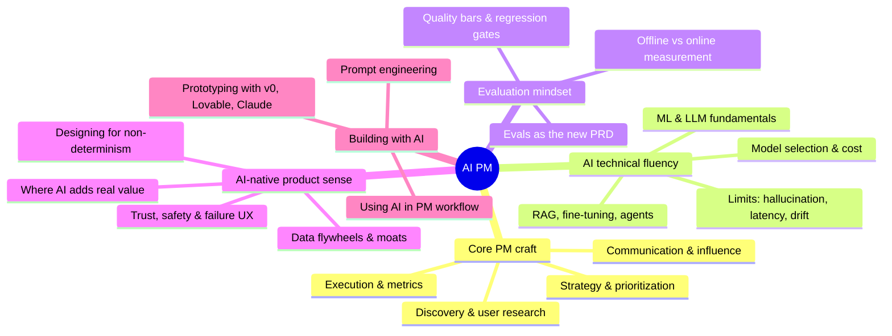
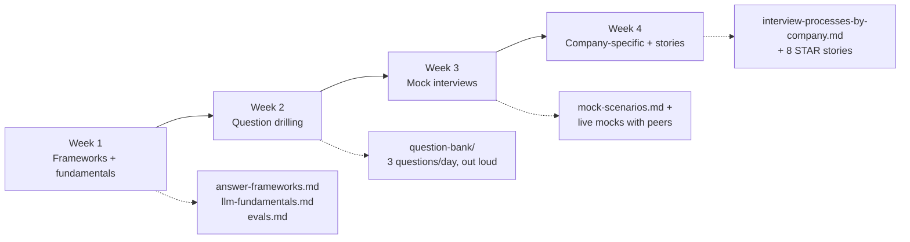

# 🧭 Start Here: Your AI PM Learning Path

> **Goal of this repo:** take you from *"I want to work on AI products"* to *"I can discover, spec, build, evaluate, ship, and defend AI product decisions, and pass the interviews that prove it."*

---

## Who is this for?

| You are... | Your gap | Your path |
|---|---|---|
| 🌱 **Aspiring PM / student / new grad** | PM craft **and** AI knowledge | [Path A: Full Foundation](#path-a-full-foundation-12-16-weeks) |
| 🔄 **Traditional PM (2-8 yrs)** moving into AI | AI/ML technical depth, AI-specific product patterns | [Path B: AI Upskill](#path-b-ai-upskill-for-experienced-pms-6-8-weeks) |
| 🧑‍💻 **Engineer / Data Scientist** moving into PM | Product craft, stakeholder skills, interview storytelling | [Path C: Product Craft](#path-c-product-craft-for-technical-folks-6-8-weeks) |
| 👔 **Senior / Group PM / Director** leading AI teams | AI strategy, org design, governance, portfolio bets | [Path D: AI Leadership](#path-d-ai-leadership-4-6-weeks) |
| 🎯 **Interviewing in the next 30 days** | Structured prep, reps, question drilling | [Path E: Interview Sprint](#path-e-interview-sprint-2-4-weeks) |

---

## The skill map

An AI PM is a regular PM **plus** four extra muscles. This repo is organized around them.

---

## Path A: Full Foundation (12-16 weeks)

For aspiring PMs starting from scratch. ~6-8 hrs/week.

| Weeks | Focus | Materials |
|---|---|---|
| 1-2 | What AI PMs do; PM basics | [Role deep-dive](../01-foundations/what-ai-pms-do.md) · [Glossary](../01-foundations/glossary.md) |
| 3-4 | ML & LLM fundamentals | [ML fundamentals](../01-foundations/ml-fundamentals.md) · [LLM fundamentals](../01-foundations/llm-fundamentals.md) |
| 5-6 | Technical depth: prompting, RAG | [Prompting](../02-technical-depth/prompt-engineering.md) · [RAG](../02-technical-depth/rag.md) |
| 7-8 | Technical depth: agents, evals, cost | [Agents](../02-technical-depth/ai-agents.md) · [Evals](../02-technical-depth/evals.md) · [Model selection](../02-technical-depth/model-selection-and-cost.md) |
| 9-10 | Product craft for AI | Everything in [03-product-craft](../03-product-craft/) |
| 11-12 | **Build** 2 hands-on projects | [04-build-with-ai](../04-build-with-ai/) |
| 13-14 | Domain + case studies | Pick 2 domains in [05-domains](../05-domains/) · read all [06-case-studies](../06-case-studies/) |
| 15-16 | Interview prep | [07-interview-prep](../07-interview-prep/) |

## Path B: AI Upskill for experienced PMs (6-8 weeks)

Skip PM basics. ~5 hrs/week.

1. **Week 1-2, Technical core:** [LLM fundamentals](../01-foundations/llm-fundamentals.md) → [RAG](../02-technical-depth/rag.md) → [Fine-tuning](../02-technical-depth/fine-tuning.md) → [Agents](../02-technical-depth/ai-agents.md)
2. **Week 3, The eval mindset** (the single biggest differentiator): [Evals](../02-technical-depth/evals.md) + [AI metrics](../03-product-craft/metrics-for-ai-products.md)
3. **Week 4, AI-native product patterns:** [UX patterns](../03-product-craft/ux-patterns-for-ai.md) · [AI PRD template](../03-product-craft/prd-template-ai-feature.md) · [Responsible AI](../03-product-craft/responsible-ai.md)
4. **Week 5-6, Build:** ship at least 2 projects from [04-build-with-ai](../04-build-with-ai/projects.md). Nothing replaces this.
5. **Week 7-8, Domain + interviews:** your target domain in [05-domains](../05-domains/) + [07-interview-prep](../07-interview-prep/)

## Path C: Product Craft for technical folks (6-8 weeks)

You know how transformers work; you need to learn *why products win*.

1. [What AI PMs do](../01-foundations/what-ai-pms-do.md), especially "PM vs Eng vs DS" boundaries
2. All of [03-product-craft](../03-product-craft/): strategy, discovery, PRDs, metrics, UX
3. [06-case-studies](../06-case-studies/): learn to narrate product stories, not architectures
4. [07-interview-prep/answer-frameworks.md](../07-interview-prep/answer-frameworks.md): technical people fail PM interviews on *structure*, not knowledge
5. [08-career/transition-guides.md](../08-career/transition-guides.md): positioning your background

## Path D: AI Leadership (4-6 weeks)

1. [AI product strategy](../03-product-craft/ai-product-strategy.md): moats, build-vs-buy, portfolio thinking
2. [Responsible AI & governance](../03-product-craft/responsible-ai.md) + regulation sections of your domain in [05-domains](../05-domains/)
3. [Model selection & cost](../02-technical-depth/model-selection-and-cost.md): unit economics of AI products
4. [Case studies](../06-case-studies/), especially the [failure files](../06-case-studies/failures-hall-of-lessons.md)
5. [Metrics](../03-product-craft/metrics-for-ai-products.md): what to hold teams accountable to

## Path E: Interview Sprint (2-4 weeks)

Daily minimum: **1 product design question + 1 technical explain-it question, answered out loud, timed.** Reading is not prep; reps are prep.

---

## The three rules of this repo

1. **Build before you badge.** One shipped prototype beats three certificates. Employers ask "what have you built?"; [start here](../04-build-with-ai/projects.md).
2. **Evals are the new PRD.** If you internalize one AI-era idea, make it [this one](../02-technical-depth/evals.md).
3. **Facts go stale; verify before you cite.** Model names, prices, and stats in this repo were verified at the date stamped on each page. Re-check anything volatile before an interview.

➡️ Next: [What AI PMs actually do](../01-foundations/what-ai-pms-do.md)
