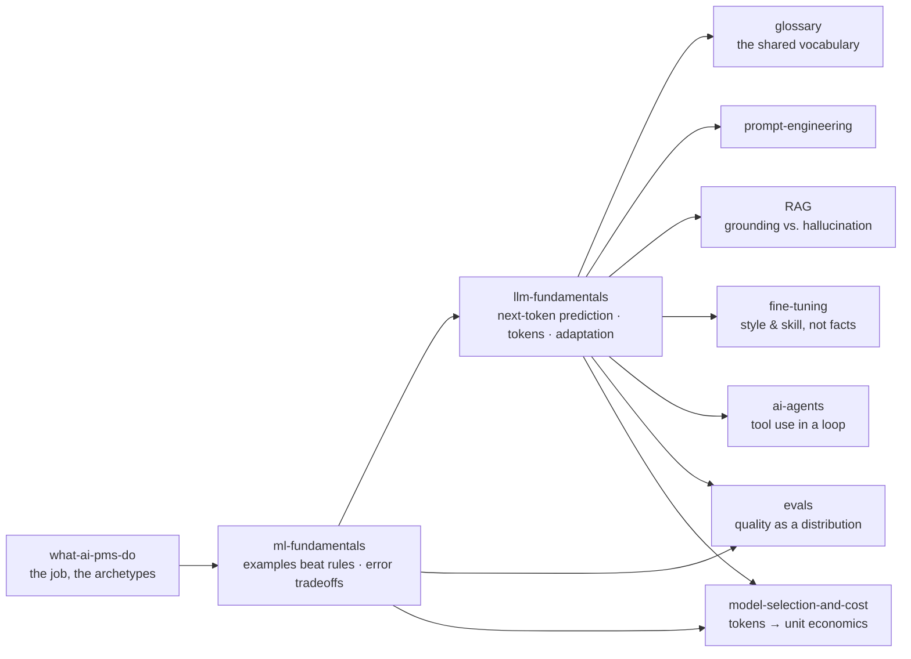

# 🧱 Foundations — Know What You're Managing

> **TL;DR:** Four pages that take you from "AI is magic" to fluent: what the job actually is, how ML works, how LLMs work, and the vocabulary to discuss both. Everything in `02-technical-depth` assumes these.

---

## The four pages

| Page | What you'll learn | Time to read | Why it matters |
|---|---|---|---|
| [what-ai-pms-do.md](what-ai-pms-do.md) | How AI PM differs from traditional PM · the 4 archetypes (platform, AI-native, feature, ML systems) · a week in the life · a 10-skill self-assessment · myths debunked | ~12 min | Tells you *which* AI PM job you're actually applying for — the same title covers genuinely different roles |
| [ml-fundamentals.md](ml-fundamentals.md) | Rules vs. examples · the ML family tree · training vs. inference · precision/recall · overfitting · drift · labels · the "should this be ML?" decision tree | ~15 min | Ranking, fraud, and recommendations predate the LLM wave and are still the most common AI PM jobs |
| [llm-fundamentals.md](llm-fundamentals.md) | Next-token prediction · tokens & context windows · the pre-train → SFT → preference-tuning pipeline · inference knobs · what LLMs are bad at · explain-it-to-an-exec cheat sheet | ~15 min | Every generative product decision — cost, latency, hallucination, prompting — falls out of how the model works |
| [glossary.md](glossary.md) | 100+ terms by theme: core ML, evaluation, LLMs, architectures, production economics, responsible AI. ~30 bolded as interview-fluent must-haves | Skim, then reference | Misusing a term is a louder signal in an interview than not knowing it |

## Read in this order

Straight down the table. `what-ai-pms-do` frames the job so the rest has somewhere to land; `ml-fundamentals` before `llm-fundamentals` because LLMs are a branch of the tree, not a replacement for it; `glossary` last — and then keep it open in a tab forever.

If you already run ML products, skim 1–2 and read `llm-fundamentals` properly. If you came for chatbots, do **not** skip `ml-fundamentals` — see [00-start-here](../00-start-here/README.md) for path selection.

## How foundations feed the deep dives

Concretely: the adaptation ladder previewed in [llm-fundamentals §6](llm-fundamentals.md) becomes [prompt-engineering](../02-technical-depth/prompt-engineering.md) → [rag](../02-technical-depth/rag.md) → [fine-tuning](../02-technical-depth/fine-tuning.md) → [ai-agents](../02-technical-depth/ai-agents.md). The precision/recall operating point from [ml-fundamentals §3](ml-fundamentals.md) becomes [evals](../02-technical-depth/evals.md). Tokens become [model-selection-and-cost](../02-technical-depth/model-selection-and-cost.md).

## You're ready to move on when…

Five self-tests, all answerable from the pages above. No partial credit — say them out loud.

- [ ] **Explain hallucination to an exec in one breath** — that it's the failure mode of plausibility-based next-token prediction, not a bug awaiting a patch, and name the four-part product response: grounding, calibration UX, evals, stakes-based design.
- [ ] **Name precision vs. recall as a product decision, not an ML one** — and defend a specific operating point for a specific product (99% precision / 60% recall on fraud blocks almost no good users but misses 40% of fraud; who eats that?).
- [ ] **Place RAG vs. fine-tuning on the adaptation ladder** — and answer "just train the model on our docs so it stops hallucinating" without flinching (fine-tuning teaches style and skill; RAG grounds facts; prompting comes first, always).
- [ ] **Say which of the four archetypes you're targeting** — platform, AI-native, feature, or ML systems — and what technical depth that one demands.
- [ ] **Use ten bolded glossary terms correctly** in a sentence each, to an engineer *and* to a CEO. Try: inference, baseline, drift, threshold, context window, temperature, system prompt, eval, groundedness, prompt injection.

Can't clear one? The gap names the page to reread. Score yourself on the [10-skill inventory](what-ai-pms-do.md) too — the low scores are your study plan.

---

➡️ **Next:** [02-technical-depth](../02-technical-depth/) — where these concepts become architecture decisions you'll defend in interviews and design reviews. Start with [prompt-engineering](../02-technical-depth/prompt-engineering.md).
