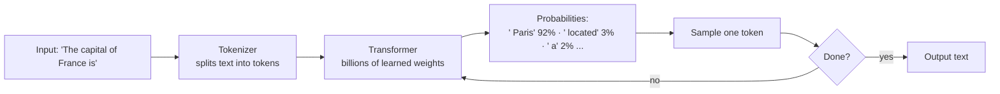
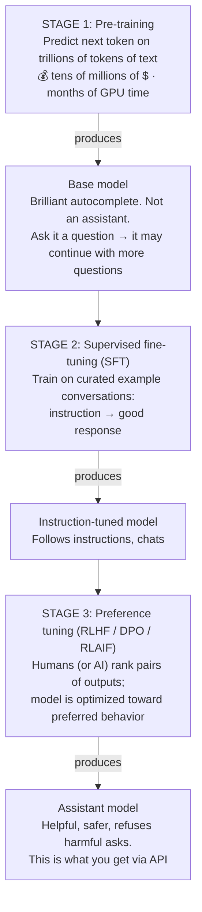
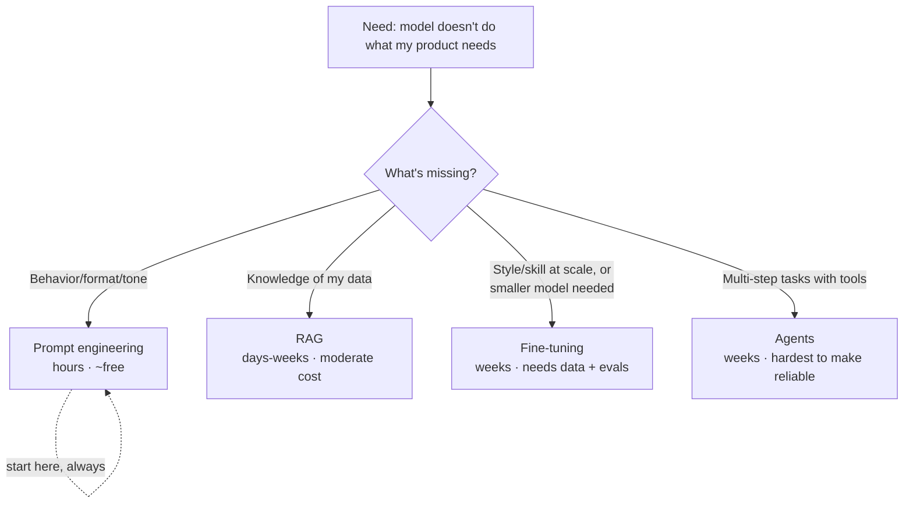

# 🤖 LLM Fundamentals for PMs: How the Magic Actually Works

> **TL;DR:** An LLM is a next-token predictor trained on internet-scale text, then shaped by human feedback into an assistant. Everything you need to reason about (context windows, hallucination, cost, latency, prompting) falls out of that one sentence.

---

## 1. What an LLM actually does

An LLM does exactly one thing: **given text so far, predict a probability distribution over the next token, then pick one. Repeat.**

Three product-critical consequences fall out immediately:

1. **It generates plausible text, not verified truth.** Hallucination isn't a bug to be patched; it's the failure mode of the core mechanism. Your product must be designed around it.
2. **Output is sampled**, so the same input can produce different outputs (controlled by *temperature*). Non-determinism is a UX and QA problem you own.
3. **Cost and latency scale with tokens**: input tokens (what you send) and output tokens (what it writes). Long documents in, long answers out = slow and expensive.

## 2. Tokens: the unit of everything

- A token ≈ ¾ of an English word ("hamburger" → `ham` `burg` `er`). ~1,000 tokens ≈ 750 words.
- **You are billed per token** (input and output priced separately; output typically costs several times more).
- **Context window** = the maximum tokens the model can consider at once (modern models: hundreds of thousands of tokens, a whole book. But bigger context ≠ automatically better recall or reasoning, and you pay for every token you stuff in).
- Non-English languages and code often tokenize less efficiently → same content costs more. This matters for international products.

## 3. How LLMs are made: the three-stage pipeline

Why a PM should care about each stage:

| Stage | What it explains about your product |
|---|---|
| Pre-training | Knowledge cutoff dates · why models know public info but not your company's data · why training your own frontier model is off the table for ~everyone |
| SFT | Why models follow formats and instructions · what "fine-tuning" on your own data actually means (you're doing a mini stage 2) |
| Preference tuning | Refusal behavior · sycophancy (models agreeing too much) · tone differences between model providers |

**Reasoning models** (a post-2024 addition): models additionally trained to produce long internal chains of thought before answering. Tradeoff: better on hard logic/math/code, but slower and pricier per query. Many products route: cheap fast model for easy queries, reasoning model for hard ones.

## 4. The knobs you can turn at inference time

| Knob | What it does | PM-level guidance |
|---|---|---|
| **System prompt** | Standing instructions defining role, rules, tone | This is product surface. Version it, eval it, review changes like code |
| **Temperature** | Randomness of sampling (0 = most deterministic) | Low for extraction/classification; higher for creative generation |
| **Max output tokens** | Caps response length | Cost & latency control |
| **Structured output / JSON mode** | Forces machine-readable output | Essential when the output feeds other software |
| **Tool use / function calling** | Model can call APIs you define (search, DB, calculator) | The foundation of [agents](../02-technical-depth/ai-agents.md) |
| **Streaming** | Tokens render as generated | Perceived latency killer; table stakes for chat UX |

## 5. What LLMs are bad at: the honest list

| Weakness | Why | Product mitigation |
|---|---|---|
| **Hallucination** | Plausibility ≠ truth | Grounding via [RAG](../02-technical-depth/rag.md), citations, human review for high-stakes outputs |
| **Freshness** | Knowledge frozen at training cutoff | Retrieval / web search tools |
| **Your private data** | Wasn't in training data | RAG or fine-tuning |
| **Arithmetic & precise counting** | Predicting digits ≠ calculating | Give it a calculator/code tool |
| **Consistency** | Sampled output varies | Temperature 0 + structured output + evals; design UX for variation |
| **Prompt injection** | Can't reliably distinguish instructions from data it reads | Never give an LLM more authority than the least-trusted text it reads; see [responsible-ai](../03-product-craft/responsible-ai.md) |
| **Sycophancy** | Preference-tuned to please | Matters for advice/coaching products; design prompts to push back |
| **Long-context degradation** | Recall weakens mid-context ("lost in the middle") | Retrieval + context curation beats context-stuffing |

Interviewers love "how would you handle hallucination in [product]?" The strong answer combines *grounding* (RAG/citations), *calibration UX* (confidence signals, "check this" affordances), *evals* (measure the rate), and *stakes-based design* (human review where errors are costly).

## 6. Ways to adapt an LLM to your product (preview)

Full treatment: [prompting](../02-technical-depth/prompt-engineering.md) · [RAG](../02-technical-depth/rag.md) · [fine-tuning](../02-technical-depth/fine-tuning.md) · [agents](../02-technical-depth/ai-agents.md). The 80/20: **prompting + RAG covers the vast majority of real products.** "Why not fine-tune?" is an interview trap. The answer is usually "we haven't exhausted cheaper options."

## 7. Explain-it-like-I'm-an-exec cheat sheet

Practice saying these out loud, because "explain X to a non-technical stakeholder" is a standard interview round:

- **LLM:** "Autocomplete trained on most of the internet, then coached by human feedback to be a helpful assistant."
- **Tokens:** "The syllables of AI; we pay by the syllable, in and out."
- **Context window:** "The model's working memory for a single conversation: big, but not infinite, and we pay for everything we put in it."
- **Hallucination:** "It's built to say plausible things, and most plausible things are true, but 'most' isn't 'all', so we ground it in our verified data and design the UX so users can tell."
- **RAG:** "Open-book exam instead of closed-book: we fetch the right company documents and let the model answer from them, with citations."
- **Fine-tuning:** "Sending the model to finishing school on our examples so it picks up our house style and skills."
- **Agent:** "An LLM given tools and permission to take steps toward a goal, like an intern with software access: powerful, needs guardrails and supervision."

## 8. Self-test (interview-calibrated)

1. Why does the same prompt give different answers twice? What two levers reduce that?
2. Your AI feature's response takes 12 seconds. Name four levers to cut latency. *(smaller/faster model, fewer input tokens, cap output tokens, streaming for perceived latency, caching common answers)*
3. A stakeholder says "just train the model on our docs so it stops hallucinating." What do you say? *(fine-tuning teaches style/skill, not reliable facts; RAG grounds answers in retrievable truth with citations; start there)*
4. Why did output tokens cost more than input tokens? *(generation is sequential: each output token requires a full forward pass; input can be processed in parallel)*
5. What's the difference between the model being *wrong* and the model being *ungrounded*, and which one can you fix with product design?

---

➡️ **Next:** [Glossary](glossary.md) · then go deep in [02-technical-depth](../02-technical-depth/)
