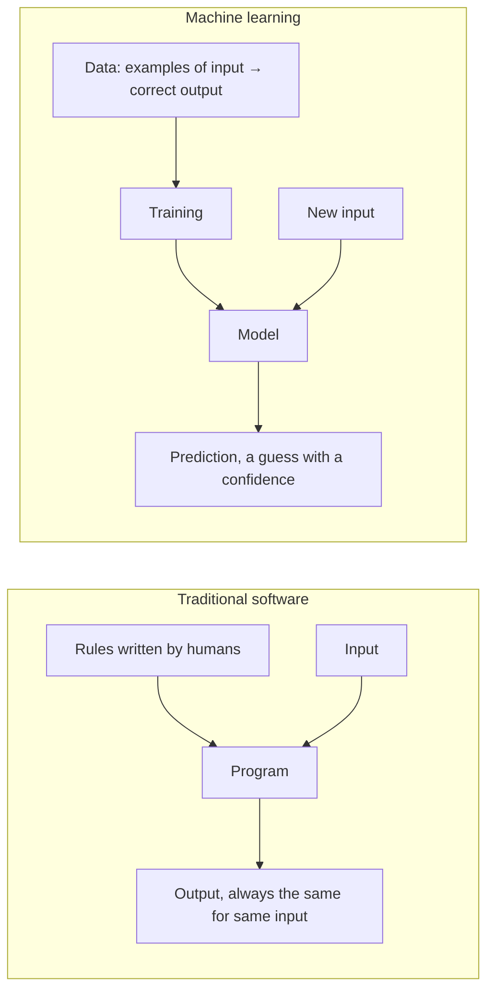
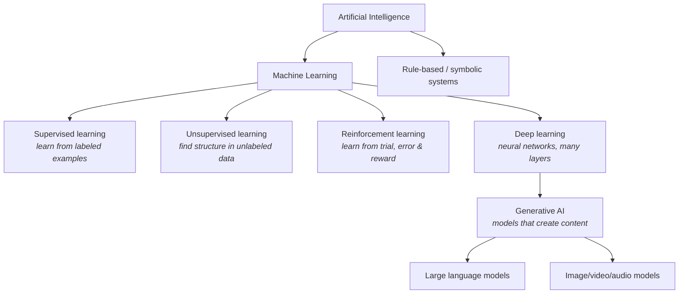
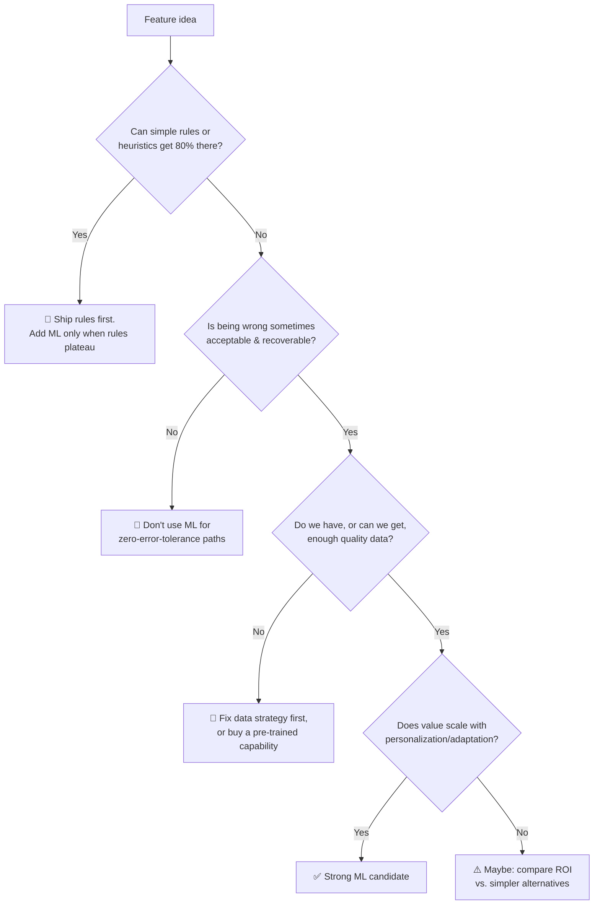

# 🧠 ML Fundamentals for PMs (No Math Required, No Hand-Waving Either)

> **TL;DR:** Machine learning is programming with examples instead of rules. Your job as PM is knowing *when* examples beat rules, *what data* the examples require, and *how wrong* the system is allowed to be.

---

## 1. The one mental model that matters

- Traditional software: humans write the logic. Great when rules are knowable ("tax = price × rate").
- ML: the machine *infers* the logic from examples. Great when rules are unknowable ("is this email spam?", "what will this user watch next?").

**PM decision rule:** if a smart intern could write the rules on a whiteboard, you don't need ML. If they'd need to see 10,000 examples first, you might.

## 2. The ML family tree

| Type | Learns from | Classic product examples | PM question to ask |
|---|---|---|---|
| **Supervised** | Labeled examples (input → answer) | Spam filters, fraud detection, churn prediction, medical imaging | "Where do labels come from and what do they cost?" |
| **Unsupervised** | Unlabeled data | Customer segmentation, anomaly detection | "Will humans find the discovered clusters meaningful?" |
| **Reinforcement** | Reward signals from actions | Ads bidding, robotics, game AI; RLHF for LLMs | "Can we define a reward that isn't gameable?" |
| **Deep learning** | Huge datasets, learns features itself | Vision, speech, translation, LLMs | "Do we have the data/compute scale this needs?" |

## 3. Core concepts you'll actually use in meetings

### Training vs. inference
- **Training** = building the model. Expensive, occasional, offline.
- **Inference** = using the model per request. Cheap-ish, constant, **scales with your traffic and eats your margin**.
- PM relevance: features are priced and latency-budgeted at *inference* time.

### Precision vs. recall: the tradeoff you'll manage forever

|  | Predicted: fraud | Predicted: not fraud |
|---|---|---|
| **Actually fraud** | ✅ True positive | ❌ False negative (missed fraud) |
| **Actually fine** | ❌ False positive (blocked good user) | ✅ True negative |

- **Precision** = of everything we flagged, how much was right? (Optimize when false alarms are costly, e.g., blocking legit payments.)
- **Recall** = of everything bad, how much did we catch? (Optimize when misses are costly, e.g., cancer screening.)
- You cannot maximize both. **Choosing the operating point is a product decision, not an ML decision.** This is a top-5 interview topic.

Worked example: a fraud model at 99% precision / 60% recall blocks almost no good users but misses 40% of fraud. Moving the threshold to 90% precision / 85% recall catches far more fraud but now 1 in 10 blocked users is innocent. Is that acceptable for *your* product? A bank says no; a free-tier signup flow might say yes.

### Overfitting
Model memorizes training data instead of learning the pattern. It aces the test set it saw, fails in the wild. PM smell test: "offline metrics are great but production performance is bad."

### Data / model drift
The world changes; the model doesn't. Consumer behavior shifts, fraudsters adapt, slang evolves. **Every ML product needs a monitoring + retraining plan**. Ask for it in the PRD review.

### Ground truth & labels
Supervised ML is only as good as its labels. Questions PMs must ask: Who labels? What does labeling cost? What's inter-labeler agreement? Is there labeler bias? Can product usage generate labels for free (the best flywheel)?

## 4. "Should this be ML?": the decision tree

Rules of thumb that impress interviewers:
1. **Start with the dumb baseline.** "Most popular items" is the baseline every recommender must beat. If ML beats it by 2%, ask if the complexity is worth it.
2. **Cost of errors is asymmetric.** Always ask "what happens when we're wrong?" before "how often are we right?"
3. **Data is the product decision.** Model architecture is eng's call; *what data we collect, with what consent, generating which labels* is yours.

## 5. Classic ML products vs. generative AI products

| | Classic ML (ranking, fraud, forecasting) | Generative AI (LLMs, image gen) |
|---|---|---|
| Output | A score, class, or ranking | Open-ended content |
| Wrongness looks like | Wrong number/rank (measurable) | Confident fabrication (hallucination) |
| Evaluation | Established metrics (AUC, precision@k) | Hard: needs evals, rubrics, human judgment |
| Data need | Your labeled data, lots of it | Pre-trained on internet; you adapt it |
| Team | Data scientists, ML engineers | Often just app engineers + an API |
| Time to prototype | Weeks-months | Hours |
| Barrier to entry | Data moat | Almost zero → differentiation shifts to UX, distribution, workflow, proprietary context |

The second column is why AI PM demand exploded: **any product team can now ship AI**, so every product team needs someone who knows what "good" means. That's you.

## 6. Vocabulary check: can you use these correctly in a sentence?

model · training · inference · label · feature (ML sense) · ground truth · precision · recall · F1 · threshold · confidence · overfitting · drift · baseline · A/B test vs. offline eval · cold start

If any feel shaky, hit the [Glossary](glossary.md). These come up as casual vocabulary in interviews, and misusing one is a louder signal than not knowing it.

---

➡️ **Next:** [LLM fundamentals](llm-fundamentals.md): how the generative wave actually works.
