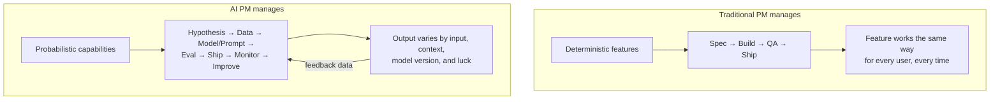
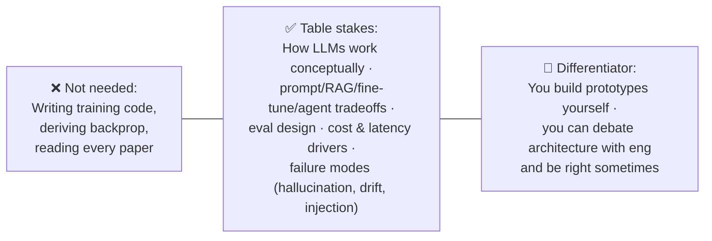

# 🎯 What AI Product Managers Actually Do

> **TL;DR:** An AI PM is a product manager whose product's core value depends on a model — which means managing probability instead of certainty, evals instead of acceptance criteria, and data flywheels instead of feature roadmaps.

---

## 1. The role in one diagram

The loop on the right never closes. That's the job.

## 2. AI PM vs. traditional PM — what actually changes

| Dimension | Traditional PM | AI PM |
|---|---|---|
| **Requirements** | "The button does X" | "The system should do X *well enough*, measured by eval Y, above threshold Z" |
| **Definition of done** | Acceptance criteria pass | Eval scores clear the quality bar **and** hold in production |
| **Failure mode** | Bug → fix → closed | Hallucination/drift → mitigate → monitor forever |
| **Timeline confidence** | Estimable | Research-shaped: "we'll know if it's feasible in 2 weeks" |
| **Core artifact** | PRD | PRD **+ eval suite + data strategy** |
| **Key partner** | Eng lead, designer | + Applied scientists / ML engineers, data engineers, legal/policy |
| **Unit economics** | Mostly fixed cost | Per-request inference cost that scales with usage — margin is a design decision |
| **UX challenge** | Usability | Usability **+ trust calibration** — users must know when *not* to trust the output |
| **Moat** | Features, network effects | Data flywheels, workflow lock-in, eval infrastructure |

Everything else — discovery, prioritization, stakeholder management, storytelling — is unchanged. **AI PM is a superset, not a different species.**

## 3. The four archetypes of AI PM

Companies use the same title for genuinely different jobs. Know which one you're applying for.

| Archetype | You ship... | Example roles | Technical depth needed |
|---|---|---|---|
| **1. AI Platform PM** | Models, APIs, and infra *for other builders* | PM on OpenAI API, Anthropic API, Vertex AI, AWS Bedrock | ████████ Very high — your users are developers |
| **2. AI-Native Product PM** | A product that *is* the AI experience | ChatGPT, Claude, Perplexity, GitHub Copilot, Cursor | ██████ High |
| **3. AI Feature PM** | AI features inside an existing product | Notion AI, Gmail smart compose, Zoom AI Companion, Adobe Firefly | ████ Medium-high |
| **4. ML Systems PM** | Invisible models powering the product | Search ranking, recommendations, fraud detection, ads, ETA prediction | ██████ High (classic ML + statistics) |

> **Interview tip:** archetype 4 (recommendations, ranking, fraud) predates the LLM wave and is the most common AI PM job at big tech. Don't prep only for chatbots.

## 4. A week in the life (AI feature PM, mid-size B2B SaaS)

| When | What | Why it's AI-specific |
|---|---|---|
| Mon | Review eval dashboard from last week's prompt change; regression in one segment | Quality is a *distribution*, not a checkbox |
| Mon | Standup + triage of flagged bad outputs from users | Failure triage is a permanent workstream |
| Tue | Work with ML eng on RAG retrieval quality; decide chunking experiment | PM owns "what good looks like," eng owns "how" |
| Wed | Write PRD for next AI feature — includes eval plan, cost model, fallback UX | Three sections a classic PRD doesn't have |
| Wed | Legal sync: customer asked whether their data trains models | Data governance questions land on the PM |
| Thu | Review A/B results: AI draft feature ↑ activation but ↑ support tickets | Tradeoff judgment between value and trust |
| Fri | Prototype next idea in an AI builder tool; test 20 prompts yourself | Best AI PMs feel the model's edges personally |
| Fri | Update exec on unit economics: cost per AI action vs. willingness to pay | Inference cost is a product decision |

## 5. Skills inventory & self-assessment

Score yourself 1–5 on each. The gaps are your study plan.

| # | Skill | 1 = | 5 = | Where to learn it here |
|---|---|---|---|---|
| 1 | ML/LLM fundamentals | "AI is magic" | Can explain transformers, training vs. inference, to an exec | [ml-fundamentals](ml-fundamentals.md), [llm-fundamentals](llm-fundamentals.md) |
| 2 | Prompting & context engineering | Copy-paste prompts | Design system prompts, few-shot, structured output | [prompt-engineering](../02-technical-depth/prompt-engineering.md) |
| 3 | Architecture literacy | — | Can whiteboard RAG vs. fine-tune vs. agent and pick one with reasons | [rag](../02-technical-depth/rag.md), [fine-tuning](../02-technical-depth/fine-tuning.md), [agents](../02-technical-depth/ai-agents.md) |
| 4 | Evaluation | "Looks good to me" | Owns eval suite; ships nothing without regression gates | [evals](../02-technical-depth/evals.md) |
| 5 | AI product strategy | Feature-copycat | Reasons about moats, wrappers, platform risk, timing | [ai-product-strategy](../03-product-craft/ai-product-strategy.md) |
| 6 | AI UX & trust design | Ships raw model output | Designs confidence signals, fallbacks, human-in-the-loop | [ux-patterns](../03-product-craft/ux-patterns-for-ai.md) |
| 7 | Unit economics | Ignores cost | Models cost/request, margin at scale, caching strategy | [model-selection-and-cost](../02-technical-depth/model-selection-and-cost.md) |
| 8 | Responsible AI | "Legal's problem" | Runs risk assessment; knows domain regulation | [responsible-ai](../03-product-craft/responsible-ai.md), [05-domains](../05-domains/) |
| 9 | Building with AI | Never built anything | Has shipped working prototypes | [04-build-with-ai](../04-build-with-ai/) |
| 10 | Core PM craft | — | Discovery, prioritization, metrics, storytelling | [03-product-craft](../03-product-craft/) |

## 6. How technical do you really need to be?

The honest answer, in one diagram:

You must be able to **(a)** call BS on a timeline, **(b)** make feasibility tradeoffs without asking eng, and **(c)** translate model behavior into user impact. That's the bar. You do not need to train models.

## 7. Where AI PMs sit in the org

| Reporting line | Common at | Implication for you |
|---|---|---|
| Product org, AI is a feature area | Most SaaS companies | You'll evangelize AI internally; expect skepticism |
| Dedicated AI/ML product org | Big tech, AI-native cos | Deep specialization; strong scientist partners |
| Research org (PM embedded) | Frontier labs | Product intuition for research; high ambiguity |
| Platform/infra org | Cloud providers | Developer-facing; API design skills matter |

## 8. Common myths, debunked

| Myth | Reality |
|---|---|
| "I need an ML degree" | Most AI PMs don't have one. Conceptual fluency + evidence you've built is what's tested. |
| "AI PM = chatbot PM" | Ranking, recommendations, fraud, forecasting, and vision products outnumber chatbots. |
| "Prompting knowledge is enough" | Prompting is week one. Evals, data strategy, cost, and trust UX are the actual job. |
| "AI will replace PMs" | AI compresses execution work (docs, tickets, analysis). Judgment, taste, and alignment work grow in value. The PMs replaced are the ones who don't use AI. |
| "It's too late, everyone's doing it" | Demand for PMs who can *actually* run eval-driven development still far exceeds supply. Most "AI PMs" have never written an eval. |

---

➡️ **Next:** [ML fundamentals for PMs](ml-fundamentals.md) · [Glossary](glossary.md)
