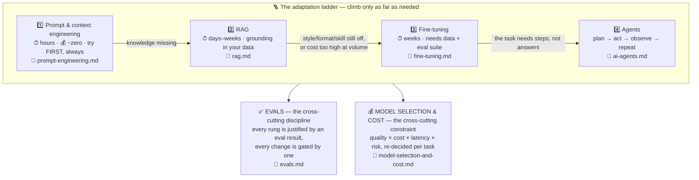

# 🔬 Technical Depth — The AI PM's Working Knowledge

> **TL;DR:** This is the section that separates PMs who've *built* AI products from PMs who've *read about* them. You don't need to train models — you need to reason out loud about prompting, retrieval, tuning, agents, evals, and unit economics under an interviewer's follow-up questions. That fluency is the differentiator.

---

## The six pages

| Page | The question it answers | Interview weight |
|---|---|---|
| [prompt-engineering.md](prompt-engineering.md) | How do we steer behavior with zero code — and why is the prompt a product spec? | **High** |
| [rag.md](rag.md) | How do we make the model know *our* stuff, with citations and permissions? | **High** |
| [fine-tuning.md](fine-tuning.md) | When is retraining actually the answer (and why is it usually not)? | Medium |
| [ai-agents.md](ai-agents.md) | What happens when the model *acts* — and who decides how much autonomy it gets? | **High** |
| [evals.md](evals.md) | How do we define, measure, and gate quality for a probabilistic product? | **High** |
| [model-selection-and-cost.md](model-selection-and-cost.md) | Which engine, at what price, and does the margin math work? | Medium |

## How the pages fit: the adaptation ladder

Every "how would you build this?" question is really "how far up this ladder do you climb, and can you justify each rung with evidence?" Climb only as far as you need — and never skip the cross-cutting layers.

**The rule that wins interviews:** *exhaust cheaper rungs first, and justify each climb with an eval result, not a feeling.* "We fine-tuned because prompting scored 71% on our golden set and we need 90%+ at 1/10th the cost per call" is a great answer. "We fine-tuned to make it know our product" is the trap answer.

## 💡 If you only read one page

> **[evals.md](evals.md).** Everything else on the ladder is a *proposal*; evals are the only thing that tells you whether the proposal worked — which is why *"evals are the new PRD"* is the single most differentiating idea in AI PM interviews today.

## Suggested order

Read them in ladder order — each page ends by pointing at the next:

`prompt-engineering` → `rag` → `fine-tuning` → `ai-agents` → `evals` → `model-selection-and-cost`

Short on time? [evals.md](evals.md) → [rag.md](rag.md) → [ai-agents.md](ai-agents.md) covers the three highest-frequency interview surfaces.

## ✅ Ready to move on?

Answer each out loud, in under two minutes, without notes:

1. **Ladder logic** — A stakeholder says "let's fine-tune it so it knows our docs." What do you propose instead, and why? *(RAG — fine-tuning shifts style and skill, not auditable facts.)*
2. **RAG debugging** — The support bot gives a wrong answer. What's your very first diagnostic question? *(Was the right information retrieved? No → retrieval problem; yes → generation problem.)*
3. **Autonomy** — What two axes set an agent's autonomy dial, and how does the dial move over time? *(Reversibility × cost of error; earn autonomy with a measured low human-override rate.)*
4. **Agent math** — Why does a 10-step agent with 95%-reliable steps fail ~40% of the time? *(0.95¹⁰ ≈ 0.60 — errors compound.)*
5. **Evals** — Name the minimum eval setup you'd demand before shipping any AI feature. *(Written rubric, golden set from real data, automated pass gate in CI, sliced dashboard, production failures feeding back into the set.)*
6. **Economics** — Your AI feature costs $6/user/month against a $10 price. Walk your levers, in order. *(Caching → routing → context/output trimming → UX triggers → distillation → price/packaging last.)*

Miss any? The answer is on the page it came from. Get all six clean and you're ready to talk about *products* instead of *plumbing*.

---

⬅️ **Coming from:** [01-foundations](../01-foundations/) — [LLM fundamentals](../01-foundations/llm-fundamentals.md) and the [glossary](../01-foundations/glossary.md) are the prerequisites for this section.

➡️ **Next:** [03-product-craft](../03-product-craft/) — turning technical fluency into product decisions.
