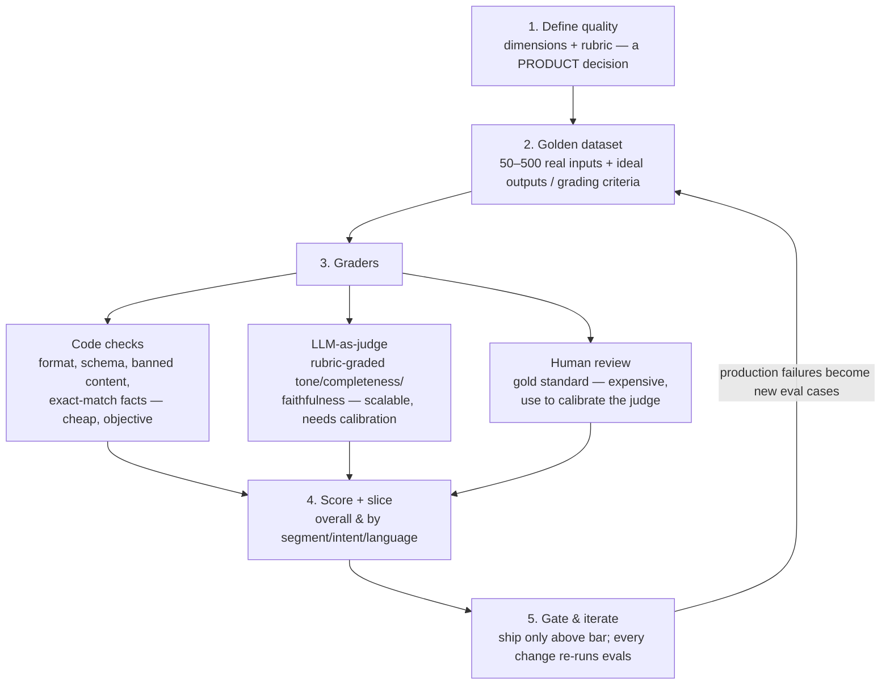

# ✅ Evals — The AI PM's Superpower

> **TL;DR:** Evals are how you define, measure, and protect quality for probabilistic products. They are to AI what acceptance criteria + test suites are to classic software — and the single most differentiating skill in AI PM interviews today. *"Evals are the new PRD."*

---

## 1. Why "looks good to me" doesn't scale

A deterministic feature: test it once, it works forever. An AI feature: works on your 5 test prompts, fails on thousands of real inputs you never tried — and every prompt tweak, model upgrade, or data change silently reshuffles which inputs fail. Without evals you have **vibes**; you cannot answer:

- Is it good enough to ship? *(vs. what bar?)*
- Did this week's change make it better or worse? *(across everything, not just the fixed complaint)*
- Which model should we use? *(on our task, not benchmark headlines)*
- Where does it fail? *(so eng knows what to fix)*

## 2. The eval stack

### Step 1 — Define quality (the PM's job, not eng's)
For a support-answer feature, quality might be: **factually correct per the KB · complete · on-policy · right tone · safe · concise**. Writing this rubric *is* product management — it's the spec. If you can't write down what "good" means, no one can build it.

### Step 2 — Golden dataset
- Source from **real usage**: actual tickets, real queries, production failures. Invented examples test imagination, not the product.
- Include: happy paths, edge cases, adversarial inputs, every language/segment you serve.
- Start small (50 cases beats zero) and grow it forever. **Every production failure becomes a new eval case** — that's the flywheel that compounds.

### Step 3 — Graders (use all three tiers)
- **Code checks** catch the objective 40%: valid JSON, required fields, length, forbidden phrases, numbers matching source.
- **LLM-as-judge** scales the subjective 60%: give a strong model your rubric and the output; get scores + reasons. **Calibrate it**: run humans on a sample, measure agreement with the judge, fix the rubric until they align. An uncalibrated judge is vibes with extra steps.
- **Human review** stays for calibration samples, high-stakes domains, and disputes.

### Step 4 — Slice
An 85% overall score hiding 45% on Spanish queries or on your top enterprise customer's use case is a launch blocker you can't see without slicing. Always segment by intent, language, user tier, and difficulty.

### Step 5 — Gate
Eval runs go in CI like tests: no prompt/model/retrieval change ships below the bar or with a regression beyond tolerance. This converts "AI quality" from a debate into an engineering discipline.

## 3. Offline evals vs. online reality

| | Offline evals | Online measurement |
|---|---|---|
| What | Golden set scored pre-ship | A/B tests, user signals post-ship |
| Catches | Regressions, capability gaps | Real-world value, distribution shift |
| Signals | Rubric scores, pass rates | Acceptance/edit rate, thumbs, task completion, retention, escalations |
| Limits | Only covers what's in the set | Slow, noisy, needs traffic |

You need both: offline to ship safely, online to learn what offline missed — and the loop between them (production failures → new eval cases) is the actual system. Implicit signals beat explicit ones at scale: **edit distance on AI drafts, acceptance rate, regenerate rate, abandonment** are richer than thumbs-up/down, which only a small fraction of users ever touch.

## 4. Public benchmarks vs. your evals

Public benchmarks (MMLU, GPQA, SWE-bench, Arena Elo…) answer "how capable is this model in general?" — useful for **shortlisting models**. They cannot answer "is my feature good?" — they don't contain your users, your data, your policies. Also: popular benchmarks saturate and leak into training data over time. The interview one-liner: *"Benchmarks shortlist the model; my golden set makes the decision."* (Current benchmark landscape: [model-selection-and-cost.md](model-selection-and-cost.md).)

## 5. The canonical PM reading

- **["Beyond vibe checks: A PM's complete guide to evals"](https://www.lennysnewsletter.com/p/beyond-vibe-checks-a-pms-complete)** — Aman Khan on Lenny's Newsletter (Aug 2025): the most-cited PM-level eval guide.
- **["Demystifying evals for AI agents"](https://www.anthropic.com/engineering/demystifying-evals-for-ai-agents)** — Anthropic engineering blog: agent-eval harnesses from a builder's perspective.
- Tools your team might use (verified active, July 2026): [Braintrust](https://www.braintrust.dev), [LangSmith](https://smith.langchain.com), [Langfuse](https://langfuse.com) (open-source), [Arize Phoenix](https://phoenix.arize.com) (open-source), [W&B Weave](https://wandb.ai), [DeepEval](https://deepeval.com), [PromptLayer](https://promptlayer.com), [Vellum](https://www.vellum.ai), [Galileo](https://galileo.ai), [Patronus AI](https://www.patronus.ai). What matters for the PM isn't the tool — it's that datasets, scores, and gates exist and you can read them.

## 6. Interview drills

**Drill 1 — "Your chatbot's response quality dropped 15% last week. Debug it."** *(A real coach-published AI PM interview question.)*
Structure: ① Verify the metric — what measures "quality," did the *measurement* change (judge model, rubric, sampling)? ② Segment the drop — all intents/languages or one? New user cohort? ③ Diff the system — model version bump, prompt change, retrieval index update, tool outage, traffic mix shift? ④ Reproduce on the golden set — if offline scores also fell, it's the system; if not, it's the inputs (drift). ⑤ Fix + add the failing cases to the eval set so it never silently regresses again.

**Drill 2 — "Would you rather have 90% accuracy on 100 use cases or 99% on 10?"** *(Also from a published AI PM question set.)*
There's no universal right answer — reason from stakes and strategy: 99%-on-10 for high-stakes domains (health, finance, legal) and for building trust in a wedge product; 90%-on-100 for low-stakes breadth products with graceful failure UX. Name the recovery path and how each error type costs you. Strong candidates also note: the 10 use cases must be the ones users actually need.

**Drill 3 — Write the rubric.** Feature: AI meeting summarizer. Write 5 graded dimensions with a 1–5 anchor each, then say which two get code checks instead of judges. *(Sample: attendee/date accuracy → code check against calendar; action-item completeness vs. transcript → judge; no invented commitments → judge w/ strict rubric; length ≤ 200 words → code; tone neutrality → judge.)*

## 7. Self-test

1. Why is a 50-case golden set from real tickets worth more than a 5,000-case synthetic one? *(Represents the true input distribution and true failure modes; synthetic sets encode your blind spots.)*
2. Your LLM judge gives your feature 4.6/5 but users are churning. List three hypotheses. *(Judge measures the wrong dimensions; rubric miscalibrated vs. human perception; offline set no longer matches production inputs; quality isn't the churn driver.)*
3. What's the minimum eval setup you'd demand before shipping any AI feature? *(Written rubric, golden set from real data, automated pass gate wired to CI, a dashboard slicing by key segments, and a feedback path from production failures back into the set.)*

---

➡️ **Next:** [Model selection & cost](model-selection-and-cost.md) — choosing and affording the engine.
