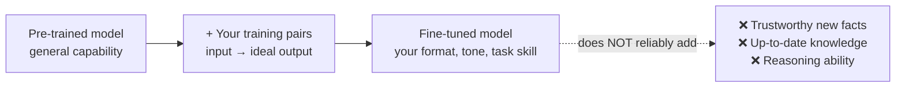
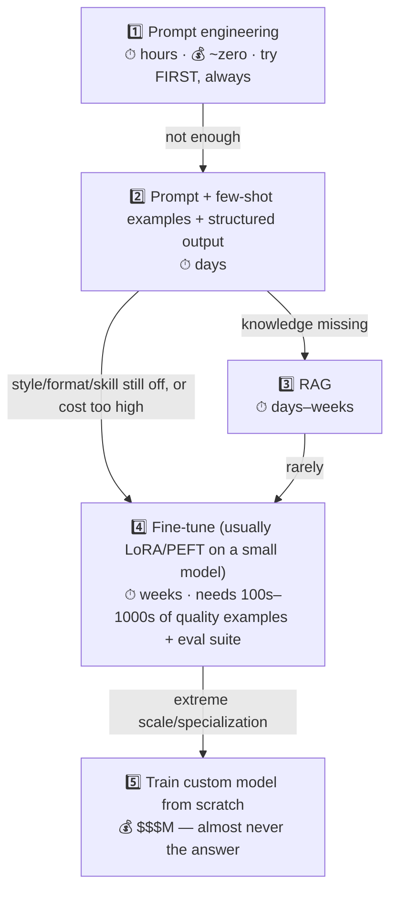

# 🎛️ Fine-Tuning — When, Why, and (Mostly) Why Not

> **TL;DR:** Fine-tuning teaches a model *skills and style*, not *facts you can trust*. It's the right tool far less often than stakeholders think — and "why wouldn't you fine-tune here?" is a classic interview trap.

---

## 1. What fine-tuning actually is

Take a pre-trained model, continue training it on **your** examples (hundreds to tens of thousands of input → ideal-output pairs), and its weights shift toward your patterns.

What it's genuinely good at:
- **Format/style at scale** — always output our exact JSON schema, our brand voice, our clinical-note structure.
- **Narrow task skill** — classify tickets into *our* 40 categories; extract fields from *our* document types.
- **Distillation / cost-down** — teach a small cheap model to match a big model's behavior on your specific task → 10x cheaper inference at scale.
- **Behavior you can't prompt in** — when the instruction + examples don't fit or don't stick.

What it's bad at (and why the trap exists):
- **Facts** — it doesn't create a reliable, auditable knowledge store; it nudges probabilities. The model may still hallucinate, now with more confidence in your domain's vocabulary. Facts → [RAG](rag.md).
- **Freshness** — every data change means retraining. Retrieval updates instantly.
- **Traceability** — no citations, no "why did it say that."

## 2. The adaptation ladder (climb only as far as needed)

**Rule that wins interviews:** *exhaust cheaper rungs first, and justify each climb with an eval result, not a feeling.* "We fine-tuned because prompting scored 71% on our golden set and we need 90%+ at 1/10th the cost per call" is a great answer. "We fine-tuned to make it know our product" is the trap answer.

## 3. What the PM owns in a fine-tuning project

| Workstream | PM's job |
|---|---|
| **Training data** | Define what "ideal output" looks like; source real examples; set labeling guidelines; check consent/rights to use the data — *this is 80% of project success* |
| **Eval suite** | The before/after measuring stick — without it you cannot know if fine-tuning helped ([evals.md](evals.md)) |
| **Baseline** | Force the comparison: fine-tuned small model vs. well-prompted frontier model vs. RAG — on quality, cost, latency |
| **Lifecycle plan** | Models get deprecated; data drifts; who retrains, how often, at what cost? |
| **The business case** | Fine-tuning pays off when: high request volume (cost-down), strict format/voice needs, or latency budgets requiring small models |

Techniques worth recognizing by name (eng owns the details): **LoRA / PEFT** (cheap partial fine-tuning — the default), **distillation** (big teacher → small student), **RLHF/DPO** (preference tuning — usually only model providers), **continued pre-training** (domain corpora, e.g. medical text — heavy).

## 4. Worked example — the cost-down story

A support-ticket classifier handles 2M tickets/month with a frontier model at ~$0.01/ticket = **$20K/month**. Distilling to a fine-tuned small model at ~$0.0005/ticket = **$1K/month**, with quality within 1 point on the eval suite. Fine-tuning cost + a few weeks of eng time pays back in month one. **This — volume + narrow task — is the canonical good fine-tuning story.** Notice the story requires: measured quality parity (evals), high volume, and a narrow task.

## 5. Decision one-liners (memorize)

| Situation | Answer |
|---|---|
| "Make it know our product docs" | RAG, not fine-tuning |
| "Make it always follow our clinical note format" | Fine-tune (or first: structured output + examples) |
| "Answers are outdated" | RAG / retrieval; never fine-tuning |
| "Too expensive at our volume" | Distill/fine-tune a smaller model, or cache/route |
| "Tone isn't our brand voice" | Prompt first; fine-tune if volume justifies |
| "It reasons poorly on our hard cases" | Better/reasoning model, decomposition — fine-tuning rarely fixes reasoning |
| "We want a moat" | Fine-tuned weights on proprietary *interaction* data can be one — but workflow + data flywheel usually matter more ([strategy](../03-product-craft/ai-product-strategy.md)) |

## 6. Self-test

1. Legal team wants the model to "learn all our contracts." What do you probe, and what do you likely propose? *(What tasks? QA/clause-lookup → RAG with citations + permissions. Drafting in house style → maybe fine-tune for style + RAG for facts. Always: golden set first.)*
2. Your fine-tuned model shipped 6 months ago; quality is drifting. Name three causes. *(Input drift — new products/vocab; the narrow task's definition changed; base model deprecated/serving stack changed. Fix: monitoring evals + scheduled refresh.)*
3. When does fine-tuning *hurt*? *(Overfits to narrow examples and loses general capability on inputs outside them; bakes in biases from bad training pairs; anchors you to a model that gets deprecated.)*

---

➡️ **Next:** [AI Agents](ai-agents.md) — models that act, not just answer.
