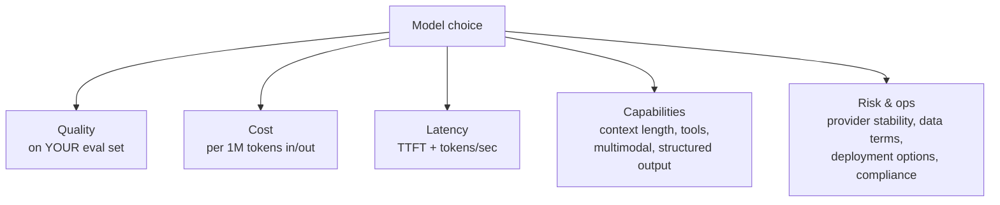

# 💰 Model Selection & Unit Economics

> **TL;DR:** Picking a model is a product tradeoff across quality, cost, latency, and risk — re-made every quarter as the market moves. The PM who can whiteboard cost-per-user math gets hired; margin on AI features is a *design decision*.

> ⚠️ **Volatility warning:** model names and prices below were verified **July 2026** from official pricing pages. This is the fastest-staling page in this repo — treat numbers as a snapshot for learning the *method*, and re-check before citing. Live comparison: [artificialanalysis.ai](https://artificialanalysis.ai).

---

## 1. The selection tradeoff



There is no "best model" — there is a best model **per task at a price**. Mature AI products run a *portfolio*: frontier model for hard/high-stakes tasks, cheap fast model for high-volume simple ones, with a **router** deciding per request. (a16z's 2025 enterprise survey: 37% of enterprises run 5+ models in production.)

## 2. The market map (snapshot: July 2026)

| Provider | Flagship tier | Cheap/fast tier | $/1M tokens (in / out) | Notes |
|---|---|---|---|---|
| OpenAI | GPT-5.6 family (GA Jul 2026) | smaller 5.6 variants | flagship ~$5/$30 · mid ~$2.50/$15 · small ~$1/$6 | 1M-token context on 5.6 family |
| Anthropic | Claude Fable 5 · Opus 4.8 | Claude Sonnet 5 · Haiku 4.5 | Fable $10/$50 · Opus $5/$25 · Sonnet $2/$10 intro → $3/$15 after Aug 31, 2026 · Haiku $1/$5 | 1M context on recent models; cache reads 0.1×; batch −50% |
| Google | Gemini 3.1 Pro | Gemini 3.5 Flash / Flash-Lite | Pro ~$2–4/$12–18 · Flash $1.50/$9 · Lite $0.25/$1.50 | Flash tiers have free quotas |
| DeepSeek | V4 Pro | V4 Flash | ~$0.44/$0.87 · ~$0.14/$0.28 | The price floor; open-weight heritage |
| Mistral | Large 3 (open-weight, Apache 2.0) | Small 3 / Ministral | ~$0.50/$1.50 · from $0.04 | Self-hostable flagship |
| Meta | Llama 4 (last open family) | — | free weights, pay for hosting | Newer Meta frontier models are closed API-only |
| xAI | Grok 4.5 | Grok 4.1 Fast | ~$2/$6 · ~$0.20/$0.50 | Up to 2M context on fast tier |
| Alibaba | Qwen 3.5 (open) / Qwen 3.7 Max (closed) | — | free weights / API pricing | Strongest open-weight family from China alongside DeepSeek |

**Structural facts more durable than prices:** ① output tokens cost ~5–6× input; ② every capability tier gets ~10× cheaper within roughly a year or two of debut (frontier capability of 2023 is nearly free in 2026); ③ open-weight models trail frontier by months, not years; ④ "reasoning modes" cost more per query — route them only to hard problems.

## 3. Closed API vs. open-weight — the build-vs-buy of AI

| | Closed API (GPT/Claude/Gemini) | Open-weight self-hosted (Llama/Mistral/Qwen/DeepSeek) |
|---|---|---|
| Quality ceiling | Highest | Months behind frontier |
| Start cost | ~zero | Infra + MLOps team |
| Unit cost at scale | Per-token forever | Can be lower at very high volume |
| Data control | Contractual (check training/retention terms) | Physical — data never leaves |
| Compliance | Depends on provider terms (BAA, residency) | You control everything, and must certify everything |
| Ops burden | Provider's problem | Your pager |
| Middle path | — | **Hosted open models** (Bedrock, Vertex, Together, Fireworks, Groq, OpenRouter): open-model economics without the pager |

Interview-ready heuristic: *default to closed API for speed and ceiling; consider open-weight when you have extreme volume on a narrow task (with fine-tuning/distillation), hard data-residency requirements, or need deployment control (on-prem, edge).*

## 4. Unit economics — the worked example to rehearse

**Feature:** AI email-draft assistant in a B2B SaaS, $30/user/month plan.

```
Assumptions (state them out loud):
- 20 drafts/user/workday × 22 days           = 440 drafts/user/month
- Context per draft: 2,000 tokens in, 300 out ≈ mid-tier model @ $2.50/1M in, $15/1M out
- Cost per draft  = 2000×$2.50/1M + 300×$15/1M = $0.005 + $0.0045 ≈ $0.0095
- Cost per user/mo = 440 × $0.0095            ≈ $4.18 → ~14% of the $30 price. Viable but heavy.

Levers, in the order to pull them:
1. Prompt caching — the system prompt + user's style examples repeat every call.
   Cached input at ~0.1× ⇒ cost/user → ~$2 (>50% cut for an infra flag).
2. Routing — 70% of drafts are short replies a cheap model handles;
   route those at ~1/5th the cost ⇒ ~$0.90/user.
3. Output caps + retrieval discipline — trim context to what the draft needs.
4. Product design — generate on explicit request, not on every keystroke.
5. Only THEN: fine-tune/distill a small model if volume justifies it.
```

The pattern generalizes: **cost per action → actions per user → cost per user → % of ARPU → levers.** Do this math in any monetization or feasibility interview and you're in the top decile of candidates.

## 5. Latency — the other budget

- **TTFT (time to first token)** drives perceived speed; **streaming** makes 8 seconds feel like 1. Non-streamed spinners kill chat UX.
- Levers: smaller model, shorter context, prompt caching, capped output, parallelizing retrieval, showing progressive UI.
- Latency and quality trade off through model size and reasoning effort — decide *per surface*: autocomplete needs <300ms (small model, no reasoning); a contract analysis can take 30s if progress is visible.

## 6. Benchmarks for shortlisting (status: July 2026)

| Benchmark | Measures | Status |
|---|---|---|
| **Arena** (ex-LMArena) — arena.ai | Human preference Elo, blind A/B | Live; the vibes leaderboard |
| **Artificial Analysis** | Aggregated intelligence + speed + price | Live; best single shopping stop |
| **SWE-bench Verified** | Real GitHub issue fixing (agents) | Live; SOTA ~mid-70s% (Apr 2026) |
| **GPQA Diamond** | Graduate-level science QA | Approaching saturation |
| **τ²-bench** | Customer-service agents w/ simulated users | Live; agent behavior |
| **ARC-AGI-2** | Abstract reasoning generalization | Live; frontier <~30% — the open frontier |
| MMLU, HumanEval | Knowledge MCQ / Python synthesis | **Saturated — historical only**; citing them as differentiators is a red flag |

And repeat the mantra: benchmarks shortlist, **your evals decide** ([evals.md](evals.md)).

## 7. Provider risk — the diligence checklist

1. **Data terms**: is our data used for training? Retention window? Zero-retention option? BAA/DPA available?
2. **Deprecation policy**: how long are model versions supported? (Model retirements break un-evaled products.)
3. **Rate limits & SLAs**: can they handle our peak? Enterprise support?
4. **Concentration risk**: one provider = pricing power over your margin; abstraction layers and portable evals keep you mobile.
5. **Compliance surface**: SOC 2, ISO 42001, regional hosting, sector certifications — table stakes for enterprise sales.
6. **Corporate stability**: the 2024–26 M&A wave (IDE and eval vendors acquired, pivoted, or shut down) is a reminder: check that your vendor's roadmap survives their cap table.

## 8. Self-test

1. Your AI feature costs $6/user/month against a $10 price. Walk through your levers in order. *(Caching → routing → context/output trimming → UX triggers → distillation → price/packaging change last.)*
2. "Why not just always use the best model?" *(Cost at scale, latency budgets, and measured need — if the cheap model scores within a point on our golden set for 70% of traffic, the frontier model there is pure margin burn.)*
3. A provider releases a model claiming +10 points on MMLU. Ship it? *(No — MMLU is saturated/irrelevant; run our golden set + regression gates, check price/latency, then canary.)*

---

➡️ **Next:** [03-product-craft](../03-product-craft/) — turning technical fluency into product decisions.
