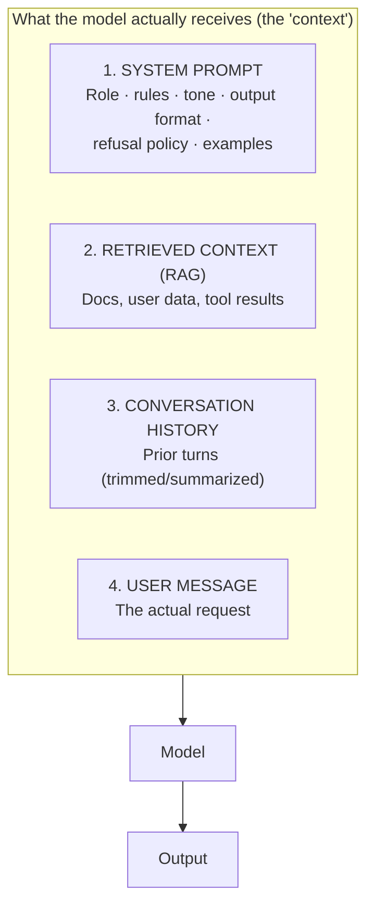
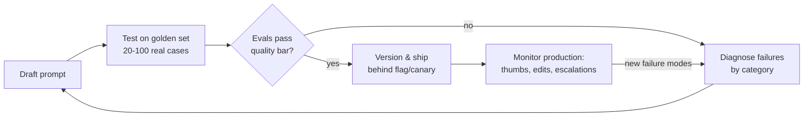

# ✍️ Prompt & Context Engineering for PMs

> **TL;DR:** The prompt is product surface, as much a spec as your PRD. PMs who write, version, and eval prompts ship better AI products and dominate the "how would you improve this feature?" interview question.

---

## 1. Why this is a PM skill, not just an eng skill

- The **system prompt encodes product decisions**: tone, refusal policy, format, persona, guardrails. That's product, not infrastructure.
- Prompt changes ship user-facing behavior changes with **zero code**, which means they need PM review and eval gates, exactly like a feature launch.
- In interviews, "walk me through how you'd prompt this feature" separates PMs who've built from PMs who've read.

## 2. Anatomy of a production prompt



**Context engineering** is the discipline of deciding what goes in each box, in what order, within token budget. It has largely replaced "prompt engineering" as the real skill: the hard part isn't wording; it's *curation*.

## 3. The techniques that matter (with before/after)

### 3.1 Be specific about the task, audience, and format

❌ `Summarize this customer call.`

✅
```text
Summarize this customer call for an account executive preparing a renewal.
Format:
- 3-bullet summary (≤15 words each)
- Sentiment: positive / neutral / at-risk, with one supporting quote
- Action items with owners, as a table
If pricing was discussed, always include it.
```

### 3.2 Give the model a role and boundaries

```text
You are a support assistant for Acme's billing product.
- Answer ONLY from the provided help articles.
- If the answer isn't in them, say "I don't have that information" and offer to connect a human.
- Never discuss competitors, refunds over $500, or legal topics; hand those to a human.
```
Every line here is a **product policy decision**. This is why PMs review prompts.

### 3.3 Few-shot examples: show, don't tell

Adding 2-5 worked examples of input → ideal output is often the single highest-leverage change, especially for format, tone, and edge-case handling. Choose examples that cover your tricky cases, not your easy ones.

### 3.4 Let it think (chain of thought)

For judgment tasks: `First, list the key facts. Then reason through the options. Then give your recommendation.` Reasoning-then-answer measurably beats answer-first on complex tasks. (Reasoning models do this internally; see [model selection](model-selection-and-cost.md).)

### 3.5 Structured output

When output feeds software (not humans), demand JSON with a defined schema and use the provider's structured-output mode. Half of "flaky AI feature" bugs are actually unparsed free-text output.

### 3.6 Tell it what to do when it can't comply

The most-forgotten line in real prompts:
```text
If the request is ambiguous, ask one clarifying question instead of guessing.
If the document doesn't contain the answer, say so explicitly.
```
Unhandled "can't comply" paths are where hallucinations breed.

## 4. The prompt development lifecycle (treat prompts like code)



Non-negotiables for a real product:
1. **Version control**: prompts live in the repo, changes get reviewed. "Who changed the prompt?" should never be a mystery.
2. **Eval before ship**: a prompt tweak that fixes one complaint can silently break ten other cases. Regression evals catch this. ([evals.md](evals.md))
3. **A/B when stakes are high**: prompt variants are cheap to test online.

## 5. Common failure patterns (and what they signal in interviews)

| Failure | What's happening | Fix |
|---|---|---|
| Great demo, flaky in prod | Tested on 3 happy-path inputs | Golden set with real, messy inputs + edge cases |
| Model ignores an instruction | Buried in a wall of text, or conflicts with another instruction | Shorter, structured, prioritized instructions; move critical rules near the end; check for conflicts |
| Output format drifts | Free-text asked, machine-parsing expected | Structured output mode + schema |
| Model answers outside its lane | No refusal policy defined | Explicit scope + escape hatch ("say you don't know") |
| Works in English, breaks in Hindi | Prompt/examples all English | Localized examples; explicit language instruction; per-locale evals |
| Quality dropped overnight | Model version updated | Pin model versions; re-eval before adopting upgrades |
| Users extract system prompt or hijack behavior | Prompt injection via user input or retrieved docs | Input handling, output checks, least-privilege tools (see [responsible-ai](../03-product-craft/responsible-ai.md)); assume the system prompt will leak |

## 6. Advanced: prompting as portfolio evidence

Hiring managers increasingly ask "show me a prompt you're proud of." Strong artifact: a system prompt for a realistic feature +the golden set you tested it on + 2 iterations with before/after eval scores. That's a portfolio piece. Build it in [Project 1](../04-build-with-ai/projects.md).

## 7. Learn from the source (free, canonical)

- **[Anthropic's prompt engineering docs](https://docs.anthropic.com/en/docs/build-with-claude/prompt-engineering/overview)** ([interactive tutorial](https://github.com/anthropics/prompt-eng-interactive-tutorial) + technique guides)
- **OpenAI's prompt engineering guide & [Cookbook](https://developers.openai.com/cookbook)**: platform.openai.com/docs
- **Google's Gemini prompting guides**: ai.google.dev
- **[promptingguide.ai](https://www.promptingguide.ai/)**: community-maintained survey of techniques with paper links

(Links verified in [09-resources/courses.md](../09-resources/courses.md) with the rest of the catalog.)

## 8. Self-test

1. Rewrite this prompt to production grade: `Reply to this customer complaint.` (Cover: role, tone policy, format, escalation rule, refusal path.)
2. Your AI email-drafting feature writes great drafts but sometimes invents meeting times. Fix it *without* fine-tuning. *(Ground on calendar data via tool/RAG; instruct "never state times not present in the provided calendar"; add eval checking every stated time against source; UX: highlight times for user confirmation.)*
3. Why can a prompt change be riskier than a code change? *(No compiler, no type errors. Behavior shifts silently across the whole input distribution; only evals catch it.)*

---

➡️ **Next:** [RAG](rag.md), grounding models in your data.
