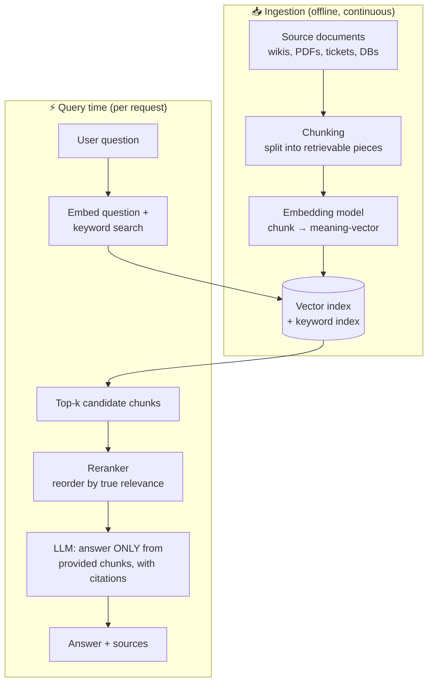

# 📚 RAG — Retrieval-Augmented Generation

> **TL;DR:** RAG turns a closed-book exam into an open-book exam: retrieve the right passages from *your* data, hand them to the model, and have it answer with citations. It's the default architecture for "AI that knows our stuff" — and the most common system you'll be asked to whiteboard in interviews.

---

## 1. The problem RAG solves

LLMs don't know: **your private data** (docs, tickets, contracts), **anything after their training cutoff**, and **which of their memories to trust**. Fine-tuning doesn't reliably fix facts (it shifts style/skill, not knowledge you can audit). RAG fixes all three by *looking things up at question time*.

## 2. How it works

Two halves, two failure surfaces:
- **Ingestion**: if the right answer was never chunked/indexed well, no model can find it.
- **Query time**: if retrieval returns the wrong chunks, the model answers from wrong context — *fluently*.

**The most important diagnostic idea in RAG:** when the answer is bad, first ask *"was the right information retrieved?"* If no → retrieval problem (chunking, embeddings, search). If yes → generation problem (prompt, model). Interviewers probe exactly this debugging instinct.

## 3. Design decisions a PM should be able to discuss

| Decision | Options | The tradeoff |
|---|---|---|
| Chunk size | Small (precise, loses context) ↔ large (context-rich, dilutes relevance) | Usually a few hundred tokens + overlap; structure-aware (by heading/section) beats fixed-size |
| Search type | Vector-only ↔ keyword-only ↔ **hybrid** | Hybrid wins in practice: vectors catch meaning ("laptop died" → hardware policy), keywords catch exact terms (SKUs, error codes, names) |
| Top-k | Few chunks (cheap, may miss) ↔ many (costly, noisy) | Retrieve more + **rerank** down to the best few |
| Freshness | Re-index nightly ↔ streaming updates | Driven by product need: support KB (hours ok) vs. pricing data (must be live) |
| Permissions | Filter at query time by user's access | **Non-negotiable in enterprise** — retrieval that ignores ACLs is a data breach. Ask about this in any B2B design; it's a differentiator in interviews |
| Citations | Show sources ↔ don't | Show them. Citations are the trust UX for RAG, and they let users self-verify |
| Refusal path | Answer anyway ↔ "not in the docs" | Instruct the model to say when the context doesn't contain the answer; measure how often it holds |

## 4. Where RAG quality actually dies (ranked by frequency in the wild)

1. **Garbage corpus** — outdated, duplicated, contradictory documents. RAG faithfully retrieves your organizational chaos. *Content ops is a real workstream.*
2. **Bad chunking** — tables split in half, answers separated from their headings.
3. **Retrieval misses** — user vocabulary ≠ document vocabulary; fix with hybrid search, query rewriting, synonyms.
4. **Lost in the noise** — top-k too high, model anchors on an irrelevant chunk.
5. **Ungrounded generation** — model blends retrieved facts with its own priors. Measure **faithfulness** (is every claim supported by the retrieved text?) in your evals.
6. **Stale index** — the doc was updated; the index wasn't.

## 5. RAG metrics (the eval stack)

| Layer | Metric | Question it answers |
|---|---|---|
| Retrieval | Recall@k | Was the needed chunk in the top k? |
| Retrieval | Precision@k | How much of what we fetched was relevant? |
| Generation | Faithfulness / groundedness | Is every claim in the answer supported by the retrieved text? |
| Generation | Answer relevance | Did we actually answer the question asked? |
| Product | Citation click-through, deflection rate, escalation rate, thumbs | Do users trust and succeed? |

Golden set for RAG = ~50–200 real questions + the doc(s) that contain each answer + the ideal answer. Build it from real support tickets/search logs, not imagination. Details: [evals.md](evals.md).

## 6. Beyond basic RAG (know these exist)

- **Query rewriting / decomposition** — reformulate vague questions, split multi-part ones.
- **Agentic RAG** — model decides *whether* to search, *what* to search, and iterates on results (bridges into [agents](ai-agents.md)).
- **GraphRAG / structured RAG** — retrieval over knowledge graphs or SQL for relational questions ("which customers renewed after a P1 incident?").
- **Long-context stuffing** — with huge context windows, sometimes you skip retrieval and paste everything. Works for small corpora; costs more per request, degrades on huge ones, and gives you no per-source citations for free. Retrieval remains the norm at scale; caching changes the math for repeated context.

## 7. Interview drill — "Design an AI assistant that answers questions over your company's internal docs"

A strong 25-minute answer hits, in order:
1. **Users & jobs**: who asks what? (new-hire onboarding vs. sales asking about contracts — different corpora, stakes, latency needs)
2. **Why RAG** (vs. fine-tune): private, fast-changing data; auditability via citations; per-user permissions.
3. **Architecture sketch**: the diagram above, spoken aloud — sources → chunk → embed → hybrid index; query → retrieve → rerank → generate with citations.
4. **The two hard parts**: permissions-aware retrieval; content quality/staleness ops.
5. **Quality plan**: golden set from real queries; retrieval recall + faithfulness evals; "not in docs" refusal rate; regression gate on every change.
6. **Metrics**: time-to-answer vs. old search, deflection of internal tickets, weekly active questioners, trust signals (citation clicks, thumbs).
7. **Risks**: hallucinated synthesis across contradictory docs → show sources, confidence language; prompt injection via document contents → sanitize/limit tool authority.

## 8. Self-test

1. Support bot cites the right doc but gives a wrong answer from it. Retrieval or generation problem? What's your next step? *(Generation — check the prompt's grounding instructions, chunk boundaries around the cited passage, then model choice.)*
2. Users ask "can I expense a standing desk?" and the policy doc says "ergonomic equipment reimbursable up to $500." Keyword search misses it. Why? What fixes it? *(Vocabulary gap — semantic/hybrid search, query expansion.)*
3. Why is "just increase top-k to 50" a bad fix for retrieval misses? *(Cost/latency up, relevant signal diluted by noise, lost-in-the-middle; better: hybrid search + reranking.)*
4. An exec demands "100% accurate answers." What do you commit to instead? *(A measured faithfulness/accuracy bar on a golden set, citations for verification, refusal on low-confidence, human escalation path — and explain why 100% is not an achievable spec for any QA system, human or AI.)*

---

➡️ **Next:** [Fine-tuning](fine-tuning.md) — when adaptation goes deeper than retrieval.
