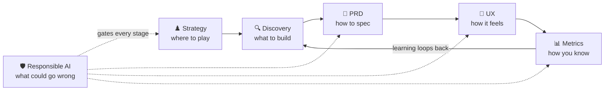

# 🎨 Product Craft for AI — Judgment, Not Just Knowledge

> **TL;DR:** Technical fluency without product craft is an ML engineer with a PM title. This section is the judgment layer: where to play, what to build, how to spec it, how it should feel, how you'll know it worked, and what could go wrong.

---

## 1. The six pages

| Page | What it gives you | When you'll use it |
|---|---|---|
| [♟️ AI Product Strategy](ai-product-strategy.md) | The value stack, the "wrapper" answer, the capability curve, business-model patterns, build vs. buy vs. wait | Roadmap/exec conversations; any "isn't this just a wrapper?" or platform-risk question |
| [🔍 Discovery for AI](discovery-for-ai.md) | The AI discovery funnel: AI-fit screen, data audit, feasibility spike, opportunity scoring | Before anything hits the roadmap — especially when someone says "we have an AI budget" |
| [📄 The AI PRD](prd-template-ai-feature.md) | Copy-paste template + worked example; the five sections classic PRDs lack | Writing the spec; the review checklist before you circulate it |
| [🎨 UX Patterns for AI](ux-patterns-for-ai.md) | Trust engineering: the pattern library, failure UX, calibrated friction, named references | Design partnership; any "design an AI feature" interview |
| [📊 Metrics for AI Products](metrics-for-ai-products.md) | The three-layer stack, the metrics menu, north star + guardrails, measurement traps | Defining success; post-launch reads; metrics interview loops |
| [🛡️ Responsible AI](responsible-ai.md) | Risk map, the five cases, fairness/privacy/security checklists, governance table | Launch reviews; senior loops probe this hard |

## 2. The lifecycle — who owns which stage

Two things to notice. **Metrics loop back to discovery** — the online numbers you promised in the PRD are the evidence for the next round of problem selection; a feature that ships and isn't measured teaches you nothing. And **responsible AI isn't a stage** — it's a gate on all of them. Risk discovered at launch review is risk you designed in three months earlier.

## 3. The five artifacts a strong AI PM produces

1. **A strategy memo** — where value accrues, what our moat actually is, and the honest answer to "what happens when the model beneath us gets 10× better?" ([strategy](ai-product-strategy.md))
2. **A feasibility spike result** — a number and a demo on real data, not a slide. The move that separates PMs who've shipped AI from those who've read about it. ([discovery](discovery-for-ai.md))
3. **An eval-gated PRD** — a quality bar that is a *number on a named dataset*, with regression policy and kill criteria. ([template](prd-template-ai-feature.md))
4. **A failure-UX spec** — every failure mode with a designed screen, a next step, and a measured rate target. ([ux-patterns](ux-patterns-for-ai.md))
5. **A metric tree with guardrails** — one north star, 2–4 guardrails that must not degrade, and counter-metrics for gaming. ([metrics](metrics-for-ai-products.md))

Each is a *falsifiable* artifact — it can be wrong, and you'd find out. That's the point. Vibes, demos, and adjectives are none of those things.

## 4. Ready to move on?

- [ ] Can you answer "isn't your product just a wrapper?" with four defensibility sources, not one?
- [ ] Can you run a discovery funnel out loud, ending in a spike + eval bar before roadmap commitment?
- [ ] Have you written a quality bar as a number on a named dataset, sliced by segment?
- [ ] Can you name three failure UX patterns and say when each applies?
- [ ] Can you draw the model → product → business metric chain for a feature, plus a guardrail?
- [ ] Can you name the lethal trifecta and the PM-level defenses against it?
- [ ] For any feature you'd propose: do you know the baseline it must beat — the human, rule, or template that exists today?

If a box is unticked, the page that owns it is in the table above.

---

➡️ **Next:** [04-build-with-ai](../04-build-with-ai/) — stop reading, start prototyping; the feasibility spike is a thing you can run yourself.

🔗 **Also:** [05-domains](../05-domains/) — the same craft, refracted through healthcare, fintech, edtech, and five more, where the constraints get specific.
