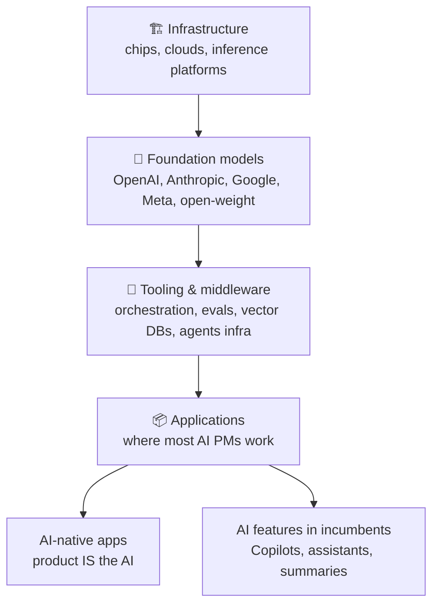
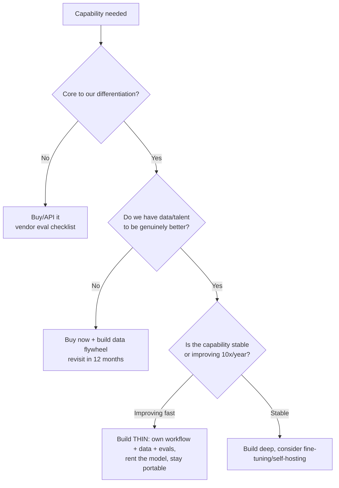

# ♟️ AI Product Strategy: Moats, Wrappers, and Where Value Accrues

> **TL;DR:** When every competitor can call the same API, the model is not the moat. Strategy in the AI era is about workflow depth, proprietary data flywheels, distribution, and timing capability curves, and about being honest about what happens when the platform beneath you improves.

---

## 1. The value stack: know where you sit

Each layer has different economics: infra sells compute to everyone; model providers fight a capability + price war; **application-layer margin depends on paying the layers below**, which is why unit economics ([model-selection-and-cost.md](../02-technical-depth/model-selection-and-cost.md)) is a strategy topic, not an engineering topic.

## 2. The "wrapper" question: the interview classic

*"Isn't your product just a wrapper around GPT/Claude?"* The honest framework:

| Defensibility source | Weak version | Strong version |
|---|---|---|
| **Workflow depth** | A chat box over the API | Deep embedding in how the work actually gets done: data in, approvals, integrations, audit trails (e.g., coding agents living inside the IDE + CI, not beside them) |
| **Proprietary data flywheel** | "We'll collect data eventually" | Usage generates labeled data that measurably improves the product, which attracts usage: a loop competitors can't shortcut |
| **Distribution** | Hoping for virality | Existing user base to deploy into (incumbents' advantage: Microsoft shipping Copilot to hundreds of millions of seats) |
| **Trust & compliance** | A privacy page | Certifications, BAAs, residency, evals evidence: 6-18 month moats in regulated domains |
| **Eval/quality infrastructure** | Prompt + vibes | A golden-set + regression machine that keeps quality provably above competitors as models churn underneath |
| **Cost structure** | Paying frontier prices for everything | Routing/distillation delivering same quality at 1/5 cost: pricing freedom competitors lack |

The strong one-liner: *"The model is the engine, not the car. Engines are becoming commodities; cars win on everything wrapped around the engine."*

## 3. The capability curve: strategy's clock

The most important strategic inversion in AI: **don't build for what models can do today; build for the trajectory.**

- **"If it sort-of works today, it will work next year."** Products built at the frontier's ragged edge (agents in 2024, computer-use in 2025) looked premature, then the models caught up, and the teams with 18 months of workflow, data, and evals kept the lead.
- **The corollary, the steamroller:** if your product's entire value is *compensating for a model weakness* (stitching context, fixing formatting, simple orchestration), the next model release may absorb it. Ask brutally: *does a 10× better model make us stronger or redundant?* Products that get stronger: those owning data, workflow, and distribution. Products that die: thin capability patches.
- OpenAI/Anthropic/Google shipping a feature adjacent to yours is the "platform risk" question. Answer it with the same test.

## 4. Where AI actually creates product value (the honest list)

Use this in any "where would you apply AI?" question. Value concentrates where:

1. **High-volume, pattern-heavy work**: support triage, document processing, code review, data entry. (Economics: cheap prediction replacing expensive repetition, the *Prediction Machines* frame.)
2. **Expertise bottlenecks**: one expert's judgment applied at scale (radiology triage, contract review, sales coaching).
3. **Blank-page problems**: first drafts of anything (email, code, designs, plans); humans are better editors than starters.
4. **Synthesis at scale**: 10,000 reviews/tickets/calls → themes; unreadable-by-humans volumes made legible.
5. **Personalization beyond segments**: per-user content, difficulty, recommendations (the classic ML value pool: Netflix's recommender was self-estimated at $1B+/year in retention value back in 2015).
6. **Interface transformation**: natural language over complex tools (SQL, BI dashboards, admin panels), shrinking time-to-competence.

And where it *doesn't*: deterministic calculations, zero-error-tolerance paths without human review, tasks where users enjoy the doing, and anywhere the failure UX costs more than the automation saves (see the drive-thru case in [failures](../06-case-studies/failures-hall-of-lessons.md)).

## 5. Business-model patterns for AI (with real anchors)

| Pattern | Example (verified) | When it works |
|---|---|---|
| **Freemium ladder** | GitHub Copilot: Free tier (Dec 2024) → Pro $10 → Business $19 → Enterprise $39/user/mo | Developer/prosumer products; free tier feeds the funnel & the flywheel |
| **Add-on → bundle** | Notion AI: $10/member add-on (2023) → folded into Business tier (May 2025) | Add-on while AI is novel; bundle once it's table-stakes and competitors include it |
| **Included as retention moat** | Zoom AI Companion free with paid plans (2023→), then paid tiers for advanced | When AI defends the core subscription rather than monetizing directly |
| **Usage/credits** | Prototyping tools (Lovable, v0, Figma AI credits) | Costs scale with use; aligns price to inference cost, adds budget anxiety |
| **Outcome pricing** | Support-agent vendors pricing per resolved ticket | When outcomes are cleanly attributable: the purest alignment, hardest to operationalize |
| **Seat uplift** | Microsoft 365 Copilot as per-seat add-on | Incumbent distribution + clear per-user value story |

Pricing questions to always ask: does price scale with our inference cost? What's the margin at P95 usage? What does abuse look like?

## 6. Build vs. buy vs. wait: the exec conversation

"Build" almost never means training a foundation model. It means owning the *application layer*: data, evals, workflow, UX. Renting intelligence is the default; owning judgment about quality is mandatory.

## 7. Case studies to wield in strategy interviews

- **GitHub Copilot**: capability-curve timing + distribution + freemium ladder → ~20M all-time users (2025), ~4.7M paid subs (Jan 2026). ([full case study](../06-case-studies/github-copilot.md))
- **Klarna's AI reversal**: optimizing the visible metric (cost/ticket) over the retention metric (CSAT) and having to walk it back publicly. Strategy = choosing the *right* success metric. ([case study](../06-case-studies/klarna-ai-assistant.md))
- **IBM Watson Health**: marketing ahead of capability + no ground-truth data strategy → $4B+ in, ~$1B out. The cautionary anchor for "AI strategy by press release." ([failures](../06-case-studies/failures-hall-of-lessons.md))
- **Duolingo**: decade of Birdbrain personalization data + first-mover GPT-4 partnership (Max, 2023) = flywheel + timing; then the 2025 "AI-first" memo backlash = strategy comms risk. ([case study](../06-case-studies/duolingo.md))

## 8. Self-test

1. A CEO says "add AI to everything, competitors are." Give your framework for where to start. *(Value list §4 × feasibility × risk; pick 1-2 wedges with measurable outcomes and a data flywheel; explicitly defer the rest.)*
2. Your AI startup's feature was just announced as a native capability by a model provider. Your move? *(Assess: do we win on workflow/data/trust/distribution? Reposition into the durable layer, integrate their capability rather than fight it, or exit the segment.)*
3. Design the data flywheel for an AI sales-email tool. *(Drafts → edits/accepts as implicit labels → per-team style + outcome data (reply rates) → measurably better drafts → more usage. Name the consent and privacy line.)*

---

➡️ **Next:** [Discovery for AI products](discovery-for-ai.md)
