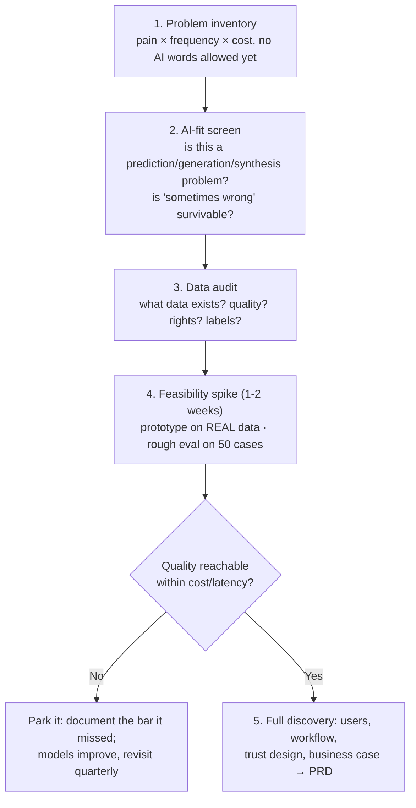

# 🔍 Discovery for AI Products: Finding Problems Worth a Model

> **TL;DR:** AI discovery is classic discovery (problems, not solutions) plus two new gates: a *feasibility spike* because you can't know if AI can do the job until you try it on real data, and a *data audit* because the model is only as good as what feeds it.

---

## 1. The anti-pattern this page exists to kill

> "We have an AI budget. What can we build with it?"

Solution-first AI discovery produces demo-ware: features that impress in all-hands and get 4% weekly usage. The 2025 McKinsey State of AI survey found roughly **two-thirds of organizations still stuck in pilot/experiment mode** with AI. Pilots die when they were never anchored to a costly problem. Start where discovery always starts: *what's expensive, slow, error-prone, or hated today?*

## 2. The AI discovery funnel

### Stage 2: the AI-fit screen (four questions)
1. **Task type fit**: prediction, classification, generation, extraction, synthesis, ranking? If it's arithmetic or rules, use code.
2. **Error tolerance**: what happens when it's wrong? Who catches it, at what cost? ("Wrong = mild annoyance + easy correction" = great fit. "Wrong = irreversible harm" = needs human-in-loop by design.)
3. **Better-than-baseline**: what's the current best alternative (a human, a rule, a template)? AI must beat *that*, not zero. The McDonald's drive-thru AI failed against a very good human baseline at the point of use.
4. **Volume & repetition**: value scales with frequency; a task done 50×/day/user justifies what a monthly task never will.

### Stage 3: the data audit (PM-led, before eng commits)
| Question | Why it kills projects |
|---|---|
| Does the needed data exist, digitized, accessible? | "It's in people's heads / on paper / in a vendor's silo" ends many AI dreams |
| Is it *good*? (current, consistent, deduplicated) | RAG over a stale wiki ships confident wrong answers |
| Do we have **rights**? (consent, contracts, PII, residency) | Enterprise deal-breakers and regulatory exposure surface here, not in legal review after build |
| Are there labels / can usage generate them? | Determines supervised options and the flywheel potential |
| Amazon's recruiting-tool lesson | Historical data encodes historical bias: audit *what the labels actually reward* before training on them |

### Stage 4: the feasibility spike
The AI-specific twist: **you cannot scope what you haven't prototyped.** Timebox 1-2 weeks: hack a prompt/RAG prototype on real data (tools: [04-build-with-ai](../04-build-with-ai/)), run it on ~50 real cases, score roughly. Output is a *number and a demo*, not a slide. This is also where PM-built prototypes shine: you can run this spike yourself before asking for eng time.

## 3. User research twists for AI

- **Research the workflow, not the wow.** Users rate AI demos highly and then don't adopt. Instrument the *job*: where in their flow would this live? What do they do with the output? What's their verification cost?
- **Watch verification behavior.** The killer adoption question is "how long does it take to check the AI's work?" If verifying takes as long as doing, value ≈ zero (a common finding in coding-assistant research).
- **Probe trust boundaries.** Ask: "what would this need to get right for you to rely on it?" and "what mistake would make you never use it again?" The answers define your quality bar and failure UX ([ux-patterns](ux-patterns-for-ai.md)).
- **Expectation-setting is part of the product.** Users arrive with ChatGPT-calibrated expectations; your scoped feature must communicate what it can't do or it will be judged against AGI.

## 4. Prioritizing AI opportunities: a scoring lens

Score 1-5 each; multiply. Use for portfolio conversations:

| Dimension | 5 looks like |
|---|---|
| Problem value | Frequent + costly + user-hated today |
| AI advantage | AI is 10× the baseline, not 1.1× |
| Data readiness | Clean, owned, labeled or self-labeling |
| Error survivability | Wrong answers cheap to catch & correct |
| Feasibility spike result | Hit quality bar on real data at viable cost |
| Strategic fit | Feeds a flywheel/moat ([strategy](ai-product-strategy.md)) |

A "5" on value with a "1" on error survivability is a *human-in-the-loop* product, not a no-go. The score shapes the design, not just the ranking.

## 5. Interview drill: "How would you decide what AI feature to build for [product]?"

Structure that scores: ① users & top pains (pick a segment, name 3 pains) → ② screen each with AI-fit questions → ③ data reality-check → ④ pick the wedge, justify vs. baseline → ⑤ feasibility spike + eval bar before committing roadmap → ⑥ define success metrics + failure UX up front. The differentiating move: mentioning the *spike and eval bar* between idea and roadmap. That's what separates candidates who've shipped AI from those who've read about it.

## 6. Self-test

1. Sales VP: "Build an AI that writes all our proposals." Run the funnel out loud. *(Problem: proposal drafting time? win rate? Fit: generation, human reviews before send = survivable errors. Data: past proposals + win/loss labels; rights? quality? Spike: 50 real RFPs, draft quality rubric-scored by sales. Then decide.)*
2. Your feasibility spike scores 62% on the golden set; the bar is 85%. Options? *(Narrow the scope to the subtask where it scores 90%; add retrieval/better prompts; change the design so humans cover the gap; or park with a documented bar and revisit as models improve.)*
3. Why is "error survivability" a design input rather than a veto? *(Because human-in-the-loop, confidence thresholds, and reversibility patterns convert high-stakes tasks into shippable assisted workflows.)*

---

➡️ **Next:** [The AI PRD template](prd-template-ai-feature.md)
