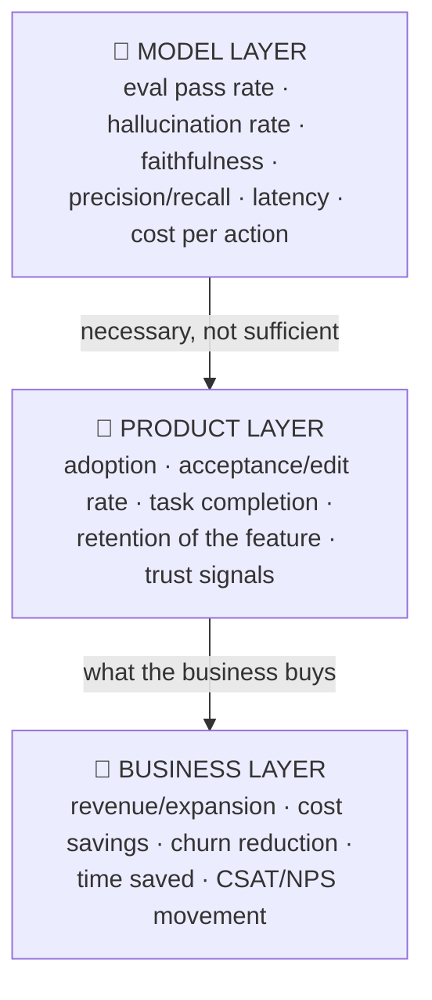

# 📊 Metrics for AI Products: Measuring the Probabilistic

> **TL;DR:** AI product metrics live on three layers (model quality, product engagement, and business impact) connected by a causal chain you must be able to draw. The classic interview failure is quoting model metrics when asked about product success.

---

## 1. The three-layer stack

The connecting sentence to rehearse: *"Model quality is a hypothesis about product value; product engagement is a hypothesis about business impact; each layer needs its own metrics and the links need testing."* A model that gets 5 points better on evals but doesn't move acceptance rate is a research win and a product no-op.

## 2. The AI metrics menu (pick, don't hoard)

### Model layer (from your evals: [details](../02-technical-depth/evals.md))
| Metric | Watch for |
|---|---|
| Eval/rubric pass rate (sliced!) | Aggregate hiding segment failures |
| Hallucination / faithfulness rate | The trust killer; measure on grounded tasks |
| Refusal correctness (right refusals vs. over-refusal) | Over-refusal quietly kills utility |
| Precision/recall at chosen threshold | Threshold = product decision |
| p50/p95 latency, TTFT | p95 is the experience for your busiest users |
| Cost per action | Margin early-warning |

### Product layer
| Metric | Why it's the real signal |
|---|---|
| **Adoption**: % eligible users who try; **habit**: % who use weekly | AI features are notorious for high try, low stay |
| **Acceptance rate** (drafts/suggestions accepted) | The workhorse metric of assistant UX |
| **Edit distance** on accepted output | Accepted-but-heavily-rewritten = shallow value |
| **Task completion rate** (agents) | Outcome, not activity |
| **Regeneration / retry rate** | Frustration proxy |
| **Escalation/fallback rate** | Where AI hands off: quality + coverage signal |
| **Trust signals**: citation clicks, "check source" taps, report rate | Leading indicators of the relationship |
| Feature retention curve | Distinguishes novelty spike from durable value |

### Business layer
Time saved (measured, not surveyed, where possible) · deflection/automation rate **paired with CSAT** · revenue attach/expansion · churn delta · cost-to-serve. **Always pair an efficiency metric with a quality guardrail.** Klarna's cost-per-ticket triumph (Feb 2024) became a public reversal (May 2025) because quality wasn't guarded with equal weight.

## 3. North star + guardrails: the standard pattern

For any AI feature, define:
1. **One north star** at the product/business layer (e.g., median handle time on eligible tickets; weekly tasks completed with AI).
2. **2-4 guardrails** that must not degrade: CSAT, error/complaint rate, policy violations, cost per action, (for agents) override rate.
3. **Counter-metrics for gaming**: if the north star is "AI-resolved %," watch reopen rate and silent churn of users who stopped contacting support at all.

## 4. AI-specific measurement traps

| Trap | What happens | Defense |
|---|---|---|
| **Novelty inflation** | Week-1 usage 5× week-8 | Judge at 30/60/90 days; cohort curves, not launch spikes |
| **Vanity volume** | "10M AI messages sent!" | Messages ≠ outcomes; measure completed jobs |
| **Survey-only value** | "Users say it saves 2 hrs/wk" | Instrument the workflow where possible; surveys anchor, logs verify |
| **Average hiding P95** | Fine on average, awful for power users | Slice by usage decile, segment, language |
| **Offline-online gap** | Evals up, acceptance flat | Golden set drifted from production distribution; refresh it |
| **Feedback selection bias** | Thumbs come from extremes | Weight implicit signals (edits, retries, abandonment) |
| **Efficiency without quality guardrail** | The Klarna pattern | Pair every cost metric with a satisfaction metric of equal standing |

## 5. Experimentation with AI features: what changes

- **A/B still rules**, but: outputs are non-deterministic (bigger samples or paired designs), effects are heterogeneous (segment before averaging), and novelty effects are strong (run longer).
- **Shadow mode** is your friend pre-launch: generate silently, score offline, compare against the human/status-quo action.
- **Model/prompt changes are experiments too.** Canary them like features, gated on both eval scores and live guardrails.
- Holdouts: keep a small long-term no-AI holdout where feasible; it's the only clean read on durable business impact (and on skill-atrophy/second-order effects).

## 6. Benchmark numbers worth knowing (verified; for calibration, not gospel)

- GitHub's controlled study (2023, n=95): Copilot users completed a coding task **55.8% faster**. That's the canonical "AI productivity stat," and an RCT, not telemetry (arXiv:2302.06590).
- Netflix (2015 paper): personalization influences ~**80% of hours streamed**; self-estimated retention value **>$1B/yr**. The classic ML-value citation, now a decade old; date it when you use it.
- Klarna (Feb 2024): AI assistant handled **2/3 of support chats** in month one, est. **$40M** profit improvement, followed by the 2025 quality walk-back. Cite both halves.
- McKinsey State of AI (Nov 2025): **88%** of orgs use AI somewhere; only **~39%** see enterprise-level EBIT impact. The adoption-vs-value gap in one pair of numbers.

## 7. Interview drills

**"You launch a new embedding-model API. Top 3 success metrics?"** *(Published AI PM question.)* Think platform: adoption (weekly active API keys / orgs integrating), usage depth (embeddings generated, retention of usage), quality-in-the-wild (retrieval benchmark vs. competitors, customer-reported relevance), plus guardrails: latency p95, error rate, cost per 1M tokens vs. plan.

**"Define success for an AI meeting-notes feature."** North star: % of meetings where notes were *shared or referenced afterward* (value realized, not generated). Guardrails: factual-error report rate, attendee-name accuracy (code-checked), latency to notes ready. Counter-metric: are people skipping meetings' action-item follow-through because "the AI has it"?

**"Metrics for Meta's AI chat inside WhatsApp?"** Layer it: model (response quality evals, refusal correctness), product (weekly conversers, retention curve, conversation depth, block/mute rate as trust guardrail), business (engagement lift on core surface, without cannibalizing messaging satisfaction).

## 8. Self-test

1. Draw the metric chain for an AI code-review assistant, one metric per layer, plus one guardrail. *(e.g., eval: true-issue precision on golden PRs → product: % suggestions accepted → business: escaped-defect rate; guardrail: PR cycle time not increasing.)*
2. Acceptance rate is 60% and rising while retention of the feature falls. Three hypotheses. *(Novelty decay among casual users while power users stay; acceptance easy but value shallow, so check edit distance and downstream outcomes; the eligible-trigger set shrank, concentrating survivors.)*
3. Why is "deflection rate" dangerous alone for a support AI? *(It counts conversations that ended, not problems solved. Pair with reopen rate, CSAT, and did-they-come-back-angry measures. Klarna is the case study.)*

---

➡️ **Next:** [Responsible AI](responsible-ai.md), the risk layer every senior loop probes.
