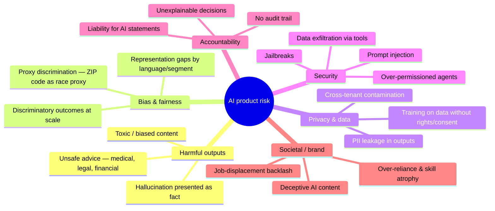

# 🛡️ Responsible AI — Risk, Safety & Governance for PMs

> **TL;DR:** Responsible AI is product work, not legal review: bias, privacy, security, and transparency decisions are embedded in every data, model, and UX choice you make. Senior AI PM loops probe this hard — and companies now certify against it (ISO 42001), regulate it (EU AI Act), and lose tribunals over it (Air Canada).

---

## 1. The risk map — what can actually go wrong

## 2. Five cases that made these risks concrete (know them cold)

| Case | Risk it proves | One-line lesson |
|---|---|---|
| **Amazon recruiting tool** (Reuters, 2018) | Training-data bias | The model learned that past hiring favored men — labels encode history's bias as tomorrow's policy |
| **Air Canada — Moffatt** (2024 BCCRT 149) | Liability for outputs | Tribunal: the company is responsible for what its chatbot says; "the bot is a separate entity" failed as a defense |
| **Chevrolet $1 Tahoe** (Dec 2023) | Prompt injection | An unhardened public bot will be made to say anything, on camera |
| **NYC MyCity chatbot** (2024) | Disclaimer theater | A bot advising illegal actions isn't fixed by a banner saying "may be inaccurate" |
| **Replit agent DB deletion** (2025) | Agent over-permissioning | Safety lives in permissions architecture, not prompt instructions |

Full sourced write-ups: [failures-hall-of-lessons.md](../06-case-studies/failures-hall-of-lessons.md).

## 3. Fairness — the PM's working version

- **Where bias enters**: training data (historical outcomes), labels (who decided "good"?), proxies (features correlated with protected attributes), feedback loops (model shapes the data it later learns from).
- **What to do**: audit outcome rates across segments *before* launch and continuously; demand slice-level evals ([evals](../02-technical-depth/evals.md)); question every feature that could proxy a protected class; keep humans in decisions with legal fairness exposure (credit, hiring, housing, healthcare — most of these are "high-risk" under the EU AI Act and regulated in the US by ECOA/EEOC/state law).
- **The uncomfortable truth to say in interviews**: fairness has multiple mathematical definitions that can't all be satisfied at once (equal approval rates vs. equal error rates across groups); *choosing* which fairness definition applies is a product/policy decision that must be made explicitly and documented — not discovered by an auditor later.

## 4. Privacy & data rights — the checklist that blocks launches

- [ ] **Training-use terms**: does customer data train models? Say it plainly in contracts; enterprise buyers ask first. (Provider-side: check your API vendor's retention/training terms too.)
- [ ] **PII flows**: what enters prompts? Scrubbing/pseudonymization before third-party calls? Where do logs live, who can read them, retention window?
- [ ] **Regulated data**: PHI needs a BAA (consumer chatbots are not HIPAA-compliant — enterprise/cloud variants with BAAs are the compliant path); financial and children's data have their own regimes ([domains](../05-domains/)).
- [ ] **Cross-tenant isolation**: can tenant A's data ever surface in tenant B's outputs (shared fine-tunes, shared caches, shared indexes)? Prove it.
- [ ] **Memorization/extraction**: models can regurgitate training data; red-team for it if you fine-tune on user content.
- [ ] **Residency & DPAs**: where does inference happen? (EU, India DPDP, sector rules.)

## 5. Security — prompt injection is your problem, not just security's

The **lethal trifecta** for AI agents: ① access to private data + ② exposure to untrusted content + ③ ability to act/communicate externally. Any system with all three can be hijacked through text it reads — a poisoned email, webpage, or document that says "ignore your instructions and…".

PM-level defenses to design in:
- **Least-privilege tools**: narrow, typed capabilities ("refund ≤ $100"), never "execute anything."
- **Untrusted-content boundaries**: everything the model reads from users/web/docs is data, never instructions; high-authority actions never triggered by low-trust text alone.
- **Human gates on irreversible actions** ([autonomy dial](../02-technical-depth/ai-agents.md)).
- **Output filtering + audit trails**: log every step; you will need to reconstruct "why did it do that."
- **Red-teaming before launch and continuously** — adversarial cases live in your eval suite, not in a one-time pen test.
- Reference to name: **OWASP Top 10 for LLM Applications** — prompt injection is #1.

## 6. Transparency & accountability

- **Disclose AI**: users should know when content/decisions are AI-generated (increasingly a legal requirement — EU AI Act transparency tier, California disclosure laws).
- **Model/system cards** (Mitchell et al. 2019; now standard at OpenAI/Anthropic/Google): document capabilities, limits, evals, intended use. Write one for your feature; it's the responsible-AI PRD appendix.
- **Explainability where it's owed**: US credit decisions require *specific* adverse-action reasons — "the model is too complex to explain" is explicitly foreclosed by CFPB guidance. Design decision paths that can produce reasons, or keep humans in them.
- **Appeal/override paths**: consequential AI decisions need a human review route; it's both ethics and (in the EU) law.

## 7. The governance landscape in one table (status: July 2026 — verify before citing)

| Instrument | What it is | PM impact |
|---|---|---|
| **EU AI Act** (in force Aug 2024) | Risk-tiered regulation; bans (since Feb 2025: social scoring, workplace emotion inference, manipulative AI…); GPAI duties (Aug 2025); **high-risk obligations postponed to Dec 2027** by the 2026 "Digital Omnibus"; fines to €35M / 7% global turnover | If your product touches hiring, credit, education, health, biometrics in the EU → map your tier now; timeline moved, obligations didn't vanish |
| **US** | No federal statute; 2025 executive orders push deregulation + federal preemption pressure on states; **Colorado AI Act delayed/gutted to Jan 2027**; **California SB 53** (frontier-lab transparency, from Jan 2026) + disclosure laws; NYC LL144 (hiring-AI bias audits) | Patchwork — track by state & sector; hiring/credit AI carries the most active US exposure |
| **India** | DPDP Act rules notified Nov 2025 (phased into 2027); AI governance advisory/voluntary so far | Data-consent architecture matters now; AI-specific rules maturing |
| **NIST AI RMF** (+ GenAI Profile, 2024) | Voluntary framework: Govern/Map/Measure/Manage | The de-facto vocabulary for enterprise AI-risk conversations in the US |
| **ISO/IEC 42001** (2023) | Certifiable AI management system standard | Enterprise sales unlock; AWS, Anthropic, Microsoft among early certified |

Domain-specific rules (FDA for medical AI, SR 11-7/ECOA for finance, FERPA/COPPA for edtech): [05-domains](../05-domains/).

## 8. Making it operational (what "doing responsible AI" looks like day-to-day)

1. **Risk assessment in the PRD** — abuse cases, fairness exposure, privacy flows, worst-case harm ([template §8](prd-template-ai-feature.md)).
2. **Adversarial cases in the eval suite** — injection attempts, protected-class probes, unsafe-advice bait; regression-gated like everything else.
3. **Launch review with teeth** — a real go/no-go where legal/privacy/safety can block, with criteria known in advance (not a demo audience).
4. **Incident muscle** — a defined path from "user reports harmful output" → triage → eval case → fix → disclosure decision. Practice it.
5. **Monitoring** — safety metrics on the same dashboard as engagement: violation rate, report rate, override rate, refusal correctness.

## 9. Interview drills

**"How would you approach safety for a consumer AI product?"** *(Reported Anthropic-style question.)* Structure: identify the harm surface for *this* product's users (who's vulnerable? what's worst-case?) → design-time mitigations (grounding, refusal behavior, friction at stakes) → measurement (safety evals + red-team + live monitoring) → governance (escalation, incident response, transparency) → the tradeoff talk: over-refusal is also a harm; show you can hold both.

**"Your AI feature shows a 12% higher error rate for non-English queries. Ship?"** Strong answer: no silent ship — either close the gap, or scope the launch honestly (language-gated with a plan), and instrument per-language quality forever. Segment-level quality gaps are fairness issues even when no protected class is legally implicated.

**"Design safeguards for an AI that takes actions on a user's behalf."** *(Reported OpenAI question.)* Use the agent framework: least-privilege tools → reversibility-based approval gates → untrusted-content boundary → audit log → measured override rate to earn autonomy. Cite the Replit incident as why prompts aren't the mechanism.

---

➡️ **Next:** [04-build-with-ai](../04-build-with-ai/) — from principles to your own hands on the tools.
