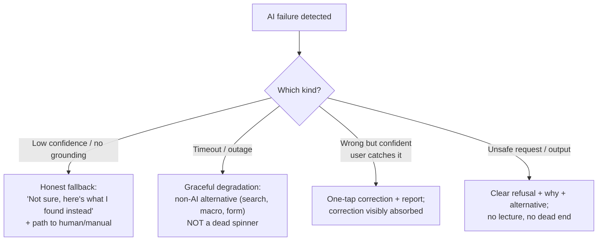

# 🎨 UX Patterns for AI: Designing for Non-Determinism and Trust

> **TL;DR:** AI UX is trust engineering. The model will sometimes be wrong; great AI products make wrongness cheap: easy to spot, easy to correct, easy to forgive. Users don't need a perfect model; they need a *predictable relationship* with an imperfect one.

---

## 1. The trust ledger

Every interaction credits or debits user trust, and debits are ~5× the size of credits. One confident wrong answer in a demo can undo weeks of good ones (ask Google: Bard's single factual error in its Feb 2023 launch demo coincided with a ~$100B market-cap drop). Design goals, in order: **make errors visible → recoverable → rare.** Note the order: visibility beats rarity, because users calibrate on what they can see.

## 2. The core pattern library

### 2.1 Entry & framing
| Pattern | What | When |
|---|---|---|
| **Contextual suggestion** | AI offers where the user already works (draft appears in reply box) | Default: meet users mid-workflow |
| **Explicit invocation** | Button/command ("✨ Summarize") | User control; low ambient cost |
| **Ambient/proactive** | Auto-surfaced insights, nudges | Only with high precision: wrong proactive AI is spam |
| **Scoped promise** | Empty-state copy says what it's *for* ("I answer questions about your billing data") | Always: unscoped chat boxes inherit ChatGPT-sized expectations, then miss them |

### 2.2 During generation
- **Stream everything** conversational (perceived latency ÷ 5).
- **Show work in progress** for long tasks: steps, sources being read, progress. It buys patience and builds trust ("reasoning... searching your docs...").
- **Interruptibility**: stop/redirect mid-generation for anything > a few seconds.

### 2.3 Output & trust calibration
| Pattern | What it does | Example |
|---|---|---|
| **Citations / sources** | Lets users verify instead of believe | RAG answers linking the KB article ([rag.md](../02-technical-depth/rag.md)) |
| **Confidence signaling** | Vary presentation by certainty: assertive vs. hedged vs. "I don't know, here's what I found" | Never uniform confidence; that's how chatbots end up in tribunals ([Air Canada case](../06-case-studies/failures-hall-of-lessons.md)) |
| **Draft framing** | Position output as *draft for your review*, not *answer* | "Here's a draft" changes verification behavior and blame allocation |
| **Highlight the checkable** | Mark names, numbers, dates for quick human verification | AI meeting notes highlighting all commitments |
| **Diff, don't replace** | Show what AI changed | Edits to user's own text especially |
| **Refusal as a feature** | A designed, helpful "I can't answer that" (+ next step) | Measured in evals; the alternative is hallucination |

### 2.4 Correction & feedback
- **Make editing cheaper than re-prompting**: inline edit, regenerate-with-instruction, tone/length toggles.
- **Instrument implicit feedback**: accept rate, edit distance, regenerations, abandonment. These are your real quality signals ([evals.md](../02-technical-depth/evals.md)); explicit thumbs get very low participation by comparison.
- **Close the loop visibly**: "tell it what went wrong" that provably improves things builds compounding trust.

### 2.5 Agency & autonomy surfaces
For agents ([ai-agents.md](../02-technical-depth/ai-agents.md)): **plan preview** ("here's what I'm about to do") → **approval gates** for consequential actions → **activity log** users can audit → **undo as sacred**. Reversibility is the strongest trust primitive that exists.

## 3. Failure UX: design the bad day first

PM rule: **every failure mode in your PRD has a designed screen, a next step, and a metric.** "Fails gracefully" written in a doc with no mock and no measured rate is how you end up as a case study. The McDonald's drive-thru pilot died less from error *rate* than from error *recovery*: customers trapped in a correction loop, publicly ([failures](../06-case-studies/failures-hall-of-lessons.md)).

## 4. Friction as a feature: calibrated, not minimal

Classic UX minimizes friction. AI UX *places* friction where errors are expensive:

| Stakes | Right friction |
|---|---|
| Low (draft a tweet) | None: generate freely |
| Medium (send email to a customer) | Preview + explicit send |
| High (refund, code merge, medical/legal output) | Human review gate, second confirmation, audit trail |

Anti-patterns to name in interviews: **auto-apply** of AI output where users expected a suggestion; **fake confidence** (uniform assertive tone); **anthropomorphic overpromise** (cute persona writing checks the model can't cash); **disclaimer theater** (a banner instead of grounding; see NYC's MyCity chatbot); **feedback black holes**.

## 5. Special surfaces, quick guidance

- **Chat**: powerful but a UX of last resort for repeated workflows; recurring jobs deserve buttons, not prose. Suggest starter prompts; retain context visibly.
- **Autocomplete/copilots**: latency <300ms rules everything; accept-rate is the north-star signal; wrong suggestions must be ignorable at zero cost (that's why ghost-text works).
- **Summaries**: link every claim back to the source span; "expand to original" everywhere.
- **Voice**: no visual affordance for confidence → design verbal confirmations for consequential actions; error recovery is 10× harder (again: drive-thru).
- **Generative media**: variations > single output (picking beats judging); provenance labeling increasingly expected/regulated.

## 6. Reference vocabulary for interviews

Name-drop accurately: **Google's People + AI Guidebook (PAIR)**, the canonical pattern reference (pair.withgoogle.com); **Microsoft's Guidelines for Human-AI Interaction** (18 numbered guidelines, CHI 2019); **"human-in-the-loop" / "human-on-the-loop"** (approval-gated vs. monitoring-after); **mixed-initiative interfaces** (the academic root of copilot design).

## 7. Interview drill: "Design the UX for an AI feature that summarizes long email threads"

Strong answer walks: user & moment (opening a 40-message thread, mobile, 30 seconds) → entry (auto-offer collapsed summary card, explicit expand, proactive but ignorable) → output design (3 bullets max, **names/dates/asks highlighted**, tap-to-jump-to-source-message = citations) → trust (never states commitments without linking the message; "AI summary: check important details" framing early, relaxed as accept-rate proves out) → failure (thread too ambiguous → "couldn't summarize confidently, key messages flagged instead") → feedback (edit/correct inline; instrument expand-then-scroll as an implicit "summary missed something" signal) → metrics (open-to-action time, summary-expand rate, correction rate, complaint rate).

## 8. Self-test

1. Why show sources even if users rarely click them? *(Verifiability is a trust signal in itself; the option to check calibrates reliance; and click-through spikes are your early-warning quality metric.)*
2. Your AI feature's accept-rate is 70% but NPS comments say "it's often wrong." Diagnose. *(Errors concentrated in a visible, memorable minority: check severity-weighted quality, not average; one bad category poisons perception; fix the worst intent or make its errors visible/recoverable.)*
3. When is *adding* friction the right call? Give two examples. *(Approval gate before an agent issues refunds; confirmation with diff before AI rewrites a user's saved document.)*

---

➡️ **Next:** [Metrics for AI products](metrics-for-ai-products.md)
