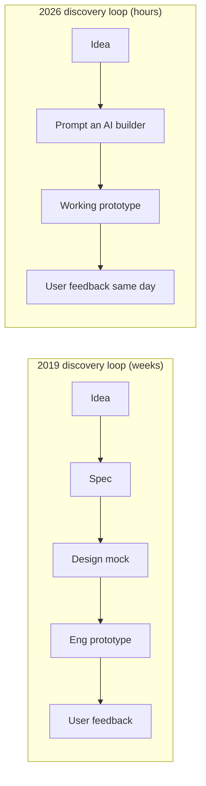

# 🛠️ Build With AI — The PM's Toolbox

> **TL;DR:** "What have you built?" is now a standard AI PM interview question. This section gives you the verified 2026 tool stack and [five portfolio projects](projects.md) that answer it. A PM who prototypes compresses discovery from weeks to hours — PRD to clickable prototype in an afternoon.

> 🗓️ **Tool facts verified July 2026.** Pricing and ownership in this space change quarterly — Windsurf changed owners in the last 18 months and Cursor's acquisition is pending. Treat prices as indicative; check current pages.

---

## 1. Why PMs build now

The discovery loop changed shape:

What building gets you beyond speed: **feasibility intuition** (you've felt where models break), **credibility with eng** (you speak from contact with the problem), and **interview evidence** (Meta now runs a "Product Sense with AI" round with live AI prototyping; a portfolio beats claims everywhere else).

## 2. The prototyping stack (verified active, July 2026)

| Tool | What it does | Pricing (indicative) | Best for |
|---|---|---|---|
| **v0** (Vercel) — v0.app | Prompt → React UI/web app | Free tier; Pro ~$20/mo | Highest-fidelity web UI mockups |
| **Lovable** — lovable.dev | Prompt → full-stack app (DB included) | Free daily credits; Pro ~$25/mo | Non-engineers shipping working apps — the current default recommendation |
| **Bolt.new** (StackBlitz) | Prompt → full-stack app in browser | Free token allowance; Pro ~$25/mo | Quick full-stack experiments |
| **Replit** + Agent | Cloud IDE + agent that builds & deploys | Free starter; Core ~$25/mo | Prototypes that need real deployment/DB |
| **Claude** (Artifacts / Claude Code) | Chat-built interactive artifacts; agentic coding in terminal | Pro ~$17–20/mo | Interactive prototypes from a conversation; Claude Code for real repos |
| **Figma Make** | Prompt → prototype inside Figma | Included in paid Figma seats (credit-based) | Teams already living in Figma |
| **Cursor** / **Windsurf** | AI-native IDEs | Free tiers; Pro ~$15–20/mo | PMs comfortable in code; pairing with eng |
| **Google AI Studio** | Free playground for Gemini models + API keys | Free tier | Testing model behavior, quick API experiments |
| **ChatGPT / Custom GPTs** | Assistant + shareable custom bots | Free/Plus | Fast persona & prompt experiments |

*Recent churn worth knowing:* ChatGPT's Canvas was folded into inline chat blocks (2026); Windsurf was acquired by Cognition (2025); Cursor's acquisition by SpaceX was announced June 2026 (pending close). Moral: never anchor a workflow—or an interview answer—to a tool's ownership status without checking.

## 3. The eval & observability stack (what your eng team likely uses)

PM-relevant so you can read the dashboards and ask for gates: **Braintrust** (eval-first, CI regression gates) · **LangSmith** (LangChain ecosystem tracing/evals) · **Langfuse** (open-source observability) · **Arize Phoenix** (open-source tracing/evals) · **W&B Weave** · **DeepEval** (pytest-style OSS evals) · **PromptLayer** (prompt registry, non-technical-friendly) · **Vellum**, **Galileo**, **Patronus AI** (enterprise eval/guardrails). ☠️ Humanloop shut down Sept 2025 (team joined Anthropic) — a reminder to check vendor pulse before recommending. What to demand from whatever tool: named datasets, scored runs, and a gate before ship ([evals](../02-technical-depth/evals.md)).

## 4. The AI-powered PM workflow (day-to-day leverage)

| PM job | AI leverage (verified patterns) |
|---|---|
| PRD drafting | ChatPRD (purpose-built, 100K+ PMs) or Claude/ChatGPT with your PRD template as a project/custom instruction |
| User research synthesis | Transcripts/tickets → themes with citations; Dovetail's AI research repo ("Ask Dovetail") if your org has it |
| Competitive analysis | Deep-research modes (ChatGPT/Claude/Gemini) with *source-checking discipline* — treat outputs as leads, not facts |
| Data pulls | Natural language → SQL (verify against known numbers before trusting) |
| Prototyping | The stack above; Lenny's Newsletter has the canonical guide (Colin Matthews, "A guide to AI prototyping for product managers") |
| Meeting/status overhead | AI notes + drafted updates — reclaim hours; edit before sending, your name is on it |

The meta-skill: **use AI on everything once, keep it where verification cost < value produced.** That judgment — where AI helps vs. where checking eats the gain — is itself the AI PM skill.

## 5. Learn the APIs (half a day, no CS degree)

Every AI PM should have called a model API directly once — it demystifies tokens, latency, system prompts, and cost more than any article:

1. Get a key: Google AI Studio (free tier), or OpenAI/Anthropic (a few dollars of credit).
2. In the provider playground/workbench: set a system prompt, adjust temperature, watch tokens count up, force JSON output.
3. Free deep-dives when hooked: **Anthropic Academy** (anthropic.com/learn — free courses on API + prompting + MCP), **OpenAI Academy**, Microsoft's **Generative AI for Beginners** (GitHub, 21 lessons).

Then go build: **[the five projects →](projects.md)**

---

➡️ **Also in this section:** [projects.md](projects.md) — the portfolio that gets interviews.
