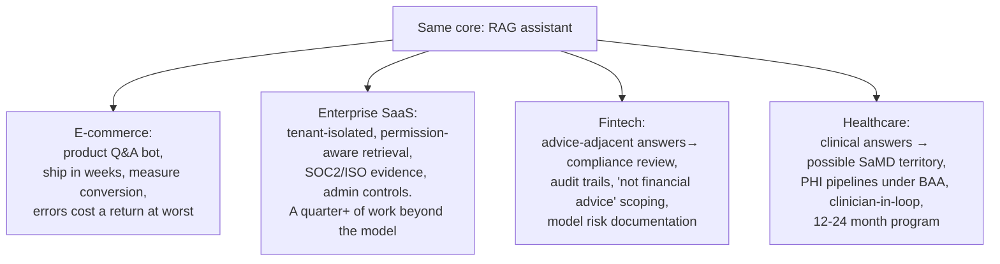

# 🌐 AI PM by Domain: Same Craft, Different Physics

> **TL;DR:** The AI PM toolkit is universal; the *constraints* are not. Error tolerance, regulation, data availability, and buyer behavior differ so much across domains that the same feature idea can be a quick win in e-commerce and a multi-year regulated program in healthcare. Interviewers test whether you adapt your approach to the domain in front of you.

---

## The domain physics table

| Domain | Error tolerance | Regulatory weight | Data situation | Human-in-loop norm | Deep dive |
|---|---|---|---|---|---|
| 🏥 Healthcare | Very low (patient harm) | ★★★★★ FDA, HIPAA, EU high-risk | Rich but siloed, consent-heavy | Mandatory for clinical decisions | [healthcare.md](healthcare.md) |
| 💳 Fintech | Very low (money, law) | ★★★★★ SR 11-7, ECOA, AML | Excellent, labeled, regulated use | Mandatory for credit/large sums | [fintech.md](fintech.md) |
| 🛒 E-commerce & retail | High (bad rec = shrug) | ★★ consumer/privacy law | Abundant behavioral data | Rare | [ecommerce-retail.md](ecommerce-retail.md) |
| 🏢 Enterprise SaaS / B2B | Medium (brand & contracts) | ★★★ via customers' industries | Customer-owned; tenancy is everything | Configurable per customer | [enterprise-saas.md](enterprise-saas.md) |
| 📱 Consumer & social | Medium (scale amplifies) | ★★★ content, minors, DSA | Massive engagement data | Rare (moderation aside) | [consumer-social.md](consumer-social.md) |
| 👨‍💻 Developer tools | Medium-high (devs verify) | ★ (license/IP questions) | Public code + telemetry | Built into workflow (review, CI) | [developer-tools.md](developer-tools.md) |
| 🎓 EdTech | Medium (pedagogy + minors) | ★★★ FERPA/COPPA, minors | Rich learning signals | Teacher oversight expected | [edtech.md](edtech.md) |

## How the same idea changes shape across domains

**Feature idea: "AI assistant that answers users' questions from documents."**

Same architecture; the product work multiplies 1× → 10× with domain stakes. This is why "how would you build X **in domain Y**" is such a common senior interview format: the domain is the question.

## The 5 questions that port across any domain

Walk into any domain interview with these:

1. **What does an error cost, and who absorbs it?** (a bad movie rec vs. a bad dosage suggestion)
2. **Who regulates this, and what specifically triggers their jurisdiction?** (the *feature*, not the company, determines exposure; an "e-commerce" company doing credit is doing fintech)
3. **Where's the data, who owns it, and what consent covers it?**
4. **What's the human baseline, and where must humans stay?**
5. **Who's the buyer vs. the user, and what do *they* each need to trust it?** (B2B: the CISO buys, the analyst uses)

## Picking your domain (career lens)

- **Match your background**: domain expertise + AI PM skills is the strongest combo in hiring right now. A nurse-turned-PM beats a generalist for health AI roles ([transition guides](../08-career/transition-guides.md)).
- **Regulated domains = deeper moats, slower loops.** Choose by temperament: weekly ship cadence (consumer, e-comm) vs. high-stakes craftsmanship (health, fintech).
- **Interview prep implication:** go deep on **one** domain (your target) and stay conversant in two others. The compare-and-contrast is where senior candidates shine.
