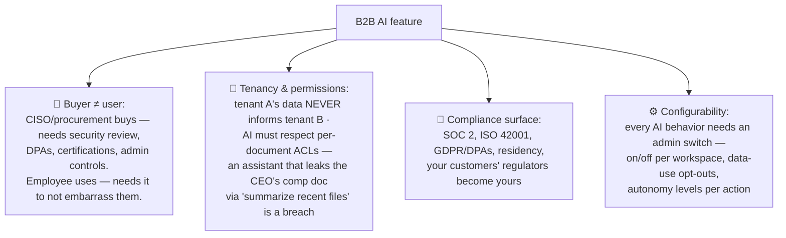

# 🏢 AI PM in Enterprise SaaS / B2B — Trust Is the Product

> **TL;DR:** In B2B AI, the model is maybe 30% of the product. The other 70% is tenancy, permissions, admin controls, compliance evidence, and change management — because your buyer is a security reviewer and your user is an employee whose mistakes have an employer. Most AI PM jobs are here.

---

## 1. The AI surface area

| Use case | Examples in the wild (verified) | Notes |
|---|---|---|
| **Copilots in the workflow** | Microsoft 365 Copilot (seat add-on at massive distribution), Notion AI (add-on → bundled into Business tier, 2025), Zoom AI Companion (free-with-paid as retention moat) | The three pricing archetypes in one row ([strategy §5](../03-product-craft/ai-product-strategy.md)) |
| **Enterprise search / knowledge assistants** | Glean; "chat with your company's docs" | Permission-aware RAG is the whole game ([rag.md](../02-technical-depth/rag.md)) |
| **Support & service AI** | Sierra, Decagon (agent-native vendors); every helpdesk suite | Agent autonomy dial + outcome pricing experiments |
| **Sales/CRM intelligence** | Salesforce Agentforce (heavy AI PM hiring, verified 2026) | Agents acting in systems of record — permissions architecture |
| **Meeting/comms intelligence** | Zoom, Teams, Gong | Recording consent varies by geography — product must adapt |
| **Vertical AI** — legal (Harvey), healthcare scribes (Abridge), finance | The "AI-native vertical SaaS" wave | Domain moats compound with workflow depth |
| **Internal platform PM** | Your company's own AI gateway/eval infra | A fast-growing, underrated AI PM role type |

## 2. What's actually different in B2B

The three questions every enterprise buyer asks first (have crisp answers or lose the deal):
1. **"Does our data train your models?"** — the default answer must be *no*, contractually.
2. **"Who can see what the AI produces/accesses?"** — permission inheritance, audit logs.
3. **"Can we turn it off / control it?"** — per-tenant configurability.

## 3. The adoption problem (B2B's silent killer)

Enterprise AI's embarrassing secret: **seats bought ≫ seats active.** (Industry surveys — e.g., McKinsey's 2025 State of AI — show most orgs deploying AI while only ~39% see EBIT impact; the gap is adoption and workflow redesign, not model quality.) PM levers:

- **In-workflow beats destination**: AI inside the tool people already use, at the moment of need — not a separate "AI tab."
- **Time-to-first-value < 5 minutes**: preconfigured for the buyer's use cases; blank chat boxes die in enterprise.
- **Champion enablement**: admins/champions get rollout kits, usage dashboards, and prompt libraries — deployment is a product surface.
- **Trust ramps**: start in draft/suggest mode org-wide; earn autonomy per workflow with visible accuracy stats ([autonomy dial](../02-technical-depth/ai-agents.md)).
- **Renewal math**: your feature's fate = provable value at renewal → instrument time-saved/outcome metrics per tenant and *ship the dashboard to the buyer*.

## 4. Pricing AI in B2B (live debate, know the map)

| Model | Tension |
|---|---|
| Seat add-on (Copilot-style) | Clean, but buyers demand per-seat value proof |
| Bundle into tier (Notion 2025 path) | Simple; monetizes via upgrades; margin pressure from heavy users |
| Usage/credits | Cost-aligned; budget-anxiety and unpredictable bills |
| Outcome-based (per resolution) | Purest alignment; attribution fights; support-agent vendors pioneering |
| Free as moat (Zoom path) | Retention play; defers monetization |

Margin discipline matters more in B2B than anywhere: heavy-usage tenants on flat pricing can invert your unit economics — model P95 tenant usage before committing ([cost math](../02-technical-depth/model-selection-and-cost.md)).

## 5. Interview drill

**"You're the PM for an AI assistant inside a project-management tool (Jira/Asana-like). Design it."** Strong path: pick jobs with daily frequency (status summarization, ticket drafting, sprint-risk flagging) → permission-aware grounding (assistant sees only what *this user* can see — say it explicitly, it's the differentiator) → autonomy: drafts and flags, no silent state changes; bulk actions behind approvals → admin surface: org on/off, data-use controls, audit log → quality: golden set per job, hallucinated-status as the killer error (a wrong "on track" summary to an exec is the nightmare case — cite-your-sources design) → metrics: weekly active AI users/seat, draft acceptance, time-to-status-report, *per-tenant* value dashboard → rollout: design-partner tenants → beta with champion kit → GA. Bonus: mention SOC 2/ISO 42001 evidence and "does our data train models?" as sales-cycle table stakes.

## 6. Know these names
Microsoft 365 Copilot (distribution as strategy) · Glean (permission-aware enterprise RAG) · Salesforce Agentforce · Sierra/Decagon (agent-native support; outcome pricing experiments) · Harvey (vertical legal AI) · ISO/IEC 42001 (certifiable AI management — AWS/Anthropic/Microsoft early certs) · SOC 2 · DPA/BAA · "shadow AI" (employees using unsanctioned tools — the governance gap you'll be asked about).

---
*Related: [strategy](../03-product-craft/ai-product-strategy.md) · [responsible-ai](../03-product-craft/responsible-ai.md) · [agents](../02-technical-depth/ai-agents.md)*
