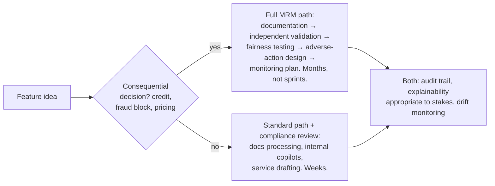

# 💳 AI PM in Fintech: Where Models Meet Model Risk

> **TL;DR:** Finance has run production ML for decades (fraud, credit, trading) under the strictest model-governance regime in industry. The AI PM here inherits mature infrastructure *and* mature regulation: every consequential model needs documentation, validation, explainability, and fairness evidence, by law, not by preference.

---

## 1. The AI surface area

| Use case | Model era | Error asymmetry that shapes the product |
|---|---|---|
| **Fraud detection** | Classic ML, decades old | False negative = stolen money; false positive = blocked good customer at checkout. Threshold-setting is the product ([ml-fundamentals](../01-foundations/ml-fundamentals.md)) |
| **Credit underwriting** | Classic ML → carefully-adopted new methods | Errors are *legally protected* territory: ECOA/fair lending |
| **AML/KYC screening** | Rules + ML hybrid | Regulator-driven recall bias → floods of false positives; triage AI thrives here |
| **Customer service & ops** | GenAI wave (Klarna's assistant = the famous case) | Wrong answer about fees/disputes = regulatory complaint |
| **Personal finance features** | GenAI, cautiously ("insights," not "advice") | The advice line is a licensing boundary |
| **Document processing**: claims, onboarding, statements | GenAI sweet spot | High volume, human-verifiable, low regulatory trigger |
| **Trading/robo-advisory** | Quant + regulated advice products | Separate licensed universe (RIA/broker-dealer rules) |

## 2. The regulatory stack (the part that makes fintech AI *different*)

- **SR 11-7 (Fed/OCC model risk management)** is the constitution of bank ML: every model needs an inventory entry, documentation, **independent validation** (a second team that can reject it), and ongoing monitoring. If you PM a model at a bank, your artifact list includes a model-risk file, and your ship date includes validation lead time. "Three lines of defense" is meeting vocabulary.
- **Fair lending (ECOA/Reg B)**: credit denials require **specific adverse-action reasons**. CFPB circulars (2022-23) explicitly foreclose "our model is too complex to explain." Product implication: explainable feature paths for credit decisions, or humans making the final call. **Proxy discrimination** is the trap: ZIP code, shopping patterns, even device type can proxy protected classes; disparate *impact* counts even with no protected inputs (the Amazon recruiting-tool lesson applied to money).
- **BSA/AML**: suspicious-activity monitoring is mandatory; models here get examiner scrutiny.
- **EU AI Act**: creditworthiness scoring and life/health insurance pricing are Annex III **high-risk** (obligations from Dec 2027 post-omnibus); plus GDPR automated-decision rights (Art. 22).
- **India**: RBI's digital-lending rules + DPDP Act consent architecture (phasing in through 2027).
- Genuinely new for GenAI: hallucinated fee/dispute answers become **UDAAP** (unfair/deceptive practices) exposure. The Air Canada chatbot ruling (company liable for chatbot statements) reads directly onto banking.

## 3. What changes in your product process

PM survival guide: **classify your feature's regulatory tier on day one** (it sets your timeline more than eng complexity does); befriend model-risk/compliance early, since they're gatekeepers only if you surprise them; design *reason codes* into any decision UX from the start (retrofitting explainability is a rebuild).

## 4. Domain product patterns

- **Two-model pattern**: complex model proposes, simple explainable model (or rules) decides for regulated calls, or human adjudication above thresholds.
- **Triage-not-decide**: AI ranks fraud/AML alerts for human investigators (recall-heavy, judgment stays human). It's the most common quiet win in the domain.
- **Scoped assistants**: service bots hard-fenced from advice territory ("insights" ≠ "recommendations"), with money-movement actions behind approval gates and full audit logs.
- **Adversary-aware iteration**: fraudsters adapt to your model within weeks; drift monitoring and retraining cadence are product features, not maintenance ([drift](../01-foundations/glossary.md)).
- **The Klarna arc as the domain's GenAI parable**: 2/3 of chats automated + $40M projected improvement (Feb 2024) → public quality walk-back + rehiring humans (May 2025). Efficiency metrics need quality guardrails of equal rank ([case study](../06-case-studies/klarna-ai-assistant.md)).

## 5. Interview drill

**"Design an AI feature to help users manage subscriptions in a banking app."** Strong path: user pain (forgotten renewals, gray charges) → detection = classic ML on transaction streams (merchant classification, recurrence); note this is *insights*, low regulatory tier → action ladder: notify → one-tap cancel assist → *never* auto-cancel without consent (money actions = approval gates) → the advice line: "you could save $40" is safe; "cancel Netflix, invest the difference" approaches advice → metrics: subscriptions surfaced accuracy (precision first, because a false "you're paying for X" erodes trust instantly), engagement, savings realized, complaint rate → data ethics: transaction data is intimate; no third-party sharing, clear consent. Bonus points: mention BNPL/dispute adjacency and UDAAP exposure for wrong claims about merchants.

## 6. Know these names
SR 11-7 · ECOA/Reg B adverse action · CFPB circulars on AI explainability · disparate impact vs. treatment · UDAAP · Klarna assistant arc · Zest AI / Upstart (AI-driven underwriting vendors; the recurring names in fair-lending-meets-ML debates) · Stripe Radar (fraud ML at platform scale) · Plaid (data rails) · RBI digital lending guidelines (India).

---
*Regulatory status verified July 2026. Related: [responsible-ai](../03-product-craft/responsible-ai.md) · [metrics](../03-product-craft/metrics-for-ai-products.md)*
