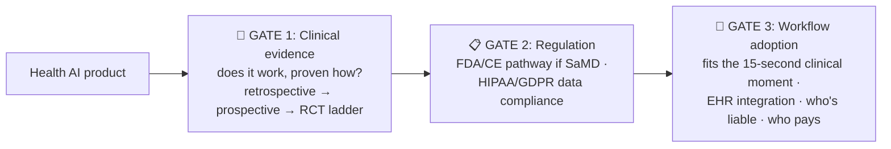

# 🏥 AI PM in Healthcare: Highest Stakes, Deepest Moats

> **TL;DR:** Health AI is where "move fast" goes to die and where durable products get built. The PM skill is navigating three gates that don't exist elsewhere: clinical evidence, regulation, and workflow adoption. Get them right and you have a moat measured in years.

---

## 1. Where AI actually works in healthcare today

| Use case | Status (2026) | Why it works |
|---|---|---|
| **Radiology/imaging triage & detection** | The workhorse: ~76% of FDA-authorized AI devices are radiology | Clear ground truth, digital data, assists (not replaces) the read |
| **Ambient clinical documentation** ("AI scribes": Abridge, Nuance DAX, etc.) | The most visible current land-grab in health AI | Attacks clinician burnout; human reviews every note → survivable errors |
| **Administrative ops**: coding, prior auth, scheduling, claims | Quietly huge | High volume, pattern-heavy, non-clinical error tolerance |
| **Patient communication**: portal message drafts, triage chat | Growing, carefully scoped | Drafts reviewed by staff; escalation paths mandatory |
| **Drug discovery & clinical trial matching** | Deep-tech track | Different PM species (research PM) |
| **Diagnosis-adjacent decision support** | The hard, regulated frontier | This is SaMD territory: see below |

**The cautionary anchor: IBM Watson for Oncology.** >$4B spent on acquisitions, trained on small volumes of *synthetic* cases curated at one hospital, marketed as revolutionizing cancer care, internally documented recommending "unsafe and incorrect" treatments (STAT, 2018), sold off for ~$1B in 2022. Every health-AI failure mode in one story: marketing ahead of evidence, no real-world ground truth, workflow ignored. ([Full case](../06-case-studies/failures-hall-of-lessons.md))

## 2. The three gates

### Gate 1: Evidence
Health buyers ask "where's your study?" not "where's your demo." PM owns the evidence roadmap: retrospective validation → prospective pilot → (for strong claims) randomized trial + peer-reviewed publication. Evals here are clinical validation studies: same discipline as [evals.md](../02-technical-depth/evals.md), higher ceremony, with **site-level generalization** as the recurring killer (models that work at Hospital A degrade at Hospital B, because scanners, populations, and workflows differ).

### Gate 2: Regulation (know the vocabulary)
- **SaMD** (Software as a Medical Device): if your software *diagnoses, treats, or drives clinical decisions*, you're likely a medical device needing FDA authorization (mostly 510(k)/De Novo). FDA has authorized **1,000+ AI-enabled devices** (cumulative ~1,451 through 2025).
- **The line that matters:** "flags studies for radiologist priority" (device, cleared) vs. "generic admin automation" (not a device). Feature wording and claims move you across it. Those are PM decisions, made with counsel.
- **Adaptive models:** FDA's **Predetermined Change Control Plans (PCCP)** (2025 guidance) let you pre-specify how a model may be updated post-clearance; otherwise every retrain is a new submission. Ask about this in any med-AI interview; it signals real domain knowledge.
- **LLM caveat:** most LLM chat tools currently sit *outside* cleared-device pathways by scoping claims to admin/documentation. The gray zone is the industry's active debate.
- **HIPAA:** PHI through an LLM requires a **BAA**. Consumer ChatGPT is not HIPAA-compliant; enterprise/cloud offerings (Azure OpenAI, Bedrock, Google Cloud, ChatGPT Enterprise) provide BAAs. BAA is necessary, not sufficient: minimum-necessary data, audit trails, retention rules still apply.
- **EU:** medical AI is high-risk under the AI Act (obligations timeline shifted to Dec 2027 by the 2026 omnibus) *plus* the existing MDR regime.

### Gate 3: Workflow (where good models die)
The clinician has ~15 seconds and 40 clicks of accumulated EHR resentment. Integration = Epic/Cerner (EHR) embedding, not a separate portal. Alert fatigue is the enemy: a 94%-precision alert still fires wrongly dozens of times/day at volume, so clinicians learn to ignore it (automation complacency), or it erodes trust in everything you ship. And map the **buyer ≠ user ≠ beneficiary** triangle: hospital CFO buys, clinician uses, patient benefits; your value story must work for all three (and often: who bills for it? Reimbursement codes can make or kill the category).

## 3. Domain-specific product patterns

- **Assist, don't decide**: outputs framed as draft/flag/prioritization with clinician sign-off; changes liability, regulation, and adoption simultaneously.
- **Show the evidence trail**: link to the guideline/source/image region behind every suggestion (grounding = clinical trust).
- **Fail visible, fail safe**: low confidence → route to human, never to a guess; measure escalation correctness.
- **Bias is a patient-safety issue**: performance sliced by demographics is mandatory (pulse-oximeter history looms large); underrepresented groups in training data → measured, disclosed, mitigated gaps.
- **Update discipline**: versioned models, monitored drift (patient populations shift, coding practices change), PCCP-governed updates.

## 4. Interview drill

**"Design an AI feature to reduce ER wait times."** Strong path: decompose waits (triage → bed → doc → tests → dispo) → pick a *non-diagnostic* wedge first (predictive bed management, documentation acceleration) vs. diagnosis-adjacent (triage severity scoring = SaMD + evidence program; say so explicitly) → data reality (EHR access, HL7/FHIR, PHI under BAA) → clinician-in-loop design + alert-fatigue budget → metrics: door-to-provider time, LWBS (left-without-being-seen) rate, guardrails on triage-error/adverse events → rollout: shadow mode against current triage, single site, prospective validation before scale. Mentioning *site generalization* and *who is liable when it's wrong* separates domain-fluent candidates.

## 5. Know these names
Epic/Cerner-Oracle (EHR gravity wells) · Abridge, Nuance DAX (ambient scribes) · Aidoc, Viz.ai (radiology AI) · Tempus (precision medicine) · FDA AI device list · PCCP · FHIR (data interop standard) · pulse-oximeter bias case · Watson Health post-mortem.

---
*Regulatory status verified July 2026. This domain moves; re-verify before interviews. Related: [responsible-ai](../03-product-craft/responsible-ai.md) · [failures](../06-case-studies/failures-hall-of-lessons.md)*
