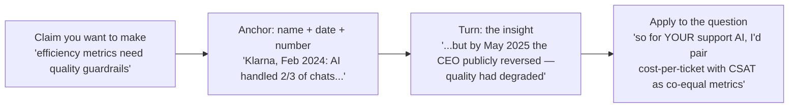

# 📖 Case Studies — Real AI Products, Real Numbers, Real Sources

> **TL;DR:** Interviews reward candidates who argue from *evidence*: named products, dated facts, honest numbers. Every stat in this section was verified against primary sources (papers, SEC filings, company announcements, tribunal records) in **July 2026** — and the ones we couldn't verify are flagged so you don't repeat myths.

---

## The deep dives

| Case | The one-line story | Best used for |
|---|---|---|
| [GitHub Copilot](github-copilot.md) | Capability-curve timing + distribution + freemium ladder → category king | Strategy, pricing, developer products, the 55% RCT |
| [Netflix Recommendations](netflix-recommendations.md) | The canonical "invisible ML = $1B of retention" story — and how to cite it honestly | Classic ML value, metrics, personalization |
| [Duolingo](duolingo.md) | A decade of quiet ML → GPT-4 first-mover → "AI-first" backlash | Data flywheels, premium AI pricing, comms risk |
| [Klarna AI Assistant](klarna-ai-assistant.md) | The efficiency triumph that publicly reversed | Metrics guardrails, agent products, exec storytelling |
| [Failures Hall of Lessons](failures-hall-of-lessons.md) | 10 sourced disasters, one lesson each | Risk questions, "tell me about an AI failure," design reviews |

## Quick-hit cases (facts verified July 2026)

| Product | Verified facts | PM takeaway |
|---|---|---|
| **ChatGPT** | Launched Nov 30, 2022; est. 100M monthly users in ~2 months (UBS/Similarweb analyst estimate — note: estimate, not disclosure); 900M weekly actives + 50M paying subscribers (OpenAI, Feb 2026) | The reference consumer-AI growth curve — and a lesson in citing estimates as estimates |
| **Notion AI** | Nov 2022 alpha waitlist hit 2M+ signups; GA Feb 2023 as $10/member add-on; May 2025: add-on killed, AI bundled into Business tier ($20/user/mo) | Add-on pricing while AI is novel → bundling when it's table stakes |
| **Zoom AI Companion** | Launched Sept 2023 free with paid plans; paid-tier AI MAU +184% YoY (May 2026 earnings) | "Free with subscription" as retention moat, monetize later |
| **Adobe Firefly** | Launched Mar 2023 trained on licensed/Adobe Stock content; 1B images within ~4 months; 24B+ generations by 2025 | "Commercially safe" as differentiation — legal posture as product strategy |
| **Spotify Discover Weekly / AI DJ** | DW launched July 2015 — 100B+ tracks streamed from it in 10 years (Spotify, 2025); AI DJ launched Feb 2023 | Personalization as brand; a decade-long compounding feature |
| **Grammarly → Superhuman** | 40M+ DAU reported; acquired Coda (2024) + Superhuman (2025); rebranded company to Superhuman (Oct 2025) | Single-feature AI companies must expand into suites as models commoditize their core |

## How to use case studies in interviews

Three rules:
1. **Date every number.** "Netflix says recommendations drive 80% of viewing" is a 2015 self-reported figure — saying so makes you *more* credible, not less.
2. **Prefer pairs**: a success + a failure on the same theme beats two successes (Copilot + Watson Health on "timing the capability curve" is a great pairing).
3. **Never repeat unverified myths.** Common ones we could NOT verify (don't use): "Copilot writes 46% of code" (undated talking point), "Klarna fired 700 people and replaced them with AI" (false framing — the 700 was a workload-equivalence claim; the layoffs were separate and earlier), Spotify AI DJ usage percentages, "ChatGPT has 1B users."
