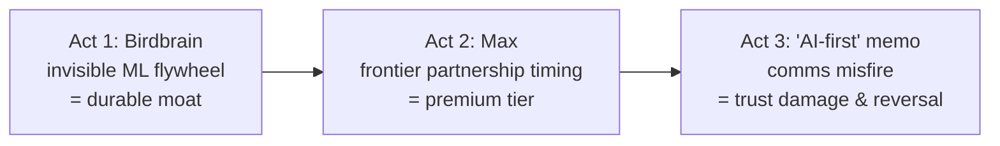

# 🦉 Case Study: Duolingo — Flywheel, First-Mover, and the "AI-First" Backlash

> One company, three distinct AI PM lessons: a decade of invisible personalization ML, a masterclass in partnership timing, and a cautionary tale about AI strategy communications. **Verified July 2026.**

---

## Act 1 — Birdbrain: the invisible flywheel

**Birdbrain** is Duolingo's ML model predicting, for every learner and every exercise, the probability they'll answer correctly — keeping lessons in the sweet spot between boring and discouraging. The V2 architecture (per IEEE Spectrum's technical profile): an LSTM compressing each learner's entire history into a 40-dimensional vector, **updated after every single exercise**.

The flywheel: more learners → more exercise-response data → better difficulty prediction → better-calibrated lessons → better retention → more learners. A decade of this created a personalization dataset competitors can't shortcut — the textbook [data moat](../03-product-craft/ai-product-strategy.md), built with zero "AI-powered" marketing.

## Act 2 — Max: buying the frontier on day one (2023)

**March 14, 2023** — the day GPT-4 launched — Duolingo announced **Duolingo Max** as one of the first GPT-4 partners, with two features:
- **Roleplay**: freeform conversation practice with AI characters (the feature language learning always wanted and could never staff)
- **Explain My Answer**: on-demand tutoring on *why* you were wrong

Priced at **$29.99/month or $167.99/year** — a significant premium over Super Duolingo — creating a new top tier built on GPT-4 capability.

The strategy lessons: ① **partnership timing as differentiation** — being in the GPT-4 launch story bought months of positioning no ad budget could; ② **rent the frontier, own the context** — Duolingo didn't build an LLM; it wrapped GPT-4 in its pedagogy, characters, and CEFR-aligned curriculum ([build-vs-buy](../03-product-craft/ai-product-strategy.md)); ③ **price the new capability as a tier**, don't give it away ([pricing patterns](../05-domains/consumer-social.md)).

## Act 3 — The "AI-first" memo (2025): strategy comms as product risk

**Late April 2025**: CEO Luis von Ahn's all-hands memo declared Duolingo "AI-first": contractors doing work AI could handle would be phased out, headcount granted only if teams couldn't automate further, AI use factored into hiring and reviews.

**The backlash was immediate and brutal** — viral social posts, users publicly deleting the app (streaks and all), press framing it as "app replaces the humans that made it good."

**The walk-back**: by May 2025 von Ahn clarified on LinkedIn; he later told press the memo "did not give enough context" and insisted no full-time employees were laid off. By **April 2026** (Fortune) he had also backed off evaluating employees on AI usage.

The lessons, which now appear in interview questions:
1. **Internal AI memos are external comms.** Assume every strategy doc leaks; write it for both audiences.
2. **"AI replaces people" framing is brand poison** — especially for a beloved consumer brand whose product *is* human connection to learning ([consumer domain](../05-domains/consumer-social.md), [edtech](../05-domains/edtech.md)).
3. **The backlash didn't kill the strategy** — Duolingo kept shipping AI features; what it lost was narrative control and some trust. Efficiency strategies need value-forward framing: "AI lets us make 10× more content for learners" vs. "AI lets us need fewer people."

## The three-act summary for interviews

Use it for: **data flywheel questions** (Act 1 is the cleanest consumer example), **build-vs-buy/partnership questions** (Act 2), **"tell me about an AI strategy that backfired"** (Act 3 — richer than the usual chatbot failures because the *product* was fine; the *story* failed).

⚠️ **Don't cite:** Birdbrain throughput/latency stats floating on blogs ("1.25B exercises daily", "14ms") — unverified; the IEEE Spectrum profile is the reliable technical source. Sources: Duolingo blog, TechCrunch (Mar 2023; Aug 2025), Fortune (Aug 2025; Apr 2026), Entrepreneur (memo text), IEEE Spectrum (Birdbrain).
