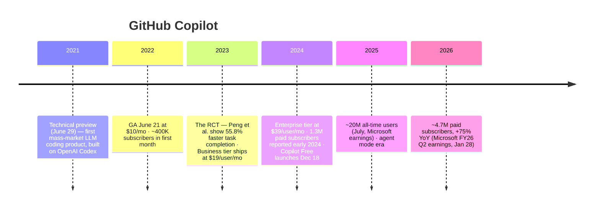

# 🐙 Case Study: GitHub Copilot — Timing, Trust, and the Freemium Ladder

> The most complete AI product success story available: right timing on the capability curve, distribution through an owned channel, evidence-based marketing, and a pricing ladder that segmented the market. **All facts verified July 2026; sources at bottom.**

---

## Timeline

## The five strategy lessons

### 1. Build at the ragged edge of capability
2021's Codex was *barely* good enough — suggestions were often wrong. Copilot shipped anyway, into a UX where wrong is cheap (ghost text: ignore = zero cost, accept = Tab). **Product design absorbed model weakness.** By the time models got great, Copilot had years of usage data, brand, and habit. The counterfactual: waiting for "reliable" models = ceding the category. ([capability curve](../03-product-craft/ai-product-strategy.md))

### 2. Distribution is the moat the model isn't
GitHub (Microsoft-owned) already had the developers — Copilot launched *inside* their editor and their existing GitHub identity. When models commoditized (competitors on the same/better models within a year), the integration surface + installed base held. Copilot later added model choice beyond its original OpenAI-only engine — when your moat is distribution and workflow, you can afford to commoditize your own supplier.

### 3. Evidence-based marketing (the 55% stat)
GitHub ran an actual randomized controlled experiment (Peng et al., n=95 devs, standardized task): Copilot group finished **55.8% faster** (1h11m vs 2h41m, p=.0017). That one rigorous number anchored the entire category's business case for years. PM lesson: **fund the study; one RCT beats a thousand testimonials** — and know its limits when citing (one task type, greenfield JS, 2022 models).

### 4. The freemium ladder as segmentation
$0 Free (Dec 2024: 2K completions/mo — funnel + habit) → $10 Pro (prosumer) → $19 Business (admin, policy controls) → $39 Enterprise (customization, indemnity-grade governance). Each rung prices a different *buyer*, not just more usage. B2B tiers monetize **trust features** (IP indemnification, license filtering, no-training guarantees, admin controls) — the enterprise premium is compliance, not completions. ([pricing patterns](../03-product-craft/ai-product-strategy.md))

### 5. Metrics honesty under pressure
Copilot's team popularized acceptance-rate and retained-code metrics but faced the hard question every AI product faces: does speed come at quality's expense? The mature answer they normalized: pair velocity metrics with quality counter-metrics (review outcomes, defect rates) and keep running studies. ([developer-tools domain](../05-domains/developer-tools.md))

## Numbers table (for interview citation)

| Fact | Number | Source & date |
|---|---|---|
| GA pricing | $10/mo · $100/yr | GitHub, June 2022 |
| First-month subs | ~400K | CIO Dive, July 2022 |
| RCT speed gain | 55.8% faster (p=.0017) | Peng et al., arXiv:2302.06590 |
| Survey sentiment | 88% "more productive" | GitHub research blog, Sept 2022 |
| Paid subscribers | 1.3M (early 2024) → ~4.7M, +75% YoY (Jan 2026) | Microsoft earnings |
| All-time users | ~20M (July 2025) | Microsoft FY25 Q4 earnings |
| Free tier | 2,000 completions + 50 chats/mo | GitHub blog, Dec 18, 2024 |

⚠️ **Don't cite:** "Copilot writes 46% of code" (a 2022–23 talking point without a stable primary source — if you use it, date it and attribute it); Copilot ARR figures (Microsoft doesn't break them out; all numbers are estimates).

## Interview applications

- **"Should we ship an AI feature that's only right 60% of the time?"** → Copilot's answer: yes, *if* the UX makes wrong nearly free and feedback flows back. Design determines the shippable accuracy bar.
- **"How do you price an AI product?"** → walk the ladder; explain what each tier's buyer actually pays for.
- **"How do you defend against the model provider?"** → distribution + workflow + multi-model optionality; Copilot did all three while *being* partly the provider (Microsoft/OpenAI nuance worth naming).

Sources: GitHub blog (product announcements, research posts) · arXiv:2302.06590 · Microsoft earnings coverage (CNBC) · CIO Dive · Wikipedia (dates cross-checked). Verified July 2026.
