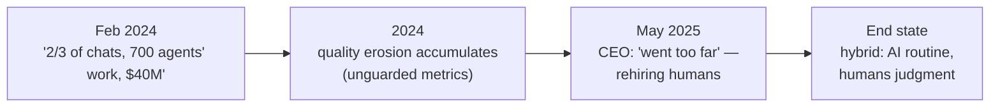

# 💬 Case Study: Klarna's AI Assistant — The Triumph That Reversed

> The single most instructive GenAI product story of the era, because both halves are true: the AI worked *and* the strategy failed. If you tell only one half in an interview, you fail the question. **Verified July 2026.**

---

## Half 1 — The triumph (February 2024)

Klarna's press release (Feb 27, 2024) and OpenAI's companion case study announced, for the assistant's **first month**:

| Claim | Number |
|---|---|
| Conversations handled | **2.3M — two-thirds of all customer-service chats** |
| Workload equivalence | "doing the equivalent work of **700 full-time agents**" |
| Estimated profit impact | **~$40M improvement in 2024** |
| Resolution time | 11 minutes → **under 2 minutes** |
| Repeat inquiries | **−25%** |
| Coverage | 23 markets, 35+ languages |

It became *the* corporate GenAI proof point — cited in earnings calls and pitch decks across the industry.

**Nuance most people get wrong:** the "700" was a **workload-equivalence claim**, not "we fired 700 people and installed a bot." Klarna's ~700-person layoff happened in **2022**, before the assistant existed, for macro reasons — media coverage fused the two. Repeating the fused version in an interview signals you read headlines, not sources.

## Half 2 — The reversal (2024–2025)

By **May 2025**, CEO Sebastian Siemiatkowski told Bloomberg the AI-driven cost-cutting had "gone too far":

> "We focused too much on efficiency and cost... the result was lower quality."

Klarna began **recruiting human agents again**, committing that customers could always reach a person, and moved to a hybrid model: AI for routine high-volume queries, humans for judgment and complex cases.

## The autopsy — five transferable lessons

1. **Unpaired metrics fail silently.** Cost-per-conversation and resolution-time were tracked and celebrated; quality/CSAT degradation showed up on a lag, in churn and brand sentiment. *Every efficiency metric needs a quality guardrail of equal rank* ([metrics](../03-product-craft/metrics-for-ai-products.md)).
2. **Deflection ≠ resolution.** A conversation that *ends* isn't a problem that's *solved* — reopens, silent churn, and "came back angry" are the honest counters ([support metrics](../03-product-craft/metrics-for-ai-products.md)).
3. **The 80% is cheap; the 20% is the brand.** Routine queries automated beautifully; edge cases, disputes, and emotionally loaded moments — where loyalty is actually won/lost — needed humans. Segment *before* automating, by stakes as well as volume ([autonomy dial](../02-technical-depth/ai-agents.md)).
4. **Public metrics are commitments.** Announcing "$40M and 700 agents' work" created a narrative Klarna then had to publicly unwind — at real brand cost. PR your outcomes, not your automation ratios (see also [Duolingo's memo](duolingo.md)).
5. **The end state was never 0% humans.** The mature design — AI-first triage with a *designed, dignified* human path — is what Klarna landed on and what you should propose from day one. "Human escalation" is a feature, not an admission of failure ([failure UX](../03-product-craft/ux-patterns-for-ai.md)).

## Using it in interviews

- **"Design a support AI"** → propose Klarna's *end state* (hybrid, stakes-based routing, paired metrics) and *say why*, citing both halves with dates.
- **"Tell me about an AI initiative that failed"** → this is a sophisticated pick precisely because the model performed: the failure was metric selection and strategy framing — PM failures, not ML failures.
- **"How do you measure a customer-service AI?"** → north star: problems fully resolved (verified by no-reopen + CSAT); guardrails: escalation availability, sentiment on AI-handled threads; counter-metric: contact-rate suppression (people giving up).

Sources: Klarna press release (Feb 27, 2024) · OpenAI case study · Bloomberg via Forbes/Entrepreneur (May 2025) · Fast Company (Feb 2024, layoff-conflation analysis) · Pragmatic Engineer (technical skeptic's read). Verified July 2026.
