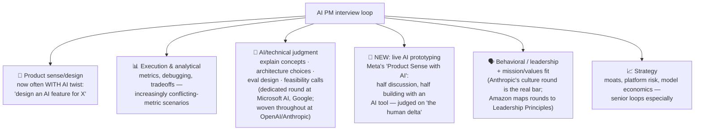

# 🎯 AI PM Interview Prep — The Complete System

> **TL;DR:** AI PM interviews = classic PM interviews (product sense, execution, behavioral) **+** an AI fluency layer that now shows up in every round — and at some companies is its own round (Meta's "Product Sense with AI" added live AI prototyping; frontier labs test AI judgment throughout). This section: how loops work company-by-company, frameworks that fit AI questions, a sourced question bank, and worked mock answers.

---

## What's actually tested (2026 reality)

The consistent finding across company guides and candidate reports: **AI product sense became its own competency in 2026**. Meta's addition of an AI round was its first PM-loop change in 5+ years — the market signal that this is permanent.

## Your prep plan by timeline

| Time to interview | Plan |
|---|---|
| **1 week** 🔥 | Day 1–2: [answer-frameworks](answer-frameworks.md) + [llm-fundamentals](../01-foundations/llm-fundamentals.md) + [evals](../02-technical-depth/evals.md). Day 3–5: 2 questions/day out loud from the [question bank](question-bank/), timed. Day 6: [mock-scenarios](mock-scenarios.md) — compare your answers. Day 7: company research + your 8 stories |
| **1 month** | Week 1: foundations + technical depth (fill gaps from the [self-assessment](../01-foundations/what-ai-pms-do.md)). Week 2: frameworks + daily question reps. Week 3: 2–3 live mocks (peers or platforms) + build one [quick prototype](../04-build-with-ai/projects.md) for prototyping-round readiness. Week 4: company-specific tuning + behavioral stories |
| **3 months** | Month 1: full learning path ([00-start-here](../00-start-here/README.md)). Month 2: build 2–3 [portfolio projects](../04-build-with-ai/projects.md) — they transform your resume AND your answers. Month 3: interview drilling as above |

## The five rules of AI PM interview answers

1. **Structure first, always.** 30 seconds of "here's how I'll approach this" beats diving in. Frameworks: [answer-frameworks.md](answer-frameworks.md).
2. **Feasibility talk is table stakes.** Every AI feature answer must touch: where errors come from, what they cost, and how you'd measure quality. Mentioning a golden set + eval gate is the single highest-ROI habit ([evals](../02-technical-depth/evals.md)).
3. **Argue from cases and numbers, dated.** "Klarna, Feb 2024… and the May 2025 reversal" is senior-level evidence. Stock up: [case studies](../06-case-studies/).
4. **Show you've built.** "When I prototyped this pattern, the model kept…" — nothing else signals like firsthand contact ([projects](../04-build-with-ai/projects.md)).
5. **Hold the tension honestly.** AI questions are tradeoff questions (helpfulness↔safety, cost↔quality, speed↔trust). Naming both sides *and choosing* beats false certainty in both directions — especially at frontier labs, where safety-washing and safety-dismissal both fail.

## In this section

| File | What's inside |
|---|---|
| [interview-processes-by-company.md](interview-processes-by-company.md) | Documented loops: OpenAI, Anthropic, Google, Meta, Amazon, Microsoft, Perplexity + sources |
| [answer-frameworks.md](answer-frameworks.md) | AI-adapted frameworks for every round type |
| [question-bank/](question-bank/) | 150+ questions: real (sourced) + practice, organized by round, with answer keys for the hard ones |
| [mock-scenarios.md](mock-scenarios.md) | Three full worked interviews with strong-answer commentary |

## Practice resources (verified July 2026)

- **Exponent** (tryexponent.com) — Gen-AI interview course, company guides, candidate interview experiences, question DB. Company guides are free; courses paid.
- **Product Management Exercises** — AI question sets + peer mocks (freemium).
- **IGotAnOffer** — deep company guides built from candidate reports; paid coaching (~$50/credit).
- **Glassdoor** — raw candidate-reported questions per company (free; quality varies).
- **Lewis Lin's *Decode and Conquer*** (5th ed., 2025 — adds AI-fluency sections) and **Lenny's Newsletter** interview guides (the Meta AI-round coverage is essential if you're interviewing there).
- **Peers > platforms**: 5 live mocks with another candidate, swapping interviewer/candidate roles, beats 50 solo reps. The interviewer seat teaches you what rambling feels like.
