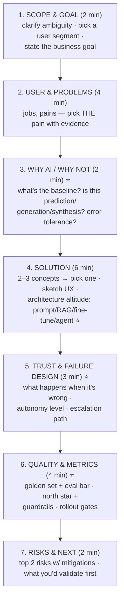

# 🧩 Answer Frameworks — AI-Adapted for Every Round

> **TL;DR:** Frameworks are scaffolding, not scripts — interviewers can smell a recited CIRCLES from across the video call. Learn the *structure*, speak it naturally, and know the AI-specific additions that classic frameworks miss.

---

## 1. AI Product Design — the DESIGN-AI flow

Classic product-sense structure (user → problem → solutions → prioritize → measure) still works; AI questions add four mandatory beats. One integrated flow:

The ⭐ beats are what separate AI-fluent candidates. Time-boxed for a 25-minute question; announce the plan up front ("I'll spend a couple minutes scoping, then users, then why AI fits, then design, quality, and risks").

**Common fails:** jumping to a chatbot for everything (consider invisible AI: ranking, prediction, automation) · designing for the demo not the workflow · no failure design ("it'll use RAG so it won't hallucinate" — it will) · metrics without guardrails.

## 2. AI Technical Questions — the EXPLAIN framework

For "explain X to me / to a stakeholder" questions (embeddings, RAG, fine-tuning, hallucination…):

1. **Plain-English definition** — one sentence, no jargon (steal from the [glossary](../01-foundations/glossary.md) and [cheat sheet](../01-foundations/llm-fundamentals.md)).
2. **Analogy** — "RAG is an open-book exam."
3. **Why it matters for the product** — connect to cost, quality, trust, or speed.
4. **A limit or tradeoff** — one honest caveat proves depth ("fine-tuning shifts style, not facts — that's why we'd still need retrieval for accuracy").
5. **Stop.** Two minutes max. Over-explaining signals insecurity.

For **architecture-choice questions** ("would you use RAG or fine-tuning for X?"): state the decision criteria first (what's missing: knowledge vs. skill vs. behavior — the [adaptation ladder](../02-technical-depth/fine-tuning.md)), apply to the case, name what evidence would change your mind ("if the golden set showed prompting alone hits 90%, I'd stop there").

For **debugging questions** ("quality dropped 15% — debug it"): **Verify the metric → segment the drop → diff the system (model/prompt/data/traffic) → reproduce offline → fix + add regression cases.** Full worked version: [evals.md §6](../02-technical-depth/evals.md).

## 3. Execution & Metrics — GAME, AI edition

**G**oal (business outcome) → **A**ctions (user behaviors that produce it) → **M**etrics (one north star + guardrails per the [three layers](../03-product-craft/metrics-for-ai-products.md)) → **E**valuate tradeoffs (what your north star sacrifices; how you'd detect gaming).

AI-specific must-mentions: pair every efficiency metric with a quality guardrail (cite Klarna in one clause); separate model metrics from product metrics from business metrics; novelty-effect discipline (judge at day-30+, cohort curves).

**Conflicting-metrics questions** (the 2026 analytical-round trend — "Reels vs. Stories"): acknowledge the conflict is real → find the shared upstream goal (total time well spent? creator success?) → propose the decision rule (which wins under what conditions) → name the counter-metric that tells you the rule is wrong.

## 4. Strategy — the WHERE-TO-PLAY flow

For "should company X build Y / respond to Z":
1. **Market physics**: where does value accrue in the [stack](../03-product-craft/ai-product-strategy.md)? What's commoditizing?
2. **Right to win**: distribution, data flywheel, workflow depth, trust — which do we have?
3. **The capability-curve test**: does a 10× better model strengthen or delete this bet?
4. **Options, then a call**: 2–3 strategic options with tradeoffs → **choose one and defend it** (fence-sitting fails senior loops).
5. **Risks & leading indicators**: what would tell you in 6 months you were wrong?

## 5. Behavioral — STAR-AI

Standard STAR (Situation, Task, Action, Result) with two upgrades:
- **Quantify results** or they didn't happen ("acceptance rate 34%→58%; support tickets −20%").
- **Add the Learning beat** — AI work is new for everyone; stories that end "and what I now do differently is…" land as senior.

**Build the 8-story portfolio** (each 90 seconds, each mapped to likely prompts): ① shipped something hard cross-functionally ② navigated deep ambiguity ③ conflict with engineering/design — resolved with data ④ a failure that taught you something real ⑤ influenced without authority ⑥ a hard tradeoff under pressure (ideally value-vs-risk — doubles for safety questions) ⑦ used data to change a decision ⑧ **an AI-specific story** — built/shipped/prototyped something with AI, including what the model couldn't do. No AI work experience? [Projects](../04-build-with-ai/projects.md) exist to create story ⑧.

For frontier labs add: **why AI, why now, why us** — with genuine specifics (what you've read/built/believe, including a real disagreement — "unusual beliefs" questions are reported at Anthropic).

## 6. The live AI-prototyping round (Meta-style)

What's scored is "**the human delta**" — your judgment on top of the tool, not the artifact's polish:
- **Narrate decisions**: "I'm rejecting this generated layout — it buries the primary action."
- **Catch the tool's errors out loud**: hallucinated features, generic UX, missed constraints — spotting them IS the test.
- **Keep tying back to the user**: "the tool gave me a dashboard, but our user is mobile-first at point-of-need, so…"
- **Timebox ruthlessly**: working-and-explained beats polished-and-silent.
- Prep = reps: build 3–4 quick prototypes under a 30-minute timer before the interview ([Project 3](../04-build-with-ai/projects.md)).

## 7. Universal mechanics

- **Clarify before structuring** (2–3 questions max), **think aloud**, **signpost transitions**, **land on a recommendation**, and when you don't know: *"I don't know the current number, but here's how I'd find out / reason about it"* — in AI, where facts churn quarterly, calibrated uncertainty is a hiring signal, not a weakness.
- Record yourself once per question category. The gap between how you think you sound and how you sound is the highest-ROI feedback loop in interview prep.

➡️ Apply these against the [question bank](question-bank/) · see them executed in [mock-scenarios.md](mock-scenarios.md)
