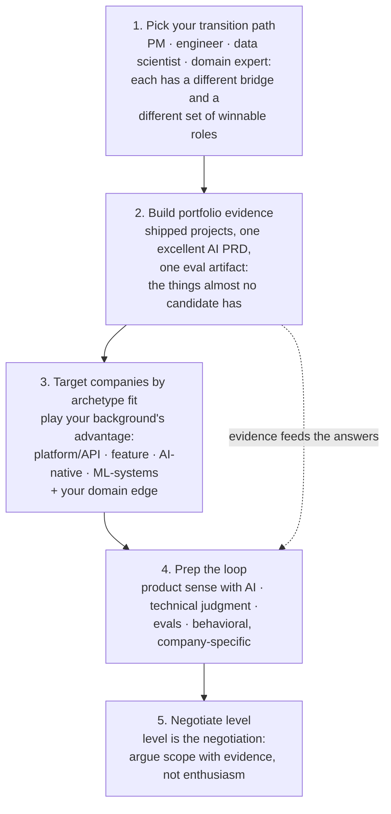

# 🚀 Career: Getting the Role

> **TL;DR:** Only **~2% of AI product postings are junior** (Axial Search analysis of 12,397 US postings, 2026), so this is a **lateral-move market**, not an entry-level one. Nobody hands you the title; you arrive with evidence you've already made judgment calls on probabilistic products. This section is the operating manual: path → evidence → targets → loop → level.

---

## In this section

| File | What's inside | Use it when |
|---|---|---|
| [transition-guides.md](transition-guides.md) | Four paths in (traditional PM, engineer/MLE, data scientist, domain expert), each with its bridge, unfair-advantage roles, and honest timeline | **Start here.** Pick your path before anything else |
| [resume-portfolio.md](resume-portfolio.md) | Bullet formula, AI-era resume specifics, the portfolio structure (PRD + eval artifact), LinkedIn, the 60-second narrative | You have evidence and need to package it |
| [companies-hiring.md](companies-hiring.md) | The verified hiring map, by tier: frontier labs, big tech, AI-natives, India & global, with demand data (verified July 2026) | Building your 10-15 company target list |
| [compensation.md](compensation.md) | Posted ranges and levels.fyi figures for US and India, plus AI-specific negotiation notes (verified July 2026) | Before the recruiter screen, and again at offer |

## The sequence

**Dependencies (this section doesn't stand alone):**
- 🛠️ [../04-build-with-ai/projects.md](../04-build-with-ai/projects.md) is where the portfolio evidence actually comes from. Step 2 is not optional; every downstream step is weaker without it.
- 🎯 [../07-interview-prep/](../07-interview-prep/) has the loops themselves: [processes by company](../07-interview-prep/interview-processes-by-company.md), [frameworks](../07-interview-prep/answer-frameworks.md), [question bank](../07-interview-prep/question-bank/).

## The 3 things that actually move the needle

1. **Shipped evidence over certificates.** Certificates organize learning and signal commitment; none substitutes for built evidence, and hiring managers consistently weight the project. Three certificates instead of one shipped project is a losing trade. (If you need scaffolding, use the [verified course catalog](../09-resources/courses.md), then go build.)
2. **Claim AI scope in your current role. Now.** Propose the AI feature, run the feasibility spike, write the eval-gated PRD. "PM who shipped an AI feature at a non-AI company" beats "PM who took a course," it's available to you this quarter, and internal transfer to your company's AI team is the highest-probability first AI title. See [transition-guides.md](transition-guides.md).
3. **Referrals via communities.** Warm paths dominate AI-native hiring: [Lenny's](https://www.lennysnewsletter.com/), [Mind the Product](https://www.mindtheproduct.com/product-management-slack-community/), [Product School Slack](https://productschool.com/slack-community), plus build-in-public posts that recruiters explicitly hunt ([communities](../09-resources/newsletters-podcasts-communities.md)). Watch source boards (Ashby/Greenhouse/Lever) directly; they're faster than LinkedIn reposts.

**The honest framing:** the demand tailwind is real (median ~$195K across those 12,397 US postings, financial services the #2 hiring industry after tech), but a market with 2% junior roles rewards preparation, not aspiration. Your edge is being the candidate who brings artifacts to the table.

➡️ **Next:** [transition-guides.md](transition-guides.md). Find your path, then go [build the evidence](../04-build-with-ai/projects.md).
