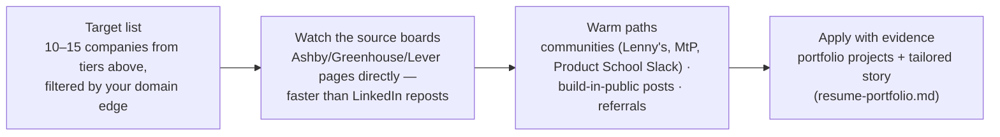

# 🏙️ Who Hires AI PMs — The Verified Map

> Compiled from live job postings, career pages, and job boards; **verified July 2026**. Companies marked ✅ had confirmed AI-PM postings at verification time; 🔶 = actively hires PMs, AI-specific titles not individually confirmed. This changes weekly — use as a targeting map, then check the boards below.

---

## Tier 1 — Frontier labs (highest comp, highest bar, mission-heavy loops)

| Company | Status | Titles seen | Notes |
|---|---|---|---|
| OpenAI | ✅ | "Product Manager, [surface]" — API Agents, Codex, Countries & Governments | Board: jobs.ashbyhq.com/openai · [loop details](../07-interview-prep/interview-processes-by-company.md) |
| Anthropic | ✅ | "Product Manager, Claude Code", "PM, Model Performance" | Posted range seen: $305K–$460K · Greenhouse board |
| Google DeepMind | ✅ | "Product Manager, [area]" — Responsibility, Technical Intelligence | Posted base seen: $183K–$271K |
| Meta (AI orgs) | ✅ | PM with AI-track loop | The "Product Sense with AI" round lives here |
| Microsoft AI | ✅ | PM in MAI/Copilot orgs | Notably technical AI PM loop |
| Mistral AI | ✅ | "Product Manager, AI Assistant" | European frontier option (Paris) |
| xAI | ⚠️ | — | PM postings **not verified** (technical-staff roles dominate); watch levels.fyi/board directly |

## Tier 2 — Big tech (most seats, structured loops)

✅ **Verified AI-titled PM postings:** **Nvidia** ("PM, Generative AI…"; posted base $168K–$328K by level) · **Salesforce** (heavy Agentforce PM hiring — multiple simultaneous postings) · **TikTok** ("Senior PM, Generative AI Safety") · **Amazon/AWS** ("Sr. PM — Technical, AI/ML").
🔶 **AI PM hiring likely but title-unverified at check time:** Google (product org beyond DeepMind), Apple (AIML org), Netflix, IBM (watsonx), Adobe, ServiceNow, Intuit, Oracle, SAP, Uber, LinkedIn, Atlassian, Shopify, Canva.
**Pattern:** big tech often hires "Product Manager" and staffs AI work internally — filter by *team*, not title.

## Tier 3 — AI-native startups (fastest loops, equity upside, ambiguity tolerance required)

| Company | Status | Notes |
|---|---|---|
| Databricks | ✅ | Staff PM AI Platform, Sr PM Databricks AI |
| Perplexity | ✅ | PM (Builder); Enterprise PM $160K–$200K posted; **runs an APM program** |
| Cursor (Anysphere) | ✅ | ~90 open roles incl. PM, Cloud Agents (acquisition-in-progress caveat) |
| Sierra | ✅ | PM Agent Development / Agent SDK; **APX rotational program for new grads** |
| Decagon | ✅ | "Agent Product Manager" |
| Figma | ✅ | PM AI Platform (owns evals/agent infra/MCP), PM AI Growth ($207K–$303K base posted) |
| Glean | ✅ | Product roles $175K–$230K reported |
| Grammarly (rebranded Superhuman, Oct 2025) | ✅ | PM roles verified |
| 🔶 Careers active, PM postings unconfirmed | | Scale AI, Hugging Face, Notion, Harvey, Writer, Cohere, Runway, ElevenLabs, Synthesia, Abridge |

**Startup title patterns:** "Product Manager (Builder)", "Agent Product Manager", "PM, AI Platform" — agent-era titles are real and growing.

## Tier 4 — India & global

✅ Verified: **Sarvam AI** (PM for India-focused AI agents), **Sprinklr** (PM/Sr PM, Gurgaon).
🔶 PM hiring confirmed, AI titles not: **Razorpay**, Flipkart, Swiggy, Zomato, Freshworks. ⚠️ Krutrim: AI-lab hiring reported, PM roles unverified.
**India pattern:** titles stay generic ("PM II/III") with AI in the job description — search JDs, not titles. Boards: productbased.in, productmanagementjob.com, plus LinkedIn/Naukri with "generative AI product" keywords.

## Demand snapshot (sourced)

- **12,397 AI product jobs** posted in the US since Jan 2026; ~half at Manager level, only **2% junior**; median salary **$195K** (Axial Search analysis, 2026).
- Financial services is the #2 hiring industry (13%) after tech (~33%) — domain routes in ([domains](../05-domains/)).
- LinkedIn's 2026 Jobs-on-the-Rise ranked **AI Engineer #1** — the adjacent-role signal; AI PM demand follows AI eng build-out.
- The junior-role scarcity (2%) is the strategic fact: **AI PM is mostly a lateral move**, which is why [transition-guides.md](transition-guides.md) matters more than entry-level listings. Exceptions that do exist: Perplexity's APM program, Sierra's APX rotation.

## How to actually hunt (the workflow)

*Related: [compensation.md](compensation.md) · [transition-guides.md](transition-guides.md) · [interview processes](../07-interview-prep/interview-processes-by-company.md)*
