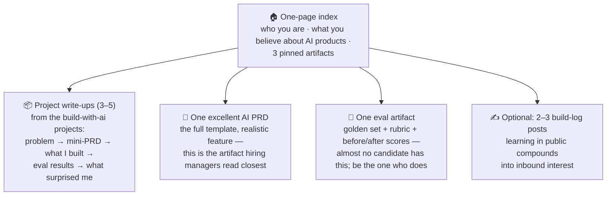

# 📄 Resume & Portfolio for AI PM Roles

> **TL;DR:** AI PM screening looks for one thing above all: **evidence you've made judgment calls on probabilistic products** — shipped AI work, built prototypes, defined quality bars. Structure everything to surface that evidence in 6 seconds of recruiter skim.

---

## The resume

### The formula for every bullet
**Action verb + AI-specific what + quantified outcome + (quality/scale dimension).**

| ❌ Before | ✅ After |
|---|---|
| "Worked on AI chatbot features" | "Shipped RAG-based support assistant across 3 languages; deflected 31% of tier-1 tickets while holding CSAT flat (the guardrail that mattered)" |
| "Used AI tools for productivity" | "Cut discovery cycle from 3 weeks to 4 days by prototyping 5 concepts in Lovable/v0 and testing with 12 users pre-eng-commit" |
| "Improved model accuracy" | "Defined eval suite (300-case golden set, LLM-judge rubric) that gated 14 prompt/model releases; caught 3 regressions pre-ship" |
| "Familiar with LLMs, RAG, prompt engineering" *(skills-section keyword soup)* | Skills live in bullets as *deeds*, not in a keyword list — ATS keywords belong in context |

### AI-era specifics
- **Name the mechanism, own the judgment**: "chose RAG over fine-tuning because policy content changes weekly" — one clause of *why* signals more than three bullets of *what*.
- **Include the quality dimension**: any efficiency claim without its guardrail invites the Klarna question in the interview — pre-empt it ("…while holding CSAT flat").
- **A "Selected AI work" section** (2–3 lines linking portfolio pieces) beats a certifications wall. Certificates: keep the 1–2 strongest, one line, bottom.
- **No AI title yet?** Bullet the AI-adjacent scope you claimed: the feasibility spike you ran, the eval you introduced, the AI feature PRD you wrote ([transition guides](transition-guides.md)).
- **The screening reality**: your resume will likely be read by AI *and* skimmed by a human — clean structure, standard section names, real nouns. Never let AI write claims you can't defend live; interviews now routinely probe resume bullets to detect inflation ("tell me exactly what the golden set contained").

## The portfolio (the differentiator)

One link in your header. A Notion page or GitHub repo containing:

Build the contents via [the five projects](../04-build-with-ai/projects.md). Quality bar: every artifact answers "what judgment call did I make and how did I know it was right?"

## LinkedIn (where AI PM sourcing actually happens)

- **Headline = role + proof**, not aspiration: "Product Manager — shipped AI support automation (31% deflection, CSAT-neutral)" beats "Aspiring AI PM | Lifelong learner."
- **Featured section**: pin the portfolio, best build-log post, and the PRD.
- **Activity**: thoughtful build-in-public posts (what you built, what broke, what you learned) — recruiters at AI-natives explicitly hunt these. Cadence beats brilliance; weekly for 8 weeks changes your inbound.
- **Keywords that match real 2026 postings** (work them into experience text naturally): AI product manager, LLM, RAG, evals/evaluation, agents, GenAI, prompt engineering, model quality, AI platform.

## The narrative (carry it into every screen)

Prepare a 60-second answer to "why AI PM, why you": **past** (the through-line from your background — [your path's framing](transition-guides.md)) → **proof** (what you've shipped/built — one concrete artifact) → **pull** (why this company's problem specifically). Rehearse until it sounds unrehearsed.

*Next stop: [companies-hiring.md](companies-hiring.md) for targets · [interview-prep](../07-interview-prep/) for the loops.*
