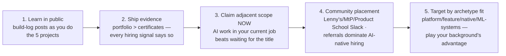

# 🔄 Transition Guides — Four Paths into AI PM

> **TL;DR:** Only ~2% of AI product roles are junior — this is overwhelmingly a lateral-move market. Good news: every adjacent role has a legitimate bridge, and the market currently rewards *demonstrated AI judgment* over AI job titles. Find your path below; each ends in the same place: [build things](../04-build-with-ai/projects.md), then [interview prep](../07-interview-prep/).

---

## Path A — Traditional PM → AI PM (the most common, fastest)

**You have:** product craft, stakeholder skills, shipping record. **You lack:** AI technical fluency, eval mindset, AI-era product patterns.

**The 8-week bridge** ([full plan](../00-start-here/README.md)): technical core (weeks 1–2) → evals deep-dive (week 3 — the single biggest differentiator) → AI product patterns (week 4) → **two shipped projects** (weeks 5–6) → domain + interview drilling (weeks 7–8).

**Positioning move:** don't wait for the title. **Claim AI scope in your current role** — propose the AI feature, run the feasibility spike, write the eval-gated PRD. "PM who shipped an AI feature at a non-AI company" is a stronger story than "PM who took a course," and it's available to you this quarter. Internal transfer to your company's AI team is the highest-probability first AI title.

**Interview framing:** lead with shipped product outcomes; use AI vocabulary *correctly and sparingly*; your differentiator is proven PM judgment now aimed at probabilistic products — not competing with ML PhDs on theory.

## Path B — Engineer / ML Engineer → AI PM

**You have:** technical depth, feasibility instincts, builder credibility. **You lack (in interviewers' eyes):** user-first framing, ambiguity navigation, influence-without-authority evidence.

**The bridge:** ① collect PM-shaped evidence where you are — own a feature's *why* (write the PRD, define metrics, run the user calls), volunteer for scoping and customer-facing work; ② learn the craft deliberately: [product craft section](../03-product-craft/), *Inspired* + *Decode and Conquer* ([books](../09-resources/books.md)); ③ retrain your interview reflexes — the failure mode is architecting when asked about users. Force the discipline: user → problem → value → *then* how. [Answer frameworks](../07-interview-prep/answer-frameworks.md) are your syllabus, and structure practice matters more for you than content.

**Where you have unfair advantage:** platform/API PM roles, agent-infrastructure PM, evals/model-quality PM — places where the user *is* a developer ([archetypes](../01-foundations/what-ai-pms-do.md)). Target those first; consumer product-sense loops are your hardest entry.

## Path C — Data Scientist / Analyst → AI PM

**You have:** metrics fluency, experimentation rigor, model literacy — the exact muscles [the metrics round](../07-interview-prep/question-bank/04-execution-metrics.md) tests. **You lack:** shipping ownership evidence and design/UX instincts.

**The bridge:** ① reframe your record from "analyses delivered" to "decisions driven and outcomes changed" — quantified; ② attach yourself to product decisions now: propose the A/B, own a metric review, write the insight-to-roadmap memo; ③ build the design muscle deliberately — [UX patterns](../03-product-craft/ux-patterns-for-ai.md) + product-sense reps daily (your interview risk concentrates there); ④ your eval story is your superpower — you've *been* the calibration human; tell it that way.

**Unfair advantage roles:** ML-systems PM (ranking, recommendations, fraud — [archetype 4](../01-foundations/what-ai-pms-do.md)), experimentation-heavy consumer products, AI analytics products.

## Path D — Domain expert (clinician, banker, lawyer, teacher, ops leader) → AI PM

**You have:** the scarcest asset in regulated AI — knowing what *correct* looks like, what workflows really are, and where the bodies are buried. **You lack:** both PM craft and AI fluency (the longest bridge, and the highest-leverage destination).

**The bridge:** ① full foundation path ([12–16 weeks](../00-start-here/README.md)); ② aim your projects at your domain — an eval golden set for clinical-note summaries written by an actual nurse is a portfolio piece no career-PM can fake; ③ target **vertical AI companies in your domain** (health: Abridge-type scribes; legal: Harvey-type; fin: underwriting/compliance AI) — they hire domain experts into product roles precisely because [domain physics](../05-domains/README.md) is their moat; ④ consider stepping-stone titles: solutions/implementation lead, clinical/domain product specialist, forward-deployed roles — 12–18 months from PM in fast-growing verticals.

**Interview framing:** you are the person who prevents the [Watson Health failure](../06-case-studies/failures-hall-of-lessons.md) — say it with that case.

---

## The universal moves (all paths)

**On certificates, honestly:** they organize learning and signal commitment; none substitutes for built evidence. Worth it: a structured course if you need the scaffolding ([verified catalog](../09-resources/courses.md) — from free Anthropic/Google tracks to Maven cohorts to the Duke specialization). Not worth it: collecting three certificates instead of shipping one project. Hiring managers consistently weight the project.

**Timeline honesty:** internal AI scope: this quarter. Path A external: 3–6 months of deliberate work. Paths B/C: 3–9 months depending on how much interview-reflex retraining you need. Path D: 6–18 months, domain-target dependent. The market's tailwind is real ([demand data](companies-hiring.md)) — but it rewards preparation, not aspiration.
