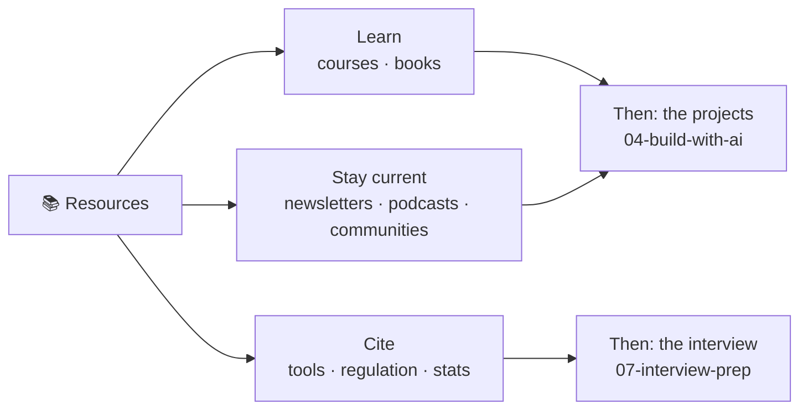

# 📚 Resources: The Verified Catalog

> **TL;DR:** Six reference pages: courses, books, the living newsletter layer, tools, regulation, and citable stats. Everything here was checked against a live source in **July 2026**; what couldn't be confirmed was omitted or marked ⚠️ unverified rather than guessed. That's the whole point: you should be able to cite this repo in an interview without getting caught.

---

## The six pages

| Page | What's inside | Use it when |
|---|---|---|
| [🎓 courses.md](courses.md) | Free foundations (Ng, Anthropic Academy, Microsoft's GitHub courses), AI-PM-specific paid programs, exec-ed tracks, and an honest decision tree | You want structure, but read "build before you badge" first |
| [📖 books.md](books.md) | The core six, ranked by job-to-be-done, plus picks by gap: ML systems, math intuition, interviews, leadership | You want foundations that don't rot in a quarter |
| [📬 newsletters-podcasts-communities.md](newsletters-podcasts-communities.md) | The recommended subscription stack by role, podcasts, YouTube, communities, and a consumption system | You need to stay current without drowning |
| [🧰 tools.md](tools.md) | Prototyping, model providers & pricing, evals/observability, benchmarks, infra, with verification dates and the 4 most volatile fact classes | You're picking a tool, quoting a price, or prepping a build |
| [⚖️ regulation-and-governance.md](regulation-and-governance.md) | EU AI Act, the US patchwork, sector regimes, voluntary frameworks, India, and what each means for your PRD | Someone asks "is this legal?" and you need the regime, trigger, obligation |
| [📊 stats-and-benchmarks.md](stats-and-benchmarks.md) | Adoption & market numbers, product benchmarks, job-market data, plus the myths that did **not** verify | You need a number you can defend in the follow-up question |

## Curation philosophy

1. **Build before you badge.** No certificate substitutes for a shipped thing. Courses are scaffolding; [the projects](../04-build-with-ai/projects.md) are the evidence. If you're choosing between a $3,000 cohort and five weekends of building, build.
2. **Pick 4 subscriptions, not 15.** The dailies overlap heavily, and one is enough. Fifteen unread newsletters is a mood, not a strategy. See the consumption system in [newsletters-podcasts-communities.md](newsletters-podcasts-communities.md).
3. **Verify volatile facts before citing them.** Model names, API prices, tool pricing, and M&A status rot in a quarter or less, which is why every page here carries a date stamp. A fresh number under a stale date is worse than no number.

## What we deliberately left out

- **The AI-PM subreddit everyone mentions.** We couldn't verify an active one, so it's not listed. ([r/ProductManagement](newsletters-podcasts-communities.md)'s AI threads instead.)
- **Prices we couldn't confirm:** Reforge membership, Stanford per-course, Kellogg tuition, Maven cohort tiers. Omitted, with a pointer to the provider page, rather than a plausible-looking guess.
- **Aggregator "statistics" sites:** the SEO listicles that recycle each other's numbers with no primary source, and sometimes invent them outright. Not a source ([per CONTRIBUTING](../CONTRIBUTING.md)). The stats page keeps a myths section precisely for the numbers those sites made popular.
- **Anything an LLM recalled but no live page confirmed**, including ours.

## How this stays fresh

This catalog rots faster than any other section of the repo, and corrections are the highest-value contribution here. If a price moved, a vendor shut down, or a regulation timeline shifted, open a PR with the source and update the date stamp, or open an issue like *"Stale: Claude pricing table in tools.md (checked Nov 2026)"*. Read [CONTRIBUTING.md](../CONTRIBUTING.md) first: claims need sources, and ⚠️ unverified is always an honest option.

---

➡️ **Next:** [Build something with it](../04-build-with-ai/projects.md). The resources are input; the projects are the output. Related: [model selection & cost](../02-technical-depth/model-selection-and-cost.md) · [responsible AI](../03-product-craft/responsible-ai.md) · [interview prep](../07-interview-prep/README.md)
