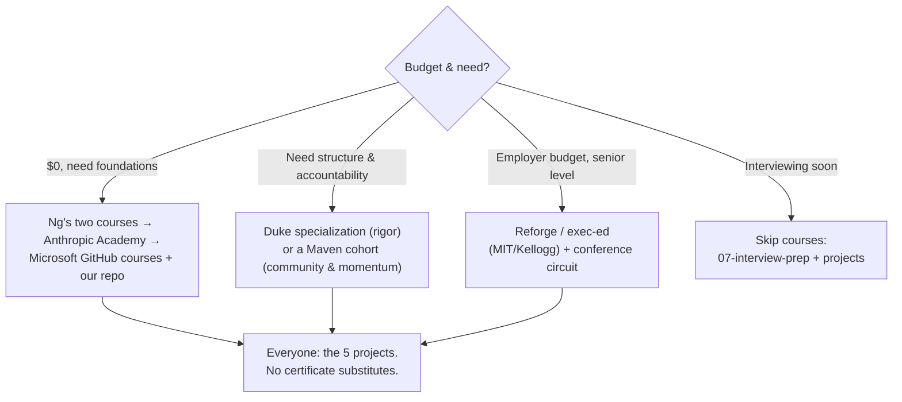

# 🎓 Courses & Certifications: The Verified Catalog

> Every entry verified to exist with a live page, **July 2026**. Prices are indicative and change; unverified prices are omitted rather than guessed. **Repo philosophy: [build before you badge](../04-build-with-ai/projects.md)**. Use courses for scaffolding, projects for evidence.

---

## Start free (genuinely good, $0)

| Course | Provider | Time | Best for |
|---|---|---|---|
| [**AI for Everyone**](https://www.deeplearning.ai/courses/ai-for-everyone) / [**Generative AI for Everyone**](https://www.deeplearning.ai/courses/generative-ai-for-everyone) | Andrew Ng, DeepLearning.AI | self-paced (check course page) | THE non-technical AI foundations; start here if brand-new |
| [**Anthropic Academy**](https://www.anthropic.com/learn) | Anthropic | self-paced, 13+ courses | AI fluency → Claude API → MCP → Claude Code tracks, free certificates; unusually practical |
| [**OpenAI Academy**](https://academy.openai.com/) | OpenAI | self-paced | Role-based ChatGPT/AI-at-work foundations, free certificates |
| [**Google AI Essentials**](https://grow.google/ai-essentials/) | Google | ~5-15 hrs | Fast broad AI-at-work credential (~$49 via Coursera; auditable) |
| [**Elements of AI**](https://www.elementsofai.com/) | Univ. of Helsinki | ~30 hrs | Zero-prerequisite concepts; 2M+ learners, 26 languages |
| [**Google ML Crash Course**](https://developers.google.com/machine-learning/crash-course) | Google | ~15 hrs | Classic ML fundamentals, updated with LLM modules |
| [**Generative AI for Beginners**](https://github.com/microsoft/generative-ai-for-beginners) (21 lessons) + **AI Agents for Beginners** (18 lessons) | Microsoft, on GitHub | project-paced | Hands-on building; pairs perfectly with [our projects](../04-build-with-ai/projects.md) |
| [**Hugging Face Learn**](https://huggingface.co/learn) (LLM course) | Hugging Face | self-paced | The open-source ecosystem's own curriculum |
| [**Kaggle Learn**](https://www.kaggle.com/learn) | Kaggle | hours per micro-course | Browser-based ML basics, zero setup |
| [**Career Essentials in Generative AI**](https://www.linkedin.com/learning/paths/career-essentials-in-generative-ai-by-microsoft-and-linkedin) | Microsoft + LinkedIn Learning | ~4-5 hrs | Quick free certificate with LinkedIn visibility |
| **Prompt engineering canon** | [Anthropic docs](https://docs.anthropic.com/en/docs/build-with-claude/prompt-engineering/overview) + [interactive tutorial](https://github.com/anthropics/prompt-eng-interactive-tutorial) (GitHub), [OpenAI Cookbook](https://developers.openai.com/cookbook), [promptingguide.ai](https://www.promptingguide.ai/) | hours | The primary sources, better than any paid prompting course |

## AI-PM-specific programs (paid; cohort or certificate)

| Program | Provider | Format / price signal | Best for |
|---|---|---|---|
| [**AI Product Management Specialization**](https://www.coursera.org/specializations/ai-product-management-duke) | **Duke University** (Coursera) | 3 courses, ~3 months, subscription (~$39-49/mo, auditable) | The most rigorous *university* grounding in ML-for-PMs; no coding |
| [**IBM AI Product Manager Professional Certificate**](https://www.coursera.org/professional-certificates/ibm-ai-product-manager) | IBM (Coursera) | subscription | Beginner-friendly PM fundamentals + genAI combo |
| [**AI Product Management 101**](https://maven.com/marily-nika/ai-product-management) / [**AI PM Bootcamp**](https://maven.com/marily-nika/ai-pm-bootcamp) / [**Advanced AI Product Leadership**](https://maven.com/marily-nika/advanced-ai-product-management) | **Marily Nika** (Maven) | cohort-based; 100+ cohorts run | The best-known AI PM instructor brand (ex-Google/Meta); strong community |
| [**AI for Product Management Certification (AIPMC)**](https://productschool.com/certifications/ai-for-product-managers) | Product School | ~$3,000-4,200, ~3 wks live | Credential + instructor network; also a free [AI Micro-Certification (AIC)](https://productschool.teachable.com/p/aic) |
| [**AI PM Certification**](https://maven.com/product-faculty/ai-product-management-certification) | Product Faculty / Rohan Varma (Maven) | cohort | Maven alternative |
| [**Reforge AI courses**](https://www.reforge.com/course-categories/ai) (AI Foundations, AI Strategy, AI Product Leadership...) | Reforge | membership | Working PMs at growth-stage companies |
| [**Section**](https://www.sectionai.com/) | Section | free tier; ~$41-82/mo | Business-side AI fluency, fast |
| **AI PM interview-prep bootcamp** | Mahesh Yadav (Maven) | cohort | Interview-focused ([see interview prep](../07-interview-prep/)) |

## Technical depth & executive tracks

- [**Stanford AI Professional Program**](https://online.stanford.edu/programs/artificial-intelligence-professional-program): graduate-lecture depth, certificate after 3 courses. For PMs who want real technical weight.
- [**fast.ai Practical Deep Learning**](https://course.fast.ai/): free; the legendary hands-on DL course if you code a little.
- [**AWS Skill Builder**](https://skillbuilder.aws/): 600+ free courses incl. "Generative AI with LLMs" (with DeepLearning.AI).
- [**MIT Sloan AI: Implications for Business Strategy**](https://executive.mit.edu/course/artificial-intelligence/a056g00000URaa3AAD.html) (~$3,200-3,850, 6 wks) and [**Kellogg: AI-Driven Product Strategy**](https://online.em.kellogg.northwestern.edu/ai-driven-product-strategy) (8 wks) are exec-ed credentials; buy for network + employer-funded budgets, not for content you can't get cheaper above.

## Choosing (the honest decision tree)

⚠️ Couldn't verify at check time (omitted rather than guessed): exact Reforge membership price, Stanford per-course fee, Kellogg tuition, Maven cohort tier pricing. Check provider pages.
