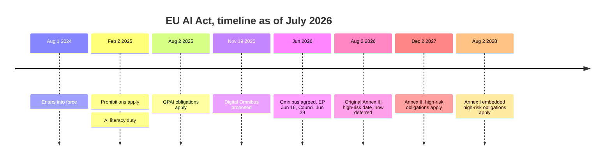
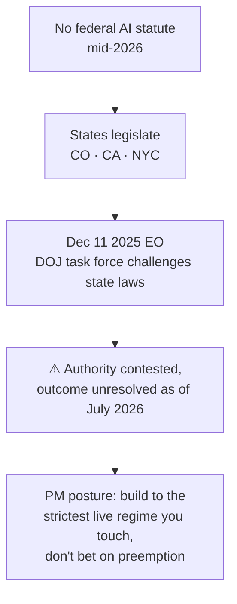
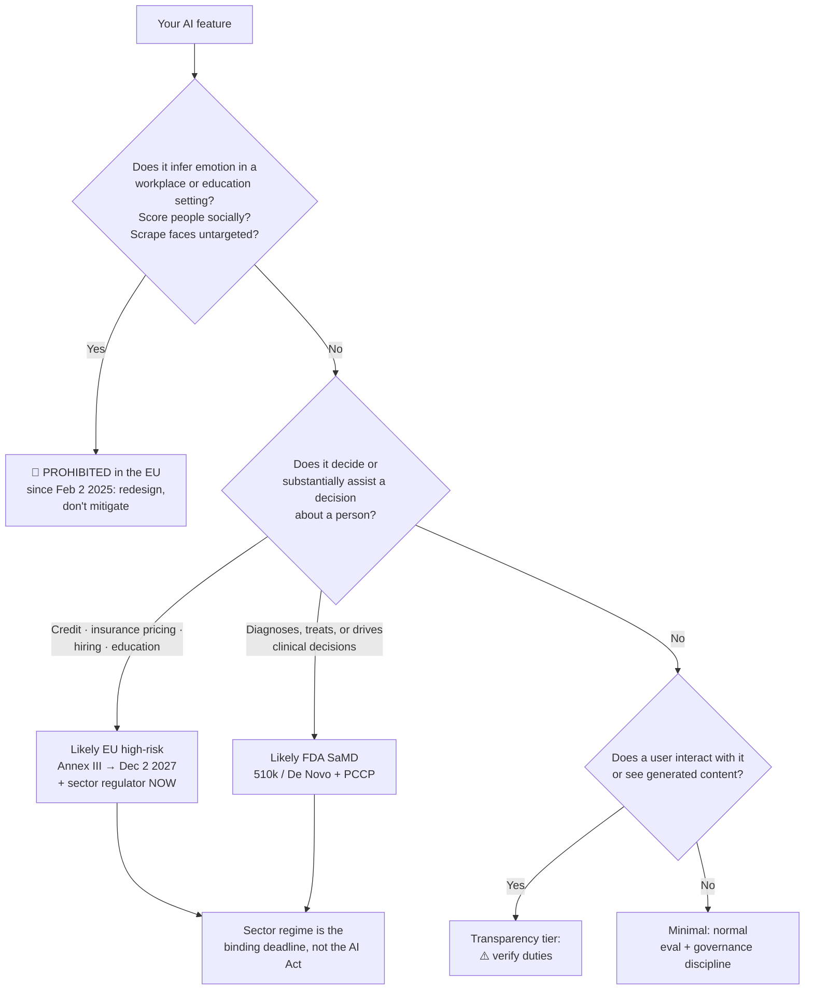

# ⚖️ Regulation & Governance: The AI PM's Reference

> **TL;DR:** You don't need a law degree. You need to know which regime your feature triggers, what artifact it demands, and who signs it off. Name the regime, the trigger, the obligation; that's the whole skill.

> ⚠️ **Status verified July 2026. Regulation moves; verify before citing in an interview or a PRD.** Dates below were true at check time. Anything the source notes couldn't confirm is marked ⚠️ unverified or omitted rather than guessed.

---

## 1. The EU AI Act: the only comprehensive AI statute that matters right now

It's horizontal (applies across sectors), risk-tiered, and extraterritorial in effect: if your product reaches EU users, it reaches you.

### 1.1 The four risk tiers

| Tier | What it means | Examples (from verified notes) |
|---|---|---|
| **Unacceptable** | Banned outright since **Feb 2, 2025** | Social scoring · manipulative AI · **emotion inference in the workplace or education** · untargeted scraping of facial images · most real-time remote biometric identification |
| **High-risk** | Permitted, but heavily conditioned. Split across **Annex III** (standalone use cases, now **Dec 2, 2027**) and **Annex I** (AI embedded in products already covered by EU product-safety law, now **Aug 2, 2028**) | **Credit scoring**; **life & health insurance pricing** (both Annex III). Employment/hiring and education uses are commonly treated as Annex III. ⚠️ Verify against the consolidated Annex III text before relying on it |
| **Limited** | Transparency obligations only | ⚠️ The specific duties are not itemized in the verified notes. Verify the transparency article before citing |
| **Minimal** | The default bucket; the vast majority of AI features | ⚠️ Residual obligations not itemized in the verified notes |

Separately: **GPAI (general-purpose AI model)** obligations landed **Aug 2, 2025**, and this is the layer that hits model providers, not most application PMs. If you're a *deployer* building on someone else's model, your obligations mostly flow from the use-case tier, not the model tier.

### 1.2 Penalties

| Cap | Basis |
|---|---|
| **€35M or 7%** of global turnover | The top tier |
| **€15M or 3%** | Middle tier |
| **€7.5M or 1%** | Lowest tier |

⚠️ Which violation type maps to which cap is not itemized in the verified notes. Check the Act's penalty article before quoting a specific pairing in an interview. Quote the €35M/7% ceiling and you'll be right about the headline.

### 1.3 What the Digital Omnibus did (and did NOT) do

Proposed **Nov 19, 2025**; European Parliament **June 16, 2026**; Council **June 29, 2026**.

| ✅ It did | ❌ It did NOT |
|---|---|
| Postpone Annex III high-risk obligations from **Aug 2, 2026 → Dec 2, 2027** | Cancel high-risk obligations |
| Postpone Annex I embedded high-risk to **Aug 2, 2028** | Touch the **prohibitions** (live since Feb 2025) |
| Narrow some definitions | Touch **GPAI obligations** (live since Aug 2025) |
| Soften the AI literacy duty | Change the penalty ceilings |

**The PM read:** the August 2026 cliff is deferred, not removed. If you're building a credit-scoring or insurance-pricing feature, you bought ~16 months of runway, not an exemption. Compliance artifacts (documentation, risk management, human oversight design) are cheaper to build *into* v1 than to retrofit in 2027. Teams that treated the delay as cancellation will do this twice.

---

## 2. The United States: no federal statute, a live preemption fight

**There is no federal AI statute as of mid-2026.** What exists is executive action plus a patchwork of state law that the executive branch is now trying to preempt.

| Instrument | Date | What it does |
|---|---|---|
| **EO 14179** | Jan 23, 2025 | Revoked Biden's **EO 14110** |
| **America's AI Action Plan** | July 2025 | Federal AI policy agenda |
| **Preemption EO** | **Dec 11, 2025** | DOJ task force to challenge state AI laws · funding conditions · FTC preemption statement. **Legal authority contested** |

### 2.1 State law: what's actually live

| Law | Status (July 2026) | What a PM needs to know |
|---|---|---|
| **Colorado AI Act (SB 24-205)** | **Delayed to Jan 1, 2027** *and* gutted by **SB 26-189, signed May 14, 2026** | The amendment **removed the duty of care, the impact-assessment requirement, and AG reporting**. The "first US comprehensive AI law" talking point is now largely obsolete, and candidates still citing the original version sound a year stale |
| **California SB 1047** | **Vetoed Sept 29, 2024** | Never became law. Frequently mis-cited as if it did |
| **California SB 53** | **Signed Sept 29, 2025 · effective Jan 1, 2026** | Frontier AI **transparency**: safety frameworks, incident reporting, whistleblower protections. **$1M per violation** |
| **California AB 2013** | Live | **Training-data disclosure** |
| **California SB 942** | Live | ⚠️ Substance not detailed in the verified notes. Verify before citing |
| **NYC Local Law 144** | Live since 2023 | **AEDT** (automated employment decision tool) **bias audits** |

**The SB 1047 vs. SB 53 contrast is the single best US-regulation interview beat:** exactly one year apart to the day, California rejected the *liability-and-kill-switch* model (vetoed Sept 29, 2024) and passed the *transparency-and-incident-reporting* model (signed Sept 29, 2025). That's not trivia. It's the direction of travel: disclose what you did, report when it breaks, protect the people who speak up.

---

## 3. Sector regimes: where the real obligations live

Most AI PMs will never touch the AI Act. Almost all of them will touch a sector regulator that has governed algorithms for decades.

| Sector | Regime | Trigger | Obligation |
|---|---|---|---|
| **Healthcare** | **FDA SaMD** (510(k) / De Novo) | Software that diagnoses, treats, or drives clinical decisions | Premarket authorization. **~1,451 cumulative AI-enabled devices through 2025** (331 in 2025; **~76% radiology**). **Jan 2025 draft guidance** incl. **PCCPs**: pre-specify how the model may be updated post-clearance, or every retrain is a new submission. LLM clinical chat mostly sits *outside* cleared pathways today |
| **Healthcare (data)** | **HIPAA** | PHI touching an LLM | **BAA required.** Consumer ChatGPT is **not** compliant; BAAs available via ChatGPT Enterprise/Edu, Azure OpenAI, Bedrock, Google Cloud. **Necessary, not sufficient** |
| **Finance** | **SR 11-7** (2011) | Any model driving material decisions at a supervised institution | Model inventory · **independent validation** · ongoing monitoring. Applies to AI/ML with no carve-out |
| **Finance** | **ECOA / Reg B** | Adverse credit action | **Specific** adverse-action reasons. **CFPB Circulars 2022-03 and 2023-03 foreclose the "too complex to explain" defense.** Proxy variables → disparate impact |
| **Finance (EU)** | AI Act **Annex III** | Credit scoring; life/health insurance pricing | High-risk, now applying **Dec 2, 2027** |
| **Education** | EU AI Act | Education use cases (⚠️ verify Annex III scope) | High-risk obligations, deferred to Dec 2027, **plus the hard stop: emotion inference in education is a prohibited practice, live since Feb 2, 2025** |
| **Employment / hiring** | **NYC LL144** + EU AI Act | AEDTs used in hiring; hiring uses in the EU (⚠️ verify Annex III scope) | **Bias audits** (LL144, since 2023); high-risk obligations in the EU |

**The employment anchor: Amazon's recruiting tool.** Built from 2014, it ranked résumés 1-5 stars, trained on ten years of mostly-male résumés. It penalized the word "women's" and downgraded two all-women's colleges. Amazon's engineers edited it and **still couldn't guarantee neutrality**, so they disbanded it (Reuters, Oct 10, 2018). The root cause is the whole lesson: **the labels were past biased hiring decisions.** No fairness metric saves a model whose ground truth is the discrimination you're trying to remove. Cite this and then say what you'd do differently. That's the answer, not the anecdote. ([Full case](../06-case-studies/failures-hall-of-lessons.md))

---

## 4. Voluntary frameworks: what you actually implement

Regulation tells you *that* you must govern. These tell you *how*, and buyers ask for them long before regulators do.

| Framework | Published | What it is | Why a PM cares |
|---|---|---|---|
| **NIST AI RMF 1.0** | **Jan 2023** | Four functions: **Govern · Map · Measure · Manage** | The common vocabulary in US enterprise procurement. Voluntary, not certifiable |
| **NIST Generative AI Profile (NIST-AI-600-1)** | **July 26, 2024** | The RMF applied to genAI risks | The genAI-specific companion; cite the number and you sound like you've read it |
| **ISO/IEC 42001:2023** | Dec 2023 | **Certifiable** AI management system (AIMS): the ISO 27001 of AI | Early certs: **AWS (Nov 2024)**, **Anthropic (Jan 2025)**, **Microsoft (Copilots)**. Increasingly an enterprise RFP line item |
| **Model cards** | **Mitchell et al., 2019** (arXiv:1810.03993) | Structured disclosure: intended use, performance by group, limitations | The origin artifact for every "responsible AI" doc you'll write |
| **System cards** | Ongoing | Model cards extended to the deployed system | OpenAI system cards; Anthropic model/system cards |

**RMF vs. 42001 in one line:** NIST tells you how to think about risk; ISO 42001 gives you something an auditor can certify. Enterprises buying from you increasingly want the second.

See [responsible-ai.md](../03-product-craft/responsible-ai.md) for how these translate into design decisions.

---

## 5. India: data first, AI later

| Item | Status |
|---|---|
| **DPDP Act 2023** | Rules **notified Nov 13, 2025** |
| Data Protection Board | **Immediate** |
| Consent managers | **Nov 2026** |
| Substantive obligations | **By May 14, 2027** |
| Binding AI statute | **None** as of mid-2026 |
| **MeitY India AI Governance Guidelines** (~Nov 2025) | Principles-based, **voluntary**. ⚠️ Specifics unverified; do not cite provisions |

**The PM read:** India's live constraint is **privacy, not AI**. If you're shipping to India, DPDP consent and data-handling obligations are the phased deadline on your roadmap; there is no AI-specific compliance gate to clear.

---

## 6. What this means for your PRD

### 6.1 Classify on day one

Do this in the PRD's first draft, not after legal review. Wrong tier discovered late = re-architecture.

**The most important line on this chart:** for a credit or health feature, **the sector regulator binds you today**. SR 11-7 and Reg B don't care that the AI Act moved to 2027, and FDA doesn't either. The AI Act is the *later*, *additional* layer.

### 6.2 Artifacts by regime

| Regime | Artifacts it demands |
|---|---|
| **EU AI Act, high-risk** | Risk management + technical documentation + human-oversight design + post-market monitoring. ⚠️ Verify the exact Annex IV/Art. 9-17 list against the consolidated text; the notes don't itemize it |
| **EU AI Act, prohibitions** | None. There is no paperwork that makes a banned practice legal. Redesign |
| **FDA SaMD** | Premarket submission (510(k)/De Novo) · clinical validation evidence · **PCCP** if the model will be retrained |
| **HIPAA** | **Signed BAA** with every LLM vendor touching PHI · minimum-necessary scoping · audit trails · retention rules |
| **SR 11-7** | Model inventory entry · **independent validation** (not by the build team) · monitoring plan |
| **ECOA / Reg B** | **Adverse-action reason codes that a human can read**: a launch requirement, never a v2 item |
| **NYC LL144** | **Bias audit** for the AEDT |
| **California SB 53** (frontier) | Published safety framework · incident reporting · whistleblower channel |
| **California AB 2013** | Training-data disclosure |
| **Enterprise buyers** | Model card · system card · NIST RMF mapping · increasingly **ISO/IEC 42001** certification |

### 6.3 Who signs off

| Artifact | Owner | Signer |
|---|---|---|
| Tier classification | **PM** | Legal/privacy counsel |
| Golden set + eval bar ([evals.md](../02-technical-depth/evals.md)) | PM | Eng lead |
| Fairness slices (by demographic) | PM + DS | Legal, and for health: clinical safety |
| BAA / vendor data terms | Legal | Security + privacy |
| Independent model validation (SR 11-7) | **Model risk function, explicitly not you** | Chief Risk Officer |
| Bias audit (LL144) | Independent auditor | Legal |
| Model card / system card | PM | Comms + legal |
| Human-oversight design | **PM: this is product design, not compliance** | Legal |

**The pattern worth internalizing:** classification and oversight design are *PM* work. Validation and audit must be *independent* of you; that's the entire point of them. A PM who says "I'd run the bias audit myself" has just failed the question.

---

## 7. How to reference regulation in an interview

**The failure mode:** *"We'd need to make sure we're compliant with regulations and work with legal."* This says nothing. Every candidate says it. It signals you've never shipped into a regulated surface.

**The formula: name the regime → name the trigger → name the obligation.** Three clauses, ~15 seconds, and you sound like you've done this.

> **Regime**: the specific law, rule, or circular (with a date if you have it)
> **Trigger**: the fact about *your feature* that pulls it in
> **Obligation**: the concrete artifact or constraint it imposes

### Worked one-liners

**Prompt: "Design an AI résumé screener."**
> *"Two regimes bite immediately. **NYC Local Law 144**: the trigger is using an automated employment decision tool for a role in NYC, and the obligation is a **bias audit**. **EU AI Act**: hiring uses sit in the high-risk bucket, deferred to **Dec 2, 2027**. Deferred, not cancelled, so I'd build the documentation into v1 rather than retrofit it. And the design constraint that outranks both: Amazon trained on ten years of mostly-male résumés, penalized the word 'women's', couldn't fix it, and killed the tool. The labels **are** the bias. So I wouldn't train on past hiring decisions at all. I'd score against structured job criteria and keep a human as the decider."*

**Prompt: "Ship an LLM that explains credit decisions."**
> *"**ECOA/Reg B** is the trigger: an adverse credit action requires **specific reasons**, and **CFPB Circulars 2022-03 and 2023-03** foreclose the 'our model is too complex to explain' defense. So reason codes are a launch blocker, not a v2 item. Second regime: **SR 11-7** puts this in the model inventory with **independent validation**, not by my team. Third, EU: credit scoring is **Annex III high-risk**, applying **Dec 2, 2027**. And the LLM never decides. It renders reason codes produced by a validated scoring model into plain language, with a faithfulness eval that fails the response if it invents a reason the model didn't emit."*

Notice what both do: they end on a **product decision the regulation forced**. Regulation knowledge is only impressive when it changes the design. Reciting statute numbers without a design consequence is trivia.

### Three credibility rules

1. **Date your facts.** "As of July 2026" costs you a second and buys enormous credibility, especially on Colorado and the omnibus, where the answer changed in 2026.
2. **Say "I'd verify" instead of guessing.** Confidently wrong on a penalty tier is worse than "I know the ceiling is €35M or 7%; I'd check which tier applies."
3. **Know the two traps.** **SB 1047 was vetoed**, and candidates cite it as law constantly. **Colorado was gutted in May 2026**, and candidates cite the original duty of care that no longer exists. Getting these right in a room where the interviewer knows is worth more than everything else on this page.

---

## 8. Self-test

1. The omnibus moved Annex III to Dec 2027. Name two things it did **not** change. *(Prohibitions, live since Feb 2, 2025; GPAI obligations, live since Aug 2, 2025. Also: penalty ceilings.)*
2. Your health-AI feature is high-risk under the EU AI Act, which now applies Dec 2027. Why is that not your binding deadline? *(FDA and HIPAA bind today. The AI Act is an additional later layer, not the first gate.)*
3. What's the difference between NIST AI RMF and ISO/IEC 42001? *(RMF = voluntary risk vocabulary, Jan 2023, Govern/Map/Measure/Manage. 42001 = certifiable management system; auditors issue certificates; AWS Nov 2024, Anthropic Jan 2025.)*
4. A PM says "we'll add explainability to the credit model in v2." What do you say? *(Reg B requires specific adverse-action reasons at launch; CFPB Circulars 2022-03/2023-03 killed the complexity defense. There is no v2.)*
5. Which US state law is most commonly mis-cited as being in force? *(California SB 1047, vetoed Sept 29, 2024. SB 53 is the one that passed, a year later to the day.)*

---

➡️ **Next:** [Responsible AI](../03-product-craft/responsible-ai.md), turning these obligations into design decisions. Related: [PRD template](../03-product-craft/prd-template-ai-feature.md) · [evals](../02-technical-depth/evals.md) · [healthcare](../05-domains/healthcare.md) · [fintech](../05-domains/fintech.md) · [failures hall of lessons](../06-case-studies/failures-hall-of-lessons.md)

*Status verified July 2026. Every date and figure above traces to the repo's verified research notes; items the notes couldn't confirm are marked ⚠️. Regulation moves, so re-verify before citing.*
