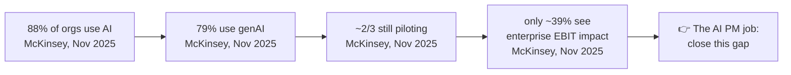
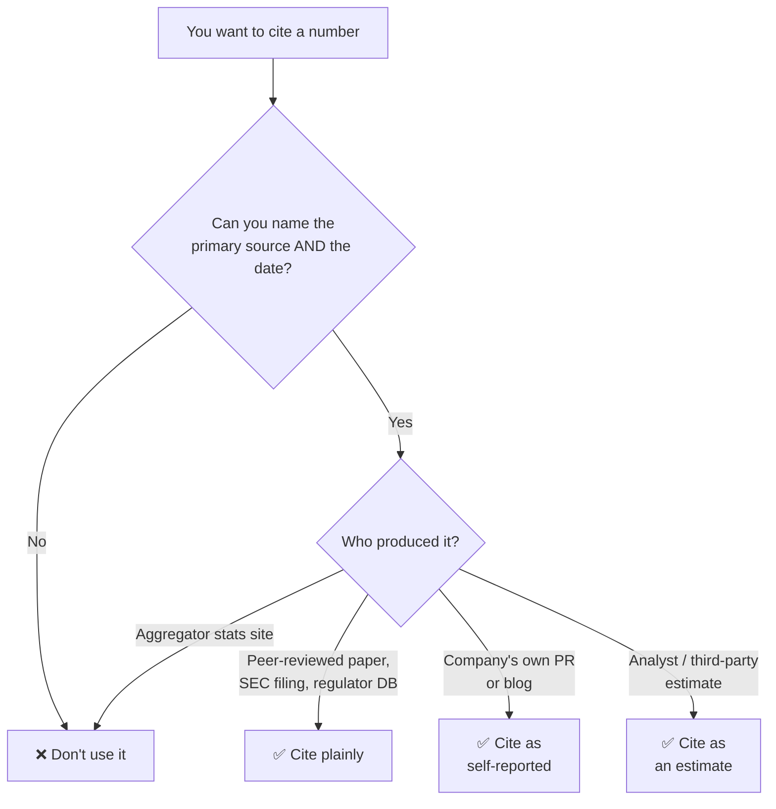

# 📊 Stats & Benchmarks: The Citable Cheat Sheet

> **TL;DR:** Numbers win arguments, but only if they're real and dated. Every stat here was verified against a primary source in **July 2026**; the myths section lists the popular numbers that did **not** survive verification.

---

## 1. Adoption & market

| Stat | Number | Source | Date |
|---|---|---|---|
| Orgs using AI in ≥1 business function | **88%** | McKinsey, State of AI | Nov 2025 |
| Orgs using generative AI | **79%** | McKinsey, State of AI | Nov 2025 |
| Orgs reporting **enterprise-level EBIT impact** from AI | only **~39%** | McKinsey, State of AI | Nov 2025 |
| Orgs still **piloting** rather than scaling | **~2/3** | McKinsey, State of AI | Nov 2025 |
| Orgs experimenting with **agents** | **62%** | McKinsey, State of AI | Nov 2025 |
| Global corporate AI investment | **$581.7B** in 2025 (**~+130% YoY**) | Stanford HAI, AI Index 2026 | 2026 |
| GenAI-specific investment growth | **+>200%** | Stanford HAI, AI Index 2026 | 2026 |
| GenAI adoption, share of global population within 3 years | **~53%**, faster than PC or internet | Stanford HAI, AI Index 2026 | 2026 |
| US adult genAI adoption | **28.3%** | Stanford HAI, AI Index 2026 | 2026 |
| Avg enterprise LLM spend | **~$4.5M → ~$7M** over two years | a16z | 2025 |
| Share of LLM spend from **innovation budgets** | **25% → 7%** (i.e. it became a permanent line item) | a16z | 2025 |
| Enterprises running **5+ models** in production | **37%** (up from 29%) | a16z | 2025 |

**The two-number move.** The 88%/39% pair from the *same* McKinsey survey is the strongest opener in an AI PM interview: near-universal adoption, scarce P&L impact. That gap is your job description. Pair it with the a16z 25%→7% shift and you've described a market that has stopped experimenting with budgets but hasn't started proving returns, which is exactly why [strategy](../03-product-craft/ai-product-strategy.md) and [metrics](../03-product-craft/metrics-for-ai-products.md) questions dominate loops.

## 2. Product benchmarks worth citing

### ChatGPT
| Fact | Number | Source | Date |
|---|---|---|---|
| Launch | Nov 30, 2022 | OpenAI | Nov 2022 |
| ~100M monthly users in ~2 months | **⚠️ analyst estimate**: UBS/Similarweb, *not* an OpenAI figure | UBS/Similarweb | Jan 2023 |
| Weekly active users | **800M WAU** | OpenAI DevDay | Oct 2025 |
| Weekly active users + paying subs | **900M WAU, 50M paying subscribers** | OpenAI (announced alongside its $110B round) | Feb 27, 2026 |

The 100M number is the most-repeated AI statistic in existence and it is an **analyst estimate**. Say so out loud; the distinction is a free credibility point.

### GitHub Copilot
| Fact | Number | Source | Date |
|---|---|---|---|
| Task completion speed | **55.8% faster** (1h11m vs 2h41m, P=.0017, CI [21%, 89%]) | Peng et al., **arXiv:2302.06590**, n=95 RCT | 2023 |
| Self-reported productivity | **88% felt more productive** | GitHub survey | - |
| All-time users | **20M** | Nadella | July 2025 |
| Paid subscribers | **~4.7M, +75% YoY** | Microsoft FY26 Q2 earnings | Jan 28, 2026 |

**Cite the caveats, not just the 55.8%.** It is one task type (writing an HTTP server in JavaScript), greenfield, n=95, with a wide confidence interval. It does not generalize to maintaining a large legacy codebase. A candidate who says *"55.8% faster on one greenfield JS task in a 95-person RCT"* sounds senior; one who says *"Copilot makes devs 55% faster"* sounds like a press release. ([Full case](../06-case-studies/github-copilot.md))

### Netflix recommendations
| Fact | Number | Source | Date |
|---|---|---|---|
| Hours streamed originating from recommendations | **80%** (~20% from search) | Gomez-Uribe & Hunt, ACM TMIS 6(4), DOI 10.1145/2843948 | Dec 2015 / Jan 2016 |
| Value of personalization + recs | **>$1B/year**, ⚠️ **the authors' own estimate** | same | same |

Both numbers are **self-reported and a decade old**, with no updated audited figures. Still the canonical recommender stat; just date it and flag it. ([Full case](../06-case-studies/netflix-recommendations.md))

### Klarna AI assistant
| Fact | Number | Source | Date |
|---|---|---|---|
| Conversations in month one | **2.3M = 2/3 of all customer service chats** | Klarna press release / OpenAI case study | Feb 27, 2024 |
| Profit improvement | **~$40M estimate** for 2024 | same | Feb 27, 2024 |
| Resolution time | **11 min → <2 min**; 25% fewer repeat inquiries; 23 markets, 35+ languages | same | Feb 27, 2024 |
| The reversal | CEO Siemiatkowski: cost-cutting **"went too far"**; rehiring humans; hybrid model | Bloomberg | May 2025 |

Never cite the Feb 2024 numbers without the May 2025 reversal. The pair *is* the insight: public efficiency stats create public reversals. ([Full case](../06-case-studies/klarna-ai-assistant.md))

### Spotify Discover Weekly
| Fact | Number | Source | Date |
|---|---|---|---|
| Launched | July 2015 | Spotify | 2015 |
| Tracks streamed from Discover Weekly, 10 years | **100B+** | Spotify Newsroom (10-yr anniversary) | Jun 30, 2025 |
| New-artist discoveries per week | **>56M**, **77% emerging artists** | Spotify Newsroom | Jun 30, 2025 |

### Others
| Product | Number | Source | Date |
|---|---|---|---|
| **Adobe Firefly** | **1B images** generated ~3 months after the March 2023 beta launch; **24B+** generations by 2025 | Adobe | 2023 / 2025 |
| **Zoom AI Companion** | **Paid AI Companion MAU +184% YoY** | Zoom Q1 FY27 earnings | ~May 2026 |
| **FDA AI-enabled devices** | **~1,451 cumulative** through 2025; **331 authorized in 2025**; **~76% radiology** | Imaging Wire | Mar 2026 |

The FDA numbers are the most useful stat in any [healthcare](../05-domains/healthcare.md) interview: they prove regulated AI ships at scale, and the 76% radiology concentration explains *which* problems clear the bar (digital data, clear ground truth, assistive framing).

## 3. Job market & comp

| Stat | Number | Source | Date |
|---|---|---|---|
| US AI product jobs posted since Jan 2026 | **12,397** | Axial Search | 2026 |
| Seniority mix | **~half Manager-level; only 2% junior** | Axial Search | 2026 |
| Industry mix | tech ~1/3; financial services 13%; **41% from 10K+ employee companies** | Axial Search | 2026 |
| Median advertised comp | **$195K** | Axial Search | 2026 |
| Fastest-growing job title | **AI Engineer #1, +143% YoY in 2025**. Note: **AI PM itself is not ranked** (adjacent signal only) | LinkedIn, 2026 Jobs on the Rise | 2026 |
| OpenAI PM total comp | **median ~$860K TC** ($310K base), range $300K-$950K+ | levels.fyi | July 2026 |
| Anthropic PM total comp | **median ~$349K TC**, small sample; corroborated by **$305K-$460K posted** | levels.fyi + job posting | July 2026 |
| US average AI PM salary | **~$159K** | ZipRecruiter | July 2026 |
| India average AI PM salary | **₹30 LPA** (P25 ₹18.25, P75 ₹45.5, **P90 ₹80.6**) | Glassdoor | May 2026 |

⚠️ **Single-source, so mark it if you use it:**
- **">20% CAGR"** for the AI PM market: Research.com only.
- **"40,000+ LinkedIn AI Product Manager roles"**: Eleken only.

Two honest framings the numbers support: the market is **senior-skewed** (2% junior openings is the single most important fact for anyone trying to break in; see [transition guides](../08-career/transition-guides.md)), and **frontier-lab comp is not the market** (~$860K median at OpenAI vs ~$159K US average is a ~5x spread; quoting the former as "AI PM pay" reads as naive). Full detail: [compensation](../08-career/compensation.md).

## 4. ☠️ The myths that did NOT verify: do not cite these

| The claim | Why it fails | What to say instead |
|---|---|---|
| **"Copilot writes 40-46% of code"** | A real talking point, but no stable primary source and no date attached to the figure as circulated | If you use it at all, date it and attribute it explicitly; otherwise use the verified **55.8% RCT** with its caveats |
| **"Klarna fired 700 people and replaced them with AI"** | **False framing.** The "700" was a *workload-equivalence* claim ("work of 700 full-time agents"). The ~700-person **layoff was in 2022**: macro-driven, and *before* the assistant existed | "Klarna said the assistant handled work equivalent to 700 agents (Feb 2024), and by May 2025 the CEO said efficiency had gone too far and was rehiring" |
| **Zillow "$881M loss"** | Not verified. The verified figures are a **~$304M Q3 2021 write-down** and **$407.9M FY2021 write-downs (10-K)**, plus **~2,000 layoffs (~25% of workforce)** | Cite the 10-K numbers; check the Q4 2021 shareholder letter yourself before ever saying $881M |
| **Spotify AI DJ "16% of Premium users weekly" / "4B hours"** | SEO blogs only; no primary source | Use the **Discover Weekly** numbers (Spotify Newsroom, Jun 30, 2025): same theme, real source |
| **ChatGPT "1 billion weekly users"** | Unverified. The last official figure is **900M WAU (Feb 2026)** | "900M weekly actives as of February 2026" |
| **Duolingo Birdbrain "1.25B exercises daily / 14ms latency"** | Blogs only | Describe Birdbrain from **IEEE Spectrum**: an LSTM predicting per-exercise difficulty, 40-dim learner vector, updated after every exercise ([case](../06-case-studies/duolingo.md)) |
| **McDonald's "260 chicken nuggets"** | Viral retelling; no primary source | The verified story: IBM drive-thru piloted from 2021 at ~100 US locations, ended June 2024 (CNBC), with widely-shared order errors |
| **Copilot "$500M ARR"** | Microsoft does not break it out | Use **~4.7M paid subs, +75% YoY** (Microsoft FY26 Q2, Jan 28, 2026) |
| **"77% of orgs building AI governance / 36% adopted NIST AI RMF"** | Vendor blog; no named survey behind it | Cite the framework itself (NIST AI RMF 1.0, Jan 2023) and say adoption rates are not reliably measured ([responsible AI](../03-product-craft/responsible-ai.md)) |

### ⚠️ Sourcing-quality warning
Aggregator "statistics" sites (the SEO-built pages that rank for queries like *"AI adoption statistics 2026"*) frequently **fabricate or extrapolate** numbers, then cite each other until the figure looks established. Several myths above (Spotify's AI DJ usage figures, Birdbrain's latency numbers) trace back to exactly this loop. If a stat appears only on sites like these, treat it as non-existent. Rule: click through to the **company's own newsroom/press release, an SEC filing, an earnings call, a peer-reviewed paper, or a regulator's database**, or drop the number.

## 5. How to cite in an interview

Three rules. They are cheap to follow and they are what separates a candidate who *reads* from a candidate who *verifies*.

1. **Date every number.** AI stats decay in months, not years. "As of February 2026..." costs you two seconds and buys you the benefit of the doubt on everything else you say.
2. **Say "self-reported" or "analyst estimate" when it is one.** Netflix's $1B is the authors' own estimate. ChatGPT's 100M-in-two-months is UBS/Similarweb, not OpenAI. Klarna's $40M is Klarna's. Naming the limitation *is* the signal; it shows you'd apply the same rigor to your own launch metrics.
3. **Prefer a success + failure pair on the same theme.** One number is a fact; two opposing numbers are judgment. Adoption + EBIT impact. Klarna's 2.3M conversations + the CEO's reversal. Copilot's RCT + its narrow task scope.

**Worked example:**

> *"Klarna reported 2.3M assistant conversations in month one (two-thirds of their chat volume) and estimated ~$40M in 2024 profit improvement. That's their own press release, February 2024. What I'd hold onto is the sequel: by May 2025 their CEO told Bloomberg the cost-cutting went too far and they were rehiring humans. So I'd treat deflection rate as a cost metric, not a quality metric, and gate any rollout on resolution quality and escalation rate too."*

Two dated numbers, an explicit self-reported flag, the failure paired with the success, and a product decision at the end. That's the whole move.

---

➡️ **Next:** [Case studies](../06-case-studies/README.md) for the full stories behind these numbers · [Answer frameworks](../07-interview-prep/answer-frameworks.md) for where to put them · [Evals](../02-technical-depth/evals.md) for measuring your own.
