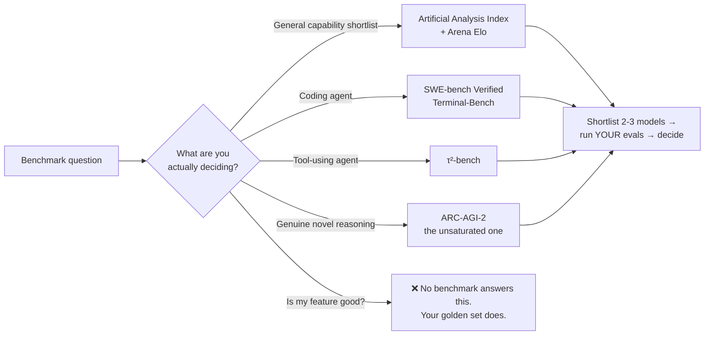
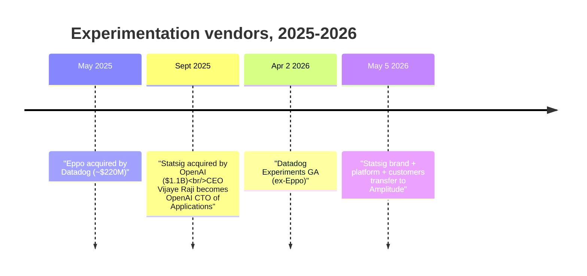
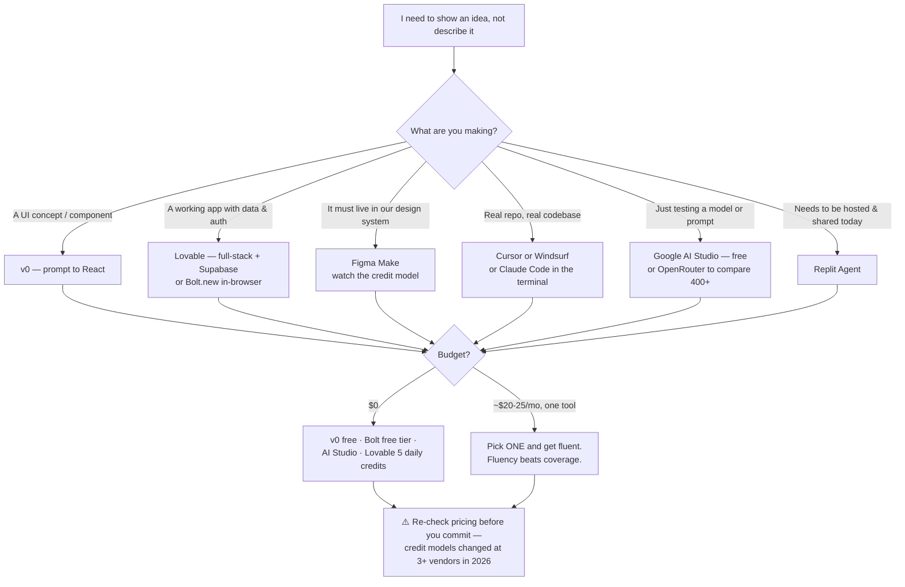

# 🧰 Tools — The Verified AI PM Directory

> **TL;DR:** Every tool below was verified live in **July 2026** — prices, ownership, and shutdowns included. Nothing here is guessed: where a fact couldn't be confirmed it's marked ⚠️ unverified or omitted. This page rots faster than anything else in the repo; **re-verify the [4 volatile fact classes](#8-the-4-most-volatile-fact-classes--re-verify-before-citing) before you cite them in an interview or a doc.**

*Verification date: **2026-07-16**. `—` in a URL cell means no official URL was captured at verification time — search rather than trust a guessed link.*

---

## 1. Prototyping & vibe-coding — the PM's new sketchpad

The single highest-leverage category for PMs: these turn a PRD paragraph into a clickable thing in an afternoon. Pair with [the projects track](../04-build-with-ai/projects.md).

| Tool | What it does | Pricing / status (July 2026) | URL |
|---|---|---|---|
| **v0** (Vercel) | Prompt → React/UI components | Free ($5/mo credits); Pro $20/mo. ACTIVE | https://v0.app/pricing |
| **Lovable** | Prompt → full-stack app (Supabase backend) | Free (5 daily credits); Pro $25/mo; Business $50/mo. ACTIVE — ~$300M ARR, 8M+ users, $6.6B valuation | https://lovable.dev/pricing |
| **Bolt.new** (StackBlitz) | In-browser AI app builder | Free (1M tokens/mo); Pro $25/mo. ACTIVE | https://bolt.new/pricing |
| **Replit Agent** | Agentic app building + hosting | Starter free; Core $25/mo ($20 annual, $20 credits); Pro $100/mo (from Feb 24, 2026). ACTIVE | https://replit.com/pricing |
| **Cursor** (Anysphere) | AI-native IDE | Hobby free; Pro $20/mo; Pro+ $60; Ultra $200; Teams $40/user. ⚠️ **Acquisition pending** — see churn notes | https://cursor.com |
| **Claude Code / Artifacts** (Anthropic) | Agentic coding CLI + shareable artifacts | Claude Pro $17/mo annual ($20 monthly); Max from $100/mo; API per-token. ACTIVE | https://claude.com/pricing |
| **Figma Make** | Design-file-native prompt-to-prototype | GA July 2025. Paid Figma plans (Full seats $16/$55/$90 per mo); Starter ~500 AI credits/mo; credit enforcement from Mar 18, 2026; PAYG $0.03/credit Q2 2026 | https://www.figma.com/make/ |
| **Windsurf** | AI IDE (SWE-1.5, Codemaps, Devin integration) | $15/mo. ACTIVE — **now owned by Cognition** | https://windsurf.com |
| **Google AI Studio** | Free model playground + API keys | Free playground; free-tier keys for Flash models (Gemini **Pro is paid-only since Apr 1, 2026**) | https://ai.google.dev/aistudio |
| **ChatGPT Canvas** | Side-panel writing/code workspace | ❌ **SUNSET May–June 2026** — folded into inline writing/code blocks in GPT-5.5+ | — |
| **ChatPRD** (Claire Vo) | AI PRD drafting/coaching for PMs | ACTIVE — 100K+ PMs | https://www.chatprd.ai |

### Churn notes — the three you'll get wrong in an interview

| What people still say | What's actually true (July 2026) |
|---|---|
| "Use ChatGPT Canvas for drafts" | **Sunset May–June 2026.** Replaced by inline writing/code blocks in GPT-5.5+. Related: **o3 retires Aug 26, 2026.** |
| "Windsurf, the independent Cursor rival" | **Acquired by Cognition** — agreement July 2025, ~$250M reported, closed ~Dec 2025. Still shipping (SWE-1.5, Codemaps, Devin integration). ⚠️ Price/close details are secondary-sourced. |
| "Cursor, the $4B independent" | **SpaceX agreed to acquire Anysphere for $60B all-stock (June 16, 2026); close expected Q3 2026 — ⚠️ PENDING, not closed.** ~$4B annualized revenue. (Context: xAI merged into SpaceX May 6, 2026.) |

**PM reading:** Colin Matthews, *["A guide to AI prototyping for product managers"](https://www.lennysnewsletter.com/p/a-guide-to-ai-prototyping-for-product)* (and *"How to get your entire team prototyping"*).

---

## 2. Model providers & flagship pricing

> ### ⚠️ VOLATILITY WARNING — READ BEFORE QUOTING
> **This is a snapshot of 2026-07-16, not a standing fact.** Model names and prices churn *quarterly*; several rows below will be wrong within a quarter. For a live, continuously-updated cross-provider comparison of price, speed, and quality, use **[Artificial Analysis](https://artificialanalysis.ai)** — and always confirm against the provider's own pricing page before it goes in a business case.

$/1M tokens, input / output. OpenAI, Anthropic, and Google rows verified from official pricing pages on 2026-07-16.

| Provider | Flagship / notable models | $ in / $ out per 1M | Notes | URL |
|---|---|---|---|---|
| **OpenAI** | GPT-5.6-sol (flagship) | **$5 / $30** | GPT-5.6 family GA **July 9, 2026**; 1M context | https://developers.openai.com/api/docs/pricing |
| | GPT-5.6-terra | $2.50 / $15 | Mid-tier | |
| | GPT-5.6-luna | $1 / $6 | Cheap tier | |
| | GPT-5.5 / GPT-5.5-pro | $5 / $30 · $30 / $180 | Pro = reasoning-heavy tier | |
| | sora-2 (video), gpt-image-2 | — | Multimodal generation | |
| **Anthropic** | Claude Fable 5 | **$10 / $50** | 1M context | https://platform.claude.com/docs/en/about-claude/pricing |
| | Claude Mythos 5 | $10 / $50 | Limited availability; 1M context | |
| | Claude Opus 4.8 | $5 / $25 | 1M context (Opus 4.7+) | |
| | Claude Sonnet 5 | **$2 / $10 intro → $3 / $15 after Aug 31, 2026** | Released June 30, 2026; 1M context | |
| | Claude Haiku 4.5 | $1 / $5 | Cheapest tier | |
| | *All models* | Cache reads **0.1×**; Batch **50% off** | The two biggest cost levers | |
| **Google** | Gemini 3.1 Pro Preview | $2–4 / $12–18 | Paid-only since Apr 1, 2026 | https://ai.google.dev/gemini-api/docs/pricing |
| | Gemini 3.5 Flash | $1.50 / $9 | May 19, 2026; has free tier | |
| | Gemini 3 Flash Preview | $0.50 / $3 | | |
| | Gemini 3.1 Flash-Lite | $0.25 / $1.50 | Cheapest Google tier | |
| **DeepSeek** | V4 Pro | **~$0.435 / ~$0.87** | Mar 2026; 1M ctx; **81% SWE-bench Verified reported**; cache ~90% cheaper. **The price floor.** | — |
| | V4 Flash | ~$0.14 / ~$0.28 | | |
| **Mistral** | Mistral Large 3 | ~$0.50 / ~$1.50 | Dec 2, 2025; **open-weight Apache 2.0** MoE 675B / 41B active | https://mistral.ai/pricing/ |
| | Small 3 · Ministral 3B | ~$0.10 / ~$0.30 · from $0.04 | | |
| **xAI / Grok** | Grok 4.5 | ~$2 / ~$6 | July 8, 2026; 500K ctx | — |
| | Grok 4.3 · Grok 4.1 Fast | $1.25 / $2.50 (1M ctx) · $0.20 / $0.50 (**2M ctx**) | xAI **merged into SpaceX May 6, 2026** ("SpaceXAI") | |
| **Qwen** (Alibaba) | Qwen 3.5 | — | Feb 16, 2026; **open Apache 2.0**, 397B / 17B active | — |
| | Qwen3.7-Max / Plus | — | May 20, 2026; **closed, API-only** | — |
| **Meta** | Llama 4 (Scout / Maverick) | — | **The last open Llama family** | — |
| | Muse Spark | — | Apr 8, 2026 — Meta Superintelligence Labs' **first closed, API-only frontier model** | — |

### 🚩 The Meta "Llama 5" claim — do not repeat it

> **"Llama 5 shipped in April 2026" is FALSE / low-credibility.** As of July 2026: **Llama 4 (Scout/Maverick) is the last open Llama family**, and Meta's April 2026 release was **Muse Spark — a closed, API-only** frontier model from Meta Superintelligence Labs. Llama 5 (codename "Avocado") is **expected 2027** and is a forecast, not a release. This one is a live trap in "what's happening in open models?" interview questions — the correct framing is *"Meta's frontier work went closed; the open baton is with Mistral, Qwen, and DeepSeek."*

➡️ Deeper: [Model selection & cost](../02-technical-depth/model-selection-and-cost.md) · [LLM fundamentals](../01-foundations/llm-fundamentals.md)

---

## 3. Evaluation & observability

The category that most separates AI PMs from AI-curious PMs. Read [evals.md](../02-technical-depth/evals.md) first — **the tool matters far less than whether datasets, scores, and gates exist.**

| Tool | What it does | Pricing / status | URL |
|---|---|---|---|
| **LangSmith** (LangChain) | Tracing + datasets + evals | ACTIVE | https://smith.langchain.com |
| **Langfuse** | Open-source (MIT) LLM observability | OSS; cloud from ~$29/mo. ACTIVE | https://langfuse.com |
| **Braintrust** | Eval-first: datasets, experiments, CI/CD regression gates | ACTIVE | https://www.braintrust.dev |
| **Arize Phoenix** | OSS, OpenTelemetry-native tracing + evals | OSS; enterprise = Arize AX. ACTIVE | https://phoenix.arize.com |
| **W&B Weave** | LLM tracing + evals | ACTIVE — owned by CoreWeave | https://wandb.ai |
| **DeepEval / Confident AI** | OSS pytest-style evals (50+ metrics) + managed cloud | ACTIVE | https://deepeval.com |
| **PromptLayer** | Prompt registry + evals; **non-technical friendly** | ACTIVE | https://promptlayer.com |
| **Vellum** | Enterprise prompt/workflow builder + evals | ACTIVE | https://www.vellum.ai |
| **Galileo** | Production guardrails — hallucination, PII, prompt injection | ACTIVE | https://galileo.ai |
| **Patronus AI** | Eval *models*: Lynx, GLIDER, Percival | ACTIVE | https://www.patronus.ai |
| **Anthropic Console — Evaluation tool** | Built-in eval tool alongside the Claude API | ACTIVE | https://docs.anthropic.com/en/docs/test-and-evaluate/eval-tool |
| **OpenAI Evals** (hosted) | Hosted eval product | ⚠️ **UNVERIFIED**: reported sunset (read-only Oct 31, 2026?) — **single source, treat as rumor**; confirm with OpenAI before planning around it | — |
| **Humanloop** | Prompt management + evals | ❌ **SHUT DOWN Sept 8, 2025** — team acqui-hired by Anthropic. **Do not recommend.** | — |

### 🩺 Check the vendor pulse — the Humanloop lesson

**Humanloop shut down on Sept 8, 2025** and its team was acqui-hired by **Anthropic**. It was a well-regarded, widely-recommended eval tool — and it is still recommended in blog posts, course decks, and "top 10 AI tools" listicles written before the shutdown. If you cite it, you're citing a dead product.

The generalizable rule: **eval tooling is a consolidating, acqui-hire-prone category.** Before you standardize a team on any vendor here, check (a) last release / commit date, (b) funding or acquisition news in the last 6 months, (c) whether an **export path for your datasets and traces** exists. Your golden dataset is the durable asset — [the tool is not](../02-technical-depth/evals.md). Note the pattern rhyme: Humanloop's founders are now *at* Anthropic, which ships the Console Evaluation tool.

**PM reading:** Aman Khan (Arize), *["Beyond vibe checks: A PM's complete guide to evals"](https://www.lennysnewsletter.com/p/beyond-vibe-checks-a-pms-complete)*, [Lenny's Newsletter](https://www.lennysnewsletter.com/), Aug 2025 · Anthropic, *["Demystifying evals for AI agents"](https://www.anthropic.com/engineering/demystifying-evals-for-ai-agents)*

---

## 4. Benchmarks & leaderboards

Benchmarks **shortlist** models; your golden set **decides**. Half the value of this table is knowing which ones are *dead* — quoting a saturated benchmark is a tell.

| Benchmark / board | What it measures | Status (July 2026) | URL |
|---|---|---|---|
| **Arena** (ex-LMArena / LMSYS) | Human-preference Elo from blind pairwise votes | ✅ **ACTIVE** — rebranded **Jan 28, 2026**; now an independent company ($150M Series A, ~$1.7B valuation); 6.8M+ votes | https://arena.ai/leaderboard |
| **Artificial Analysis** | Intelligence Index v3 (MMLU-Pro, GPQA Diamond, HLE, LiveCodeBench, Terminal-Bench, τ²-Bench) **+ speed & price** | ✅ **ACTIVE** — the default live cross-provider comparison | https://artificialanalysis.ai |
| **SWE-bench Verified** | Fixing real GitHub issues end-to-end | ✅ ACTIVE — **SOTA mid-70s% (Apr 2026)**; DeepSeek V4 reports 81% | https://www.swebench.com |
| **GPQA Diamond** | Graduate-level science reasoning | ⚠️ ACTIVE but **trending to saturation** | — |
| **τ-bench / τ²-bench** | Agentic tool-use with **simulated users** (Sierra research) | ✅ ACTIVE — the best proxy for real agent workflows | https://github.com/sierra-research/tau-bench |
| **ARC-AGI-2** | Abstract/fluid reasoning on novel puzzles | ✅ ACTIVE — **frontier <~30% in 2026; the main *unsaturated* differentiator** | https://arcprize.org |
| **MMLU / MMLU-Pro** | Broad knowledge MCQ | ⚠️ **MMLU saturated** — MMLU-Pro is the living variant | — |
| **HumanEval** | Basic Python function synthesis | ❌ **SATURATED / legacy** — historical interest only | — |
| **HELM** (Stanford) | Holistic multi-metric evaluation | ⚠️ **Maintenance mode since June 1, 2026** | — |
| **HF Open LLM Leaderboard** | Open-model automated benchmark ranking | ❌ **RETIRED / archived 2025** — historical only | — |

---

## 5. Infrastructure building blocks

You don't pick these — but you must be able to hold the conversation and read the bill. See [RAG](../02-technical-depth/rag.md) and [AI agents](../02-technical-depth/ai-agents.md).

### Vector databases (retrieval layer)

| Tool | What it does | Pricing / status | URL |
|---|---|---|---|
| **pgvector** | Vector search inside Postgres you already run | OSS. **The pragmatic default under ~10M vectors** — start here | — |
| **Pinecone** | Managed vector DB | ACTIVE — note the **Notion → Turbopuffer migration** as a reminder that vector-DB choices get revisited at scale | — |
| **Weaviate** | Open-source + managed vector DB | ACTIVE | — |
| **Chroma** | Lightweight, dev-friendly vector DB | ACTIVE | — |
| **Qdrant** | Open-source, performance-focused vector DB | ACTIVE | — |
| **Milvus / Zilliz** | OSS vector DB (Milvus) + managed cloud (Zilliz) | ACTIVE | — |

> **PM one-liner:** *"We used pgvector until retrieval scale justified a dedicated store."* That sentence signals more seniority than naming a vendor.

### Orchestration & agent frameworks

| Tool | What it does | Pricing / status | URL |
|---|---|---|---|
| **LangChain / LangGraph** | Chains + stateful graph orchestration for agents | ACTIVE — **1.0 GA Oct 2025** | — |
| **LlamaIndex** | Data framework for RAG + agent workflows | ACTIVE — **Workflows 1.0, June 2026** | — |
| **CrewAI** | Multi-agent crews / role-based orchestration | ACTIVE — v1.14 | — |
| **OpenAI Agents SDK** | OpenAI's agent-building SDK | ACTIVE | — |
| **Haystack** | Open-source NLP/RAG pipelines | ⚠️ Listed as active but **status assumed — unverified** | — |
| **AutoGen** | Multi-agent conversation framework | ⚠️ **Maintenance mode.** Successor: **Microsoft Agent Framework**; **AG2** is the community fork | — |

### MCP — Model Context Protocol

| Fact | Detail |
|---|---|
| **What** | Open standard for connecting models to tools/data — the "USB-C port" for context |
| **Origin** | Created by **Anthropic, Nov 2024** |
| **Governance** | **Donated Dec 2025** to the **Agentic AI Foundation** (Linux Foundation) — stewarded by Anthropic + Block + OpenAI, backed by Google, Microsoft, AWS |
| **Adoption** | **10,000+ public servers**; **~97M monthly SDK downloads** |
| **Supported by** | ChatGPT, Gemini, Copilot, Cursor, VS Code |
| **URL** | https://modelcontextprotocol.io |

**Why a PM cares:** a vendor-neutral, foundation-governed integration standard with that adoption curve is the closest thing the agent ecosystem has to a settled decision. "Does it speak MCP?" is now a reasonable procurement question.

### Inference & platform layer

| Tool | What it does | Pricing / status | URL |
|---|---|---|---|
| **OpenRouter** | One API, **400+ models** — the fastest way to A/B models | ACTIVE | — |
| **Together AI** | Open-model inference & fine-tuning cloud | ACTIVE — **$800M Series C, July 1, 2026 @ $8.3B** | — |
| **Fireworks AI** | Fast open-model inference | ACTIVE — ⚠️ reported ~$15B valuation talks = **UNVERIFIED, talks only** | — |
| **Groq** | LPU hardware for very low-latency inference | ACTIVE — **NVIDIA licensed LPU tech (~$20B, late 2025)**; $650M raise June 2026 | — |
| **AWS Bedrock** | Managed multi-model API + **AgentCore** | ACTIVE — AgentCore **GA Oct 13, 2025** | — |
| **Microsoft Foundry** | Microsoft's model/agent platform | ACTIVE — **renamed from Azure AI Foundry on Jan 1, 2026**; ⚠️ **Assistants API retires Aug 26, 2026** | — |
| **Google Vertex AI** | Google's model/agent platform (Agent Builder) | ACTIVE — **ADK: 7M downloads Q1 2026** | — |

> **Two dates to diary:** Microsoft **Assistants API retires Aug 26, 2026** and OpenAI **o3 retires Aug 26, 2026**. If either is in your stack, that's a migration ticket, not a nice-to-have.

---

## 6. Analytics & product tools with AI relevance

| Tool | What it does | Pricing / status | URL |
|---|---|---|---|
| **Amplitude** | Product analytics — **now also the Statsig platform** | ACTIVE — **took over Statsig's brand, platform, and customers from OpenAI on May 5, 2026** | — |
| **Mixpanel** | Product analytics + Experiments + session replay | ACTIVE | — |
| **PostHog** | OSS all-in-one analytics/flags/replay | ACTIVE — the PM-favorite free tier | — |
| **Pendo** | Analytics + in-app guides + AI | ACTIVE | — |
| **Dovetail** | AI research repository (Magic Search, Ask Dovetail) | ACTIVE — 2026: ship findings straight to **Claude Code / Cursor / Linear** | — |
| **Notion AI** | Docs/wiki AI + **Custom Agents** | ACTIVE — Custom Agents **May 2026**, credit-based | — |
| **Linear** | Issue tracking + **AI triage**, agent/MCP integration | ACTIVE | — |
| **Productboard** | Product management + **Pulse AI** voice-of-customer | ACTIVE | — |
| **Statsig** | Experimentation platform | ⚠️ **NOT INDEPENDENT** — see M&A note | — |
| **Eppo** | Experimentation / stats engine | ❌ **Now Datadog Experiments** — see M&A note | — |

### 🔀 M&A note — the experimentation layer got eaten (get this right)

- **Statsig → OpenAI (Sept 2025, $1.1B)** — founder/CEO **Vijaye Raji became OpenAI's CTO of Applications**. Then, **May 5, 2026, Amplitude took over the Statsig brand, platform, and customers.** So: *Statsig is not an independent vendor; if someone says "we're evaluating Statsig," the vendor conversation is with Amplitude.*
- **Eppo → Datadog (May 2025, ~$220M)** — relaunched as **Datadog Experiments, GA Apr 2, 2026**.

**Why it matters to you:** experimentation is the measurement substrate for every AI feature you ship ([metrics](../03-product-craft/metrics-for-ai-products.md)). Two of the three best-known independent vendors were absorbed in twelve months. Buying decisions made on 2024 knowledge are now buying decisions about Amplitude and Datadog.

---

## 7. How to choose a prototyping tool

**The honest advice:** the tools converge in capability every quarter; your leverage comes from *shipping something*, not from picking the theoretically optimal builder. Pick one, build the [projects](../04-build-with-ai/projects.md), and let the prototype be the artifact you interview with ([resume & portfolio](../08-career/resume-portfolio.md)).

*Further reading:* Marily Nika, *["PMs who use AI will replace those who don't"](https://www.lennysnewsletter.com/p/pms-who-use-ai-will-replace-those)*

---

## 8. The 4 most volatile fact classes — re-verify before citing

Everything on this page was true on **2026-07-16**. These four classes are the ones that will embarrass you first:

| # | Fact class | Churn rate | How it bites | Re-verify at |
|---|---|---|---|---|
| **1** | **Model names & prices** | ~Quarterly | You quote a flagship that's been superseded, or a $/1M that moved. Live traps: **Claude Sonnet 5 intro pricing ends Aug 31, 2026**; GPT-5.6 landed July 9, 2026 | Provider pricing pages + https://artificialanalysis.ai |
| **2** | **M&A status** | Constant | Naming an "independent" vendor that was acquired. Live traps: **Cursor→SpaceX (PENDING, not closed)**, **Statsig→OpenAI→Amplitude**, **Eppo→Datadog**, **Windsurf→Cognition**, **xAI→SpaceX** | Vendor newsroom before you say "independent" |
| **3** | **Prototyping tool pricing & credits** | High | Free tiers become credit-metered mid-quarter. Live traps: **Figma Make credit enforcement (Mar 18, 2026) + PAYG $0.03/credit**; **Replit Pro $100/mo from Feb 24, 2026**; **Gemini Pro paid-only since Apr 1, 2026** | The tool's own /pricing page, same day you cite it |
| **4** | **Benchmark saturation** | Steady drift | Quoting a dead benchmark as evidence. Live traps: **MMLU & HumanEval saturated**, **HELM in maintenance mode**, **HF Open LLM Leaderboard retired**, **GPQA Diamond trending to saturation** | https://artificialanalysis.ai · https://arena.ai/leaderboard |

**Plus the standing rule:** anything marked ⚠️ on this page (OpenAI Evals sunset dates · Fireworks $15B · Cursor close · Windsurf deal terms · Haystack status · Claude Code Artifacts beta scope) was **single-sourced or unconfirmed at verification time**. Say "reportedly," or don't say it.

---
*Tool landscape verified July 2026 — this page decays faster than any other in the repo. Related: [Model selection & cost](../02-technical-depth/model-selection-and-cost.md) · [Evals](../02-technical-depth/evals.md) · [RAG](../02-technical-depth/rag.md) · [AI agents](../02-technical-depth/ai-agents.md) · [Courses](courses.md) · [Newsletters & communities](newsletters-podcasts-communities.md)*

➡️ **Next:** [Build with AI — the projects](../04-build-with-ai/projects.md) — no directory substitutes for having shipped one.
